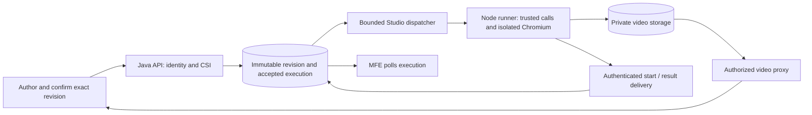

**Checks UI Studio — architecture review**

**Disposition (2026-09-10):** The documentation corrections and SSE preference are incorporated into [Studio architecture v2.1](studio-execution.md), the PRD, platform architecture, BRD and Epic 10. Findings below describe v2.0 and the inspected implementation; they are retained as review history. Documentation changes do not close runtime/security findings or constitute staging/GA validation.

Reviewed 2026-09-09 against commit `9fbd3970c`. Scope: [PRD](../../PRD.md), [platform architecture](../../ARCH.md), [Studio architecture v2.0](studio-execution.md), [Studio BRD](../brd/checks-ui-studio.brd.md), Epic 10 (then `docs/stories/10.studio-execution.epic.md`, since replaced by [EPIC-10-EXECUTION.yaml](../epics/EPIC-10-EXECUTION.yaml)), and relevant existing frontend/backend contracts. Product and runtime/security perspectives were reviewed independently. This is a review and proposed correction set, not a replacement specification or stakeholder approval.

The main architecture is appropriate: Java owns authorization and orchestration; a separate Node/Playwright deployment owns browsers; compilation happens during authoring; confirmed artifacts are replayed without an LLM; native video goes to private object storage. Keep those choices. The specification is **not ready to implement unchanged**: the artifact, execution, and security contracts do not yet establish several guarantees the documents claim.

Priorities below distinguish implementation prerequisites (**P1**) from contract and scope corrections (**P2**). Findings about existing code identify dependencies of the proposed solution, rather than implying the unbuilt runner already has those defects.

1. **P1 — Define an enforceable boundary for generated code.**

   Evidence: architecture §4.5 and §5.2 (lines 198–202, 272), and §9.3 (line 485). The design specifies a call allowlist and a function whose scope contains `page`, `expect`, and `vars`. It does not define a default-deny language covering argument expressions, receiver chains, property access, assignments, callbacks, or other AST nodes. Function parameters do not remove JavaScript globals or prototype access. Merely choosing `node:vm` would not solve this; Node explicitly excludes it as a security boundary. [Node VM documentation](https://nodejs.org/api/vm.html)

   Correction: retain generated Playwright source, but define a small, exact AST subset and reject every unsupported node. Validate complete receiver chains, literal options, token references, argument positions, and bounded input sizes. Execute the accepted call nodes through trusted harness functions; do not evaluate the model's source as general JavaScript. The compiler remains LLM-driven: this implements a permitted execution surface, not an English grammar or verb translator. Keep service credentials out of the browser child environment and apply process deadlines and cleanup independently of step code.

   Acceptance: fixtures must exercise disallowed expressions and receiver chains as well as forbidden method names; a blocked or timed-out run must release its slot and leave the validator/control endpoint responsive.

2. **P1 — Confirmation must identify the exact artifact, and executions must retain it.**

   Evidence: architecture §4.2, §4.7, §8.1–8.3 (lines 151, 222, 358–369, 403); epic 10.9 (lines 582–586). Confirmation checks current steps but takes no artifact identity. A user can review artifact A, another recompile can replace it with B for the same source, and the first user's confirmation then approves unseen B. Out-of-order compiler responses can overwrite newer work. `compiled_steps` exists only on the mutable test; executions have no immutable revision reference.

   Correction: use a source revision and immutable artifact identity/hash. Publish compilation results only if the source revision still matches. Confirm with `{sourceRevision, artifactHash}` using a conditional update; record who confirmed and when. Add explicit `COMPILING` and `AWAITING_CONFIRMATION` states. Atomically snapshot the confirmed artifact/revision, CSI, environment, nonsecret configuration, and secret references when accepting an execution. Record actual runner/Playwright/validator versions. Never snapshot resolved secrets. Metadata-only saves should not require another LLM call; relevant configuration changes need a defined reconfirmation policy.

   Acceptance: concurrent saves, reversed compile completion, confirming an old tab, editing while queued, and viewing an old execution after a test edit must all preserve what was actually approved and run.

3. **P1 — Complete the execution lifecycle and restore recovery to MVP.**

   Evidence: architecture §5.1–5.3 (lines 264–288) and §8.2/8.4 (lines 388, 430); epic 10.7 (lines 467, 489–490) and post-MVP list (line 976). The runner returns only on completion, but `RUNNING` means Chromium started. There is no signal for that transition or intermediate progress. The architecture relies on two reapers to recover lost work; the epic explicitly defers them. A process restart can therefore leave accepted executions pending indefinitely. The epic also permits retries after connection/time-out/5xx failures without establishing whether the first attempt already performed UI actions.

   Correction: define the owner and trigger of every transition, separate queue and run deadlines, and keep both reapers in V1. Bound the API dispatch executor, connection pool, pending work, and per-CSI admission; runner concurrency alone does not bound API resource use. Persist dispatch ownership/attempt identifiers and condition updates so a late result cannot overwrite another attempt or a terminal reaper decision. Retry definite nonacceptance, such as a documented 429; do not automatically replay ambiguous attempts against applications with side effects.

   A synchronous pilot can honestly define `RUNNING` as dispatch in progress and accept a terminal infrastructure error after an ambiguous loss. It cannot claim live browser progress or durable completion recovery. For the stronger evidence/progress requirements, use the small durable HTTP lifecycle proposed below. Either choice needs restart, duplicate delivery, delayed result, capacity exhaustion, and timeout tests. A message broker is not necessary.

4. **P1 — Phase 0 needs trusted authentication and working secret resolution as explicit prerequisites.**

   Evidence: architecture §3.2 and §9.1–9.2; [BffSessionAuthenticationFilter](../../backend/src/main/java/com/citi/put/checks/security/BffSessionAuthenticationFilter.java), lines 98–113; [SecretsService](../../backend/src/main/java/com/citi/put/checks/secrets/SecretsService.java), lines 42–44 and 59–66. The current filter supplies an admin identity when trusted-user headers are absent because the core-service bypass always returns true. The secrets service stores supplied values as plaintext bytes and resolves references to the placeholder `REDACTED`. Adding CSI annotations and calling the existing secret interface cannot establish the proposed security guarantees.

   Correction: require a production-capable identity path before real internal execution, fail closed when identity is absent, and specify which trusted gateway strips/replaces identity headers and how direct backend access is controlled. Keep development identities confined to local/mock operation. Name the real vault integration and secret-use authorization as dependencies of the credentialed pilot, even if delivered outside Epic 10. Resolve only references explicitly present in the confirmed artifact, authorized for that CSI and execution principal.

   Same-origin playback must also have a concrete platform contract: an ambient authenticated session or gateway identity for media requests. Same-origin alone does not supply a JavaScript bearer header. If cookie authentication is used, specify where CSRF protection for mutations is enforced; the current [SecurityConfig](../../backend/src/main/java/com/citi/put/checks/config/SecurityConfig.java), line 119, disables it. [Spring Security CSRF documentation](https://docs.spring.io/spring-security/reference/servlet/exploits/csrf.html)

   Acceptance must include real ingress/media requests with absent identity, forged identity headers, wrong CSI, and revoked secret access; a successful request through the admin bypass is not evidence of authorization.

5. **P1 — Preserve the CSI boundary of historical evidence.**

   Evidence: architecture §8.3 authorizes against the test's CSI; epic 10.15 resolves execution → test → CSI. Existing [StudioService](../../backend/src/main/java/com/citi/put/checks/studio/StudioService.java), line 75, allows changing `csiId`. Moving a test from CSI A to CSI B can transfer visibility of A's historical results and videos to B's readers. The object key's CSI does not prevent that authorization error.

   Correction: make CSI immutable after creation for V1 and snapshot CSI on execution records. If transfers are later supported, authorize both source and destination and preserve historical evidence authorization separately. List endpoints must filter by readable CSIs, including when no filter is supplied; create requires a valid CSI. Define access to retained history after a test is soft-deleted. Test cross-CSI movement and history/video access explicitly.

6. **P1 — Specify browser egress and secret-use policy beyond a method allowlist.**

   Evidence: architecture §4.4 permits secret values in actions, §5.5 (lines 304–309) describes target-URL NetworkPolicy, and §9.3 claims hostile prompts cannot produce anything except invalid code. Valid `goto`, `fill`, and `click` calls can still send a secret to an unintended destination. Fencing prompt text does not prevent valid but malicious or incorrect output.

   Correction: define approved targets per CSI/environment, permitted navigation schemes/origins, and secret use at approved destinations. Account for redirects, subresources, authentication providers, and browser-initiated traffic; do not only check the initial URL. Identify the platform mechanism that enforces destination restrictions. Standard Kubernetes NetworkPolicy controls network connections rather than application URL paths; DNS access and any FQDN-aware policy/proxy need explicit treatment. [Kubernetes NetworkPolicy documentation](https://kubernetes.io/docs/concepts/services-networking/network-policies/)

   Specify non-root execution, Chromium sandbox configuration, compatible seccomp, restricted service-account access, encrypted internal secret transport, and run scratch cleanup. The official Playwright image defaults to root, which disables Chromium sandboxing; a separate Deployment and “no privileged mode” do not establish this protection. [Playwright Docker documentation](https://playwright.dev/docs/docker)

   The validator cannot reliably recognize arbitrary secret plaintext it has never received. Replace that claim with enforceable token correspondence, secret-reference authorization, typed argument restrictions, and documented handling of user-pasted credentials before prompt submission. Retain output redaction and the explicitly disclosed on-screen-video residual risk.

7. **P2 — Separate syntactic validity, approved intent, and repeatable artifacts.**

   Evidence: architecture §4.3–4.6 (lines 161–215), §4.9 (line 240), and BRD business requirements. The model receives no target DOM or application contract. It can generate valid `getByRole('link', {name: 'Sign On'})` code when the real target is a button, or produce a valid assertion that proves the wrong condition. Syntax validation cannot guarantee task correctness. Frozen source also cannot guarantee identical browser outcomes when application state, timing, secrets, or runtime versions change. A cache with a TTL cannot ensure a line never recompiles differently forever.

   Correction: promise immutable, confirmed instructions and no runtime AI, rather than deterministic outcomes or infallible translation. Show nontechnical users an understandable action/target/assertion summary alongside the source; confirmation is not proof of correctness. Make unsupported or ambiguous instructions explicit. Validate the compiler with a representative internal-application corpus and user-observed execution/video before expanding scope. Define the initial supported workflow surface, including the disposition of iframes, popups, and enterprise login flows. Pin and record runtime compatibility; upgrades must not silently reinterpret existing artifacts.

8. **P2 — Model check outcome separately from video availability and unattempted steps.**

   Evidence: architecture §5.2 leaves later steps `PENDING`; §5.4 preserves outcome on upload failure (line 298), but §8.2 calls upload failure execution `ERROR` (line 391). BRD promises a video for every pass/fail and explicitly calls later steps “not attempted.”

   Correction: keep check outcome independent of evidence state, for example video `PROCESSING | AVAILABLE | FAILED | EXPIRED`, with a separate evidence error and expiry time. Add terminal `SKIPPED` steps with absent timing and disabled seeking. State that assertion failures normally yield video, while pre-browser failures or abrupt process loss can yield unavailable/partial evidence. Bound flush/upload retries and cleanup; do not overwrite a known assertion failure with an upload error.

   Video is finalized by closing the page/context; abrupt termination cannot guarantee a complete file. Native recordings are associated with pages, so the single-video contract needs a single-page V1 scope or an explicit multiple-page design. [Playwright video documentation](https://playwright.dev/docs/videos)

   Define the recording time origin and an acceptable seek tolerance, then test it with the pinned browser and first-navigation/failure cases. `now()` after page creation is not evidence of exact alignment with encoded frames. Keep native recording and private Range-capable streaming; no transcoding service is needed.

9. **P2 — Reconcile product scope and implementation contracts before tickets are treated as authoritative.**

   The PRD describes the broader product vision; the BRD and Studio architecture explicitly narrow V1. Deferral is reasonable, but it must be traceable. Several implementation prerequisites are also being deferred despite architecture guarantees depending on them. Use the following reconciliation as the next documentation change set.

| Topic | Current disagreement | Recommended disposition |
|---|---|---|
| Code language and confirmation | PRD §5.1–5.3 promises Python; Studio §4.8 and epic 10.11 replace the Code view with the executable TypeScript artifact. PRD §6 skips confirmation. | Update the V1 journey to write → compile → confirm → run → review. Make TypeScript the executable Code view; explicitly decide whether Python export is retired or deferred. |
| Live logs | PRD §5.2/§6 requires live execution updates; Studio §1.4 excludes streaming and the completion-only protocol supplies no progress to poll. | Either explicitly defer live progress in the PRD, or persist runner progress and expose it through the existing MFE poll endpoint. Browser SSE/WebSockets are unnecessary. |
| Scheduling and screenshots | PRD §5 includes them; Studio §1.4 defers scheduling and excludes screenshots. | Mark V1 versus later scope in the PRD and adjust visible controls. Preserve the documented future scheduler integration without adding it to V1. |
| Browser/grid/video services | ARCH §3/§4 M5 still names Selenium Grid and a video-processing service; Studio uses a Playwright Deployment/native recording. | Update ARCH to the accepted component design and link to the detailed Studio document. PRD §11 dependencies should describe capabilities rather than require those old services. |
| Object storage and routes | ARCH §5 stores video URLs; §11 API list uses test-level `/run` and `/video`. Studio uses object keys and execution-level video. | Align ARCH with `/tests/{id}/execute`, `/executions/{id}`, and `/executions/{id}/video`; persist object keys only. |
| Recovery | Studio Phase 2 requires reapers; epic lines 490/976 move them post-MVP. | Bring reapers and lost-process tests into the MVP dependencies. |
| Version checks and cache | Studio §4.3/§4.6 and BRD §7 assume reference CI checks and a cache; epic line 976 defers both. | Include version/reference CI validation with the validator. Cache may remain optional, but remove V1 cost/reproducibility claims that depend on it; a cache key must cover all compile inputs. |
| Authorization QA | Architecture allows CSI readers to view video; epic demo line 953 rejects any non-owner. | Test non-reader denial and reader success separately from owner-only execution. |
| Frontend/backend payloads | FE uses structured `TestIR`, `chrome`, client grammar validation, Python generation, and legacy statuses. Backend request currently uses JSON strings, flattened viewport fields, and `timeoutSeconds`; Studio prose says Chromium and compiled code. | Publish one typed public contract and migration mapping. Explicitly map legacy `chrome` to the chosen Chromium engine value, retire authoritative grammar validation, and test create/save/confirm/run/history with MSW and the real API shape. |
| Existing persistence | `ui_tests.last_run_status` initially permits only `PASSED/FAILED`, while new execution states include `ERROR`. `started_at` is also the execution partition key. | Specify last-run projection semantics, queue/start timestamps, and associated migrations instead of assuming the execution status migration is sufficient. |
| Cost and ownership | BRD §7 budgets separate runner pods yet cites existing worker slots as removing incremental infrastructure needs. BRD dates May changes that mention August. | Correct cost assumptions and document date; name one accountable runner on-call owner. Keep staging completion distinct from the BRD's GA sign-offs. |

The legacy contract observations are grounded in [studioTypes.ts](../../frontend/src/types/studio/studioTypes.ts), [studioApi.ts](../../frontend/src/services/api/studioApi.ts), [ChecksStudioPage.tsx](../../frontend/src/pages/ChecksStudioPage/ChecksStudioPage.tsx), [UITestRequest.java](../../backend/src/main/java/com/citi/put/checks/studio/dto/UITestRequest.java), [StepValidator.java](../../backend/src/main/java/com/citi/put/checks/studio/validation/StepValidator.java), and [V1 schema](../../backend/src/main/resources/db/migration/V1__init.sql). These are migration work, not evidence that the proposed implementation already exists.

For the generated artifact, three approaches are viable; the first best preserves the current decision:

| Option | Benefit | Cost / limit | Assessment |
|---|---|---|---|
| A. Frozen Playwright source with an exact AST subset and trusted call executor | Keeps one source artifact for execution, review, and audit; no English mapping layer | The allowed language and executor still require a maintained schema and tests | **Recommended for the current V1 direction.** Document that maintenance honestly. |
| B. LLM emits a typed action plan; trusted code renders Playwright | Simplifies validation, secret positions, and readable confirmation | Introduces an IR plus renderer; changes the document's explicit no-IR decision | Valid alternative if the team values a smaller execution language over preserving source as the canonical artifact. It still needs no English parser. |
| C. General generated JavaScript in a strong per-job sandbox | Greatest flexibility | Much larger isolation, policy, resource, and operational burden | Unnecessary for the listed V1 actions. |

For execution, I recommend retaining HTTP and PostgreSQL but making accepted work and reported results independent of the lifetime of a public API request. This is a proposed contract change, not a requirement for Kafka or another service:

The dispatcher may run in an existing Java deployment, with its own bounded resources; it must not consume the ordinary check-execution pool. It claims accepted rows transactionally, dispatches an immutable revision and attempt identifier, and resolves authorized secrets immediately before dispatch. The runner atomically admits work or returns a definite nonacceptance response. A started event supplies truthful `RUNNING`; terminal results are retried until acknowledged and applied idempotently to that attempt. Persist a redacted terminal result manifest before acknowledgment-sensitive delivery so it can be reconciled after a process restart; private Sonic storage is one available location. Pending/running reapers remain necessary for failures before a terminal manifest exists. Never replay an ambiguous browser attempt automatically. Progress can use the same reporting path if retained in V1 scope.

If the pilot deliberately keeps the existing synchronous call, document the weaker restart/evidence guarantee and truthful status meanings, and still implement bounded dispatch, conditional updates, and both reapers. Choose that compromise explicitly rather than presenting it as equivalent to durable result delivery.

Before implementation, the revised docs should settle artifact identity, accepted-language enforcement, execution state ownership, stable CSI access, the real identity/vault prerequisites, and the V1 scope table. Then validate a small end-to-end slice with adversarial artifact fixtures, concurrent-edit cases, restart/lost-response cases, cross-CSI/media authorization, secret canaries, and real video seeking. Compile/model quality needs representative application and nontechnical-user validation in addition to technical tests.

Validation performed for this review: cross-document comparison, source inspection, independent product/runtime review, and primary-source checks for Node isolation, Kubernetes network policy, Playwright deployment/video behavior, and Spring CSRF. No application code was changed and no runtime or deployment tests were run. Sonic behavior, the Citi LLM gateway, platform ingress identity, and cluster policy capabilities remain external facts to verify in the pilot.
