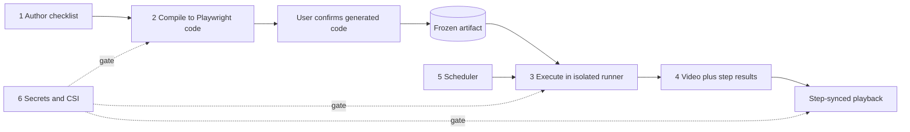
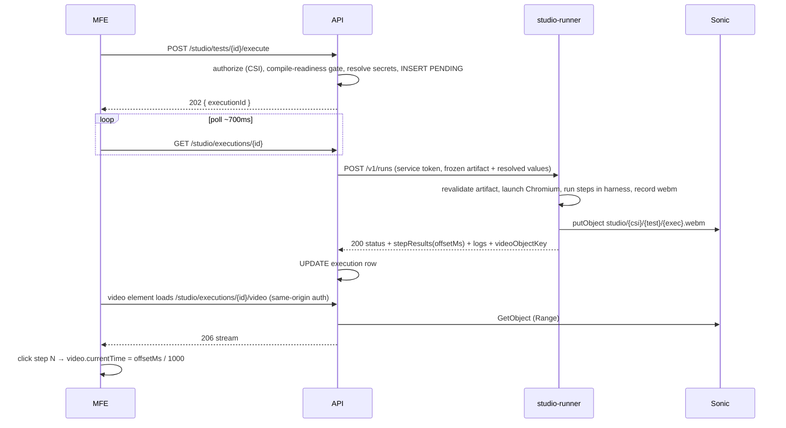

# Checks UI Studio — Architecture

**Version:** 2.0
**Date:** 2026-08-21
**Status:** Proposed
**Replaces:** v1.x of this document (parser-based translation, multi-browser scope, platform-specific auth wording)

---

## 1. Overview

### 1.1 What Studio is

Checks UI Studio is the no-code UI testing capability of PUT Checks. A support engineer writes a numbered checklist in plain English, clicks **Run Test**, and a real browser executes it. When the run finishes, every step shows a green check or a red X, and a video of the run is available — clicking a step jumps the video to that exact moment. The product promise: *write a checklist, watch a robot execute it, get video proof.*

### 1.2 Where we are

The Studio UI (step editor, run button, poll loop, video player) and the backend CRUD for tests and executions already exist. What does not exist yet: the translation of plain English into executable code, the browser execution itself, video recording, and object storage. Today the execute endpoint only records a pending row and returns. This document is the blueprint for building the missing parts.

### 1.3 V1 success criteria

- A user writes plain-English steps, gets machine-generated Playwright code back for confirmation, runs the test, sees per-step pass/fail, and watches a seekable video — end to end in staging against a real internal URL.
- Translation is **deterministic**: the code is generated once at save time, validated, frozen, and replayed identically on every run. No AI call ever happens during a run.
- The browser is **fully isolated**: zero Chromium processes on the API or worker pods. A stuck or out-of-memory browser cannot affect REST traffic or scheduled checks.
- Videos are **private**: playback requires an authorized, CSI-scoped request. Secrets never appear in prompts, artifacts, logs, step results, or storage keys.
- A **failed** run still produces a video. Proof of failure is the product, not just proof of success.

### 1.4 Scope

**In (V1):** on-demand runs of CSI-scoped UI tests; LLM-based step compilation with user confirmation; Chromium only; native `.webm` recording; upload to Sonic (internal S3-compatible object store); step-synced playback; variables and secrets; authorization on every endpoint.

**Out (V1, designed but built later or never):** scheduled runs (section 7 — built after ad-hoc is proven); more than 1–2 concurrent runs per pod; any browser other than Chromium; live log streaming; screenshots; video transcoding of any kind.

---

## 2. Core capabilities

Studio is six capabilities that compose into one loop:

| # | Capability | One-liner |
|---|---|---|
| 1 | **Authoring** | Write and edit a numbered plain-English checklist with variable/secret tokens |
| 2 | **Translation — Studio Step Compiler** | Citi LLM turns each English step into validated Playwright code at save time; frozen artifact; user confirms |
| 3 | **Execution** | Frozen artifact replayed in an isolated Chromium runner; per-step pass/fail with timing |
| 4 | **Video proof & playback** | Native `.webm` recording, private storage, step-click seeks the video |
| 5 | **Scheduling** (post-V1) | Recurring runs through the existing worker scheduler, same pipeline |
| 6 | **Secrets & access control** | CSI-scoped authorization everywhere; secrets resolved only at dispatch, never persisted or prompted |



The load-bearing rule across all of them: **the LLM lives at authoring time; execution replays a frozen, validated artifact.** Nondeterminism is quarantined to editing.

---

## 3. System architecture

### 3.1 Components

| Component | Runtime | Responsibilities |
|---|---|---|
| **MFE** (`frontend/`) | React/TypeScript | Step editor, generated-code confirmation, Run button, ~700 ms result polling (already built), video player with `offsetMs` seek |
| **API** (`backend/`, Spring Boot, profile `api`) | Java | CRUD, authorization, compile orchestration (calls the Citi LLM gateway), secret resolution, execution dispatch, result persistence, video serving |
| **Studio Step Compiler** | Logical component: orchestration in the API, validation on the Node service | Plain English → Playwright code via the Citi LLM; validation; freezing; provenance (section 4) |
| **studio-runner** (`studio-runner/`, new) | Node + Playwright, own Deployment | Executes frozen artifacts in Chromium inside a restricted harness; records video; uploads to Sonic; also hosts the browser-free artifact validation endpoint |
| **Sonic** | Internal S3-compatible object store | Private video bucket; runner writes, API reads |
| **PostgreSQL** | Existing | `ui_tests`, `ui_test_executions` (section 8) |

The runner lives as a `studio-runner/` folder in this monorepo with its own image and its own Deployment in the existing Helm chart. Extract it to a separate repo later only if ownership or deploy cadence forces it — that extraction is cheap; waiting on repo provisioning is not.

### 3.2 Trust boundaries

| Component | Holds | Must never hold |
|---|---|---|
| API | User identity (platform-provided), CSI roles, secret store access, DB, Sonic read, LLM gateway credentials | A browser process, video files |
| studio-runner | Service token, already-resolved secret values in memory for one run, Sonic write on `studio/*`, scratch disk | User credentials, DB, secret store, CSI service, LLM access |
| MFE | User session (platform-provided), execution DTOs | Secret plaintext, Sonic credentials, raw LLM access |
| Check workers | Existing scheduled-check duties | Any Studio browser work |

Authentication is generic by design: requests arrive at the API with a platform-provided authenticated identity (the fronting layer is owned by another repo and is being replaced). The API enforces identity and CSI role checks on every Studio route; video is served same-origin so the platform credential applies to media requests automatically.

### 3.3 Runtime view



Why the browser is isolated: the API must stay available regardless of Studio load, and the check workers run scheduled checks at high throughput — a Chromium OOM on either would take down unrelated functionality. The runner is the only pod with a browser, the only pod with website egress, and the only pod that can be resized or restarted around browser behavior.

---

## 4. Studio Step Compiler

This is the key component. It turns plain English into executable Playwright code using the Citi LLM — **with no manual mapping layer**. There is no hand-written grammar, no verb table, no English-to-action rule set to maintain. Precision and determinism come from the pipeline around the model, not from a parser.

### 4.1 Principles

1. **Compile at save time, never at run time.** A run never calls the LLM. If the LLM gateway is down, editing is blocked but every already-compiled test runs normally.
2. **The model proposes; the validator disposes.** Nothing the model outputs is trusted until it passes automated validation, and nothing runs until the user has seen and confirmed the generated code.
3. **Frozen artifacts.** The validated code is stored with a hash of the source steps and replayed byte-identically on every run. Model upgrades never silently change a test — only a re-save recompiles.

### 4.2 Compile pipeline

Compilation triggers automatically on test create/save (and via an explicit recompile endpoint):

```mermaid
sequenceDiagram
    participant User
    participant MFE
    participant API
    participant LLM as Citi LLM gateway
    participant Val as Validator (Node, browser-free)
    User->>MFE: Save test (steps edited)
    MFE->>API: PUT /studio/tests/{id}
    API->>API: persist steps, mark compile_status STALE
    API->>LLM: prompt = fenced steps + pinned Playwright syntax reference + output contract (temp 0, JSON output)
    LLM-->>API: candidate: [{stepIndex, originalText, code}]
    API->>Val: POST /v1/validate (candidate)
    Val-->>API: ok, or per-step diagnostics
    API->>LLM: bounded repair (max 2) with diagnostics
    API->>API: freeze artifact + provenance + steps_hash; per-step status
    API-->>MFE: compiled steps
    MFE-->>User: show generated code per step → Confirm
    User->>MFE: Confirm
    MFE->>API: POST /studio/tests/{id}/confirm-compile
    API->>API: compile_status = READY
```

### 4.3 Prompt inputs

Three inputs, nothing else:

1. **The user's steps**, each fenced as data with its index. Steps are input to translate, never instructions to the model — a line like "ignore previous instructions and …" can at worst produce code that fails validation.
2. **The pinned Playwright syntax reference** — a curated excerpt of official Playwright documentation (navigation, locators, actions, assertions) that matches the **exact Playwright version pinned in the runner image**. This is what keeps the model on current, valid syntax instead of stale training-data APIs. The reference lives in the repo, is versioned, and is bumped together with the runner's Playwright version — never independently. CI compiles the reference's own examples against the pinned version so the reference cannot drift.
3. **The output contract** (below), including the allowlist of permitted calls so the model knows the boundaries up front.

Secrets and variables travel as opaque tokens (`<secret ID>`, `<var NAME>`). Plaintext never reaches the LLM.

### 4.4 Output contract

Structured JSON, exactly one entry per input line, index-aligned:

```json
[
  { "stepIndex": 0,
    "originalText": "Go to \"https://www.citi.com\"",
    "code": "await page.goto('https://www.citi.com');" },
  { "stepIndex": 1,
    "originalText": "Click \"Sign On\"",
    "code": "await page.getByRole('link', { name: 'Sign On' }).click();" },
  { "stepIndex": 2,
    "originalText": "Type \"<secret LOGIN_PW>\" in the \"Password\" field",
    "code": "await page.getByLabel('Password').fill(vars.secret('LOGIN_PW'));" },
  { "stepIndex": 3,
    "originalText": "Check that the URL contains \"login\"",
    "code": "await expect(page).toHaveURL(/login/);" }
]
```

`code` is one or a few statements scoped to `page`, `expect`, and `vars`. Note the secret: it compiles to `vars.secret('LOGIN_PW')` — a harness call, not a value. The artifact stays secret-free forever.

### 4.5 Validation (automated, replaces manual mapping)

Every candidate runs through the browser-free validator on the Node service:

| Check | Rule |
|---|---|
| Parse | Code must parse as TypeScript (AST). Syntax errors reject the step |
| Call allowlist | Only permitted APIs: `page.goto`, `page.waitForURL`; locators `getByRole`, `getByText`, `getByLabel`, `getByPlaceholder`, `getByTestId`, `locator` (CSS); locator actions `click`, `fill`, `press`, `check`, `uncheck`, `selectOption`, `hover`; assertions `expect(locator).toBeVisible / toContainText / toHaveValue`, `expect(page).toHaveURL / toHaveTitle` |
| Forbidden constructs | `import` / `require` / `eval` / `new Function`; `page.evaluate`, `addScriptTag`, `exposeFunction`; network, filesystem, process, timer APIs; browser/context management calls; loops; variable declarations that leak across steps |
| Alignment | One output entry per input line, indexes matching; `originalText` must equal the source line |
| Secrets | Secret/variable tokens must compile to `vars.*` calls; a literal resembling a resolved value rejects the artifact |

Failures feed a **bounded repair loop**: the diagnostics go back to the model, at most twice. If the step still fails, it is marked `NEEDS_REVISION` with a human-readable reason ("couldn't produce valid code for this step — try rephrasing"). There is **no silent fallback**: the compiler never guesses, and an unconfirmable step blocks the run, not the run's correctness.

The allowlist is enforcement, not translation — widening it (new Playwright APIs) is a validator + reference change, with zero mapping code.

### 4.6 Determinism model

| Mechanism | Effect |
|---|---|
| Temperature 0 + structured JSON output at the gateway | Minimizes variance per call |
| Pinned model + prompt + syntax-reference versions | A compile is reproducible against fixed inputs |
| Result cache keyed by (step text hash, pin versions) | The same line never compiles twice to different code |
| **Freeze + replay** | The decisive guarantee: the confirmed artifact is stored with `steps_hash` and replayed unchanged on every run. Even if the model were nondeterministic, executions are not |

### 4.7 Compile-readiness gate

A test may run — ad-hoc or scheduled — only when:

```
compile_status = READY  AND  sha256(current steps) = steps_hash of the frozen artifact
```

- Any edit marks the test `STALE` and triggers recompilation on save.
- `POST /execute` preflights the gate and returns `409 COMPILE_REQUIRED` when it fails. The Run button is disabled in the MFE until every step is compiled and confirmed.
- The runner independently revalidates the artifact (AST + allowlist) before launching Chromium and refuses with `ERROR` if it does not hold — defense in depth against skew or tampering.

### 4.8 What the user sees

Per step, the generated code is shown next to the English line before the test becomes runnable — the confirmation is the moment of trust. The Code view of the test **is** this artifact: what you see is exactly what runs, not a translation of it.

### 4.9 Compiler failure handling

| Failure | Behavior |
|---|---|
| LLM gateway down / erroring | Compile fails fast with a clear message; test stays `STALE`; **already-compiled tests keep running** |
| Invalid output after repair retries | Step → `NEEDS_REVISION` with reason; test not runnable until fixed or rephrased |
| Prompt injection in a step | Worst case: generated code fails validation → `NEEDS_REVISION`. It cannot widen scope past the allowlist |
| Gateway lacks temp-0 / JSON mode | Validation still guarantees correctness; repair rates and compile latency worsen. Verify gateway capabilities early |

### 4.10 Compiler configuration

```yaml
studio:
  compiler:
    gateway-url: ${CITI_LLM_GATEWAY_URL}
    model-id: ${STUDIO_COMPILER_MODEL_ID}          # pinned
    prompt-version: 1                               # pinned
    playwright-ref-version: ${PLAYWRIGHT_VERSION}   # = runner image version
    temperature: 0
    repair-max-attempts: 2
    cache-ttl-days: 30
```

Every LLM call is audit-logged with test id, CSI, user, model id, and prompt version — never with secret values.

---

## 5. Execution & runner

### 5.1 Run flow (API side)

1. `POST /studio/tests/{id}/execute` → authorize (CSI execute role) → compile-readiness gate (`409 COMPILE_REQUIRED` on failure) → resolve secret/variable tokens into an in-memory copy → `INSERT ui_test_executions (status = PENDING)` → `202 { executionId }`.
2. Dispatch asynchronously (after the 202): `POST /v1/runs` to the runner with a service token, synchronous — the HTTP call stays open until the run finishes (client timeout = run timeout + margin). No message broker.
3. On the runner's 429 (at capacity): keep `PENDING`, retry with backoff. On success: persist step results, logs, video key, terminal status; update the test's last-run fields.

### 5.2 Run flow (runner side)

- Concurrency semaphore = `POOL_SIZE` (V1 default **1**); a full runner answers **429 + Retry-After**. Readiness means "process up", never "has capacity" — capacity is signaled per request, so the pod is never pulled from the Service for being busy.
- Revalidate the artifact (AST + allowlist), then per run: `chromium.launch()` → `newContext({ viewport, recordVideo })` → `newPage()` → `t0 = now()`.
- **Restricted harness** per step: the step's code executes as a function whose scope contains only `page`, `expect`, and `vars` (resolved values, provided by the harness — never present in the artifact). Per-step timeout (test's `timeout_seconds`, default 30 s). Stamp `offsetMs = now() − t0` at step start; record `PASS`/`FAIL` plus duration.
- **Stop at first failure** — remaining steps stay `PENDING`, the video still captures the failure.
- Close context (flushes `.webm`) → upload to Sonic → delete the local file → return the result.
- Browser lifecycle: **launch and close per run.** No warm browser pool in V1 — fewer leaks, simpler shutdown; measure before optimizing the 1–2 s cold start.

### 5.3 Backpressure and stuck-run recovery

Two reapers (scheduled on the worker profile, plain DB updates):

| Condition | Action |
|---|---|
| `PENDING` older than the dispatch SLA (retries exhausted / runner down) | → `ERROR`, `error_details.code = DISPATCH_FAILED` |
| `RUNNING` older than run timeout + 90 s (pod killed mid-run, result lost) | → `ERROR`, `error_details.code = STALE` |

Optional courtesy cap: reject new executes with 429 when a CSI has too many `PENDING` rows.

Known window, accepted for V1: if the API pod restarts during the synchronous run call, the result is lost and the reaper marks `ERROR` even though a video may exist in Sonic. If staging shows real losses during deploys, add an async callback mode to `/v1/runs` — not a broker.

### 5.4 Failure modes (user-visible)

| Failure | User sees | System |
|---|---|---|
| Step assertion / locator timeout | Red X on that step + video of the failure | Stop further steps, upload video, `FAILED` |
| Run timeout exceeded | `ERROR` | Kill context; upload partial video if flushed |
| Runner at capacity | Stays queued, then runs | 429 → API retry |
| Runner down | `ERROR` after SLA | Reaper; API unaffected |
| Sonic upload fails | Step results without video | Terminal status kept; video key null |
| Missing secret/variable | Immediate clear error | `400`, runner never called |
| Stale compilation | "Steps changed — recompile" | `409 COMPILE_REQUIRED`, runner never called |

### 5.5 Runner deployment essentials

- Own Deployment in the existing Helm chart; image built from the official Playwright base, **Chromium only** (any other browser value is rejected by the API with `400`).
- `emptyDir` on `/tmp` and `/dev/shm` (≥1 Gi shm — Chromium needs it); zombie-process reaping (init process); no privileged mode.
- Egress locked to an allowlist: target application URLs + Sonic + (if callbacks are enabled) the API. Nothing else. Only this pod needs website egress.
- Graceful drain: stop accepting runs on SIGTERM, wait out the in-flight run (`terminationGracePeriodSeconds` ≈ run timeout + drain).
- Starting size (validate in staging): 1 CPU / 2 Gi request, 2 CPU / 4 Gi limit, 1–2 replicas.
- Do not copy the API pod's hardened securityContext blindly — a read-only root filesystem without writable `/tmp` and `/dev/shm` breaks Chromium. Prove one pod in staging before templating.

---

## 6. Video proof & playback

### 6.1 Recording

Playwright records natively via `recordVideo` on the browser context — a long-stable API producing `.webm`. No transcoding, no ffmpeg, no video service of any kind. The recording covers the whole run, including failures.

### 6.2 Storage

- Key: `studio/{csiId}/{uiTestId}/{executionId}.webm` in a **private** Sonic bucket. The CSI in the key is for audit and prefix-scoped credentials, not authorization.
- Runner credentials: PutObject on `studio/*` only. API credentials: GetObject only.
- The database stores the **object key** (`video_object_key`), never a URL. Presigned or public URLs are not persisted anywhere.
- Retention: 30-day hard delete via a bucket lifecycle rule (plus an optional API job that nulls expired keys).

### 6.3 Playback

- The MFE's `<video>` points at `GET /api/v1/studio/executions/{id}/video` — same-origin, so the platform's auth credential applies to the media request automatically (JS-attached headers never reach `<video>` elements).
- The API checks CSI read access, then streams from Sonic with `Range` / `206` support (browsers require range requests for seeking).
- Later optimization, not V1: respond `302` to a short-lived presigned Sonic URL (TTL ~300 s) — only after confirming user desktops can reach the Sonic endpoint and CORS permits it. The endpoint contract does not change either way.

### 6.4 Step-synced seek

Each step result carries `offsetMs` — milliseconds from recording start to step start, stamped by the runner. Clicking step N sets `video.currentTime = stepResults[N].offsetMs / 1000`. This replaces the current placeholder seek (`stepIndex * 10`). If a visible skew appears between recording start and the first frame, calibrate `t0` at the first navigation.

---

## 7. Scheduling (post-V1)

Built only after the ad-hoc path is proven in staging. Nothing new is invented:

1. The `ui_tests` table already has a `schedule` field and an active/paused status.
2. The existing worker scheduler (periodic poll of due schedules with a distributed lock) picks up due UI tests exactly as it does other scheduled work.
3. Before dispatch, the worker applies the **same compile-readiness gate**: a stale or unconfirmed test is skipped and recorded as `ERROR` with `COMPILE_REQUIRED` — a scheduled run never guesses and never triggers compilation.
4. Dispatch goes through the same runner client with the same 429/retry semantics; failures land in the existing failed-dispatch retry mechanism.
5. Results update the execution row and the test's last-run status, feeding dashboards like any other check.

Fairness between scheduled and ad-hoc traffic on the shared runner pool is a scale-time concern; V1 capacity thinking stays at 1–2 concurrent runs.

---

## 8. Data model & API contracts

### 8.1 `ui_tests` (additions)

| Column | Type | Purpose |
|---|---|---|
| `compiled_steps` | JSONB | The frozen artifact: per-step `{stepIndex, originalText, code}` array + artifact version |
| `steps_hash` | TEXT | `sha256` of the plain-English steps the artifact was compiled from |
| `compile_status` | VARCHAR | `READY` \| `NEEDS_REVISION` \| `STALE` |
| `compile_meta` | JSONB | `modelId`, `promptVersion`, `playwrightRefVersion`, `compiledAt` |

Existing columns (`steps`, `variables`, `viewport`, `timeout_seconds`, browser field, status/schedule) stay. The API rejects any non-Chromium browser value on execute.

### 8.2 `ui_test_executions` (one forward-only migration)

- Widen the status constraint to `PENDING | RUNNING | PASSED | FAILED | ERROR` (today it only allows terminal states, which blocks honest in-flight rows).
- Make `ended_at` and `duration_ms` nullable (in-flight rows have no honest value).
- Add `step_results JSONB NOT NULL DEFAULT '[]'` and `video_object_key TEXT`.
- Partial index on `(status, started_at)` for in-flight rows (reaper queries).
- The table is partitioned — verify the constraint and column changes propagate to all partitions including the default one.

`step_results` shape:

```json
[
  { "stepIndex": 0, "status": "PASS", "offsetMs": 840,  "durationMs": 2100, "message": "Go to \"https://www.citi.com\"" },
  { "stepIndex": 2, "status": "FAIL", "offsetMs": 4120, "durationMs": 880,
    "message": "Wait for the text \"User ID\"", "error": "Locator not visible within 30000ms" }
]
```

Per-step status: `PENDING | RUNNING | PASS | FAIL`. Execution status meaning:

| Status | Meaning |
|---|---|
| `PENDING` | Accepted, not yet on a runner |
| `RUNNING` | Runner started Chromium |
| `PASSED` | All steps passed |
| `FAILED` | A step failed; video should exist |
| `ERROR` | Infrastructure problem (timeout, dispatch failure, upload failure, stale) — details in `error_details.code` |

The MFE maps legacy `COMPLETED` to `PASSED` during cutover; timeouts are `ERROR` with `error_details.code = TIMEOUT`, not a separate status.

### 8.3 Public API (MFE → API)

Base `/api/v1/studio`; every route authorized against the test's CSI.

| Method & path | Behavior |
|---|---|
| CRUD `/tests`, `/tests/{id}` | Existing; saving steps marks the test `STALE` and triggers compilation |
| `POST /tests/{id}/compile` | Re-trigger compilation (retry after gateway outage / `NEEDS_REVISION` fixes) |
| `POST /tests/{id}/confirm-compile` | User confirms the generated code → `READY` |
| `POST /tests/{id}/execute` | `202 { executionId }`; `409 COMPILE_REQUIRED` if the gate fails; `400` on missing secret/variable or non-Chromium browser |
| `GET /executions/{id}` | Execution DTO: status, `stepResults`, `logs[]`, video availability |
| `GET /executions?testId=` | List, paged |
| `GET /executions/{id}/video` | CSI check → `206` Range stream (later: `302` presign) |

### 8.4 Internal API (API → runner)

Service-token auth, cluster-internal only.

`POST /v1/runs` — request:

```json
{
  "executionId": "uuid",
  "testId": "uuid",
  "csiId": "174523",
  "artifact": { "version": 1, "steps": [ { "stepIndex": 0, "originalText": "…", "code": "…" } ] },
  "resolvedVars": { "ENV": "dev" },
  "resolvedSecrets": { "LOGIN_PW": "…" },
  "viewport": { "width": 1920, "height": 1080 },
  "stepTimeoutMs": 30000,
  "runTimeoutMs": 120000,
  "sonicKey": "studio/174523/{testId}/{executionId}.webm"
}
```

Responses: `200` result (synchronous completion) · `400` bad job · `401/403` bad token · `429 + Retry-After` at capacity · `500` crash.

Result body: `{ executionId, status, stepResults, logs, videoObjectKey, error }`.

`POST /v1/validate` — browser-free artifact validation (AST + allowlist); used by the compile pipeline. `GET /health`, `GET /ready` — process liveness only.

### 8.5 Key configuration

```yaml
studio:
  execution:
    enabled: true                  # kill switch: stops dispatch, UI degrades to CRUD
  runner:
    base-url: ${STUDIO_RUNNER_URL}
    token: ${STUDIO_RUNNER_TOKEN}
    request-timeout-ms: 150000     # run timeout + margin
    retry-429-max: 20
    retry-429-backoff-ms: 2000
  run-timeout-ms: 120000
  reaper:
    pending-sla-seconds: 600
    running-stale-seconds: 210
  sonic:
    endpoint: ${SONIC_ENDPOINT}
    bucket: ${SONIC_BUCKET}
    path-style: true
```

Runner env: `POOL_SIZE=1`, `RUN_TIMEOUT_MS`, `STEP_TIMEOUT_MS`, `VIDEO_DIR`, Sonic endpoint/bucket/credentials, `SERVICE_TOKEN`.

---

## 9. Security

### 9.1 Authorization

- Every Studio route — CRUD, compile, execute, poll, video — checks the caller's role on the test's CSI: read for viewing tests/executions/videos, owner-level for create/edit/execute. (This check is missing on Studio routes today and is a Phase 0 fix.)
- Identity arrives from the platform layer; this document intentionally does not depend on any specific session mechanism.
- The runner authenticates to nothing but Sonic and accepts nothing but the API's service token.

### 9.2 Secrets lifecycle

```
authoring        <secret ID> token in the step text
compile          token passes through the prompt and the artifact untouched (vars.secret('ID') call)
dispatch         API resolves values, sends them in the job payload over the cluster network
run              values exist only in runner memory; harness injects them; redaction filter scrubs
                 every log line, step message, and error before they leave the runner
persistence      never — resolved values appear in no database column, no log, no artifact, no key
```

Residual risk, documented and accepted: if the target page *displays* a secret on screen, the video shows it. That is a product limitation — not a justification for video post-processing.

### 9.3 Prompt-injection containment

Steps are data, fenced per line, never instructions. The output contract + AST/allowlist validation bound the blast radius: hostile input can produce at most an invalid step that fails compilation. Nothing the model emits can import modules, evaluate arbitrary JS in the page, touch the filesystem or network, or escape the harness scope.

### 9.4 Video privacy

Private bucket, no public ACLs, no durable URLs anywhere, CSI check on every byte served, 30-day hard delete.

---

## 10. Build plan

### 10.1 Phases

| Phase | Ship | Exit criteria |
|---|---|---|
| **0 — Contract & auth** | DB migration (8.2), CSI checks on all Studio routes, FE status mapping, runner API contract | A `PENDING` row inserts legally; unauthorized calls get 403 |
| **1 — Artifact & validator** | Artifact schema, AST/allowlist validator package (Node) with a fixture corpus (valid, invalid, injection attempts), pinned Playwright syntax reference + CI check | Validator accepts good artifacts, rejects every forbidden construct |
| **2 — Runner skeleton** | `studio-runner/` with `/health`, `/v1/validate`, `/v1/runs` dry-run mode (no browser, fake Sonic); API dispatch with 429 retry; both reapers | API round-trips a fake `PASSED` with step results end to end |
| **2.5 — Step Compiler** | Compiler columns on `ui_tests`; compile orchestration (LLM gateway, repair loop, caching, provenance, audit); readiness gate + `409`; MFE code confirmation + Run gating | A plain-English step compiles to confirmed code; a stale test refuses to run; a compiled test runs with the gateway down |
| **3 — Browser & video (local)** | Real Chromium via the official Playwright image, harness execution with `offsetMs`, webm recording, local S3-compatible store, FE seek | Laptop: Run Test → step icons + playable, seekable video |
| **4 — Staging** | Real Sonic, video streaming endpoint, redaction verification, egress NetworkPolicy, pod hardening, Helm runner deployment, 30-day lifecycle rule | The full user journey against an allowed internal URL in staging |
| **Later** | `POOL_SIZE > 1` + autoscaling on the runner only, presign redirect, allowlist widening, scheduled runs (section 7) | After load-test evidence |

Rollback at any phase: `studio.execution.enabled=false` stops dispatch (UI degrades to CRUD + compile); the runner Deployment deletes independently; stored videos expire by lifecycle rule.

### 10.2 Decision summary

| Decision | Choice | Why |
|---|---|---|
| Translation | Citi LLM → Playwright code at save time; **no manual mapping** | Expressiveness isn't capped by hand-coded verbs; determinism comes from freeze + replay, validity from AST/allowlist validation |
| Artifact | Validated code, not an intermediate representation | One artifact serves execution, the Code view, and audit; no parser or IR schema to maintain |
| Runner placement | Isolated Node/Playwright Deployment, monorepo folder | Browser failures can't touch API/worker; no new-repo approval on the critical path |
| Language | TypeScript/Node for compiler validation, runner, artifacts; Java orchestration | One Playwright dialect end to end |
| Browser | Chromium only | One image, one hardening profile, one egress story |
| Dispatch | Synchronous HTTP job call; no broker | Simplest correct thing; async callback is the escape hatch, Kafka is not |
| Backpressure | Runner 429 + API retry + two reapers | API stays ready regardless of Studio load; no row is ever stuck |
| Video read | Same-origin authorized streaming proxy; presign later | Works with platform auth on media requests; no bets on Sonic CORS or desktop routability |
| Recording | `recordVideo` only | Long-stable API; step sync needs only `offsetMs`, not chapters or transcoding |
| Secrets | Resolved by the API at dispatch; tokens everywhere else | Runner and LLM stay credential-free; artifacts are secret-free by construction |
| Browser lifecycle | Launch/close per run | Fewer leaks, simple drain; pool only after measuring |

### 10.3 Do not build

- Any manual translation layer: grammar parsers, verb tables, English→action mapping rules.
- LLM anywhere in the run path: no per-execution calls, no runtime re-translation, no runtime locator "self-healing".
- Unvalidated code execution: only frozen artifacts that passed AST + allowlist validation run, inside the restricted harness.
- Selenium Grid, hosted browser services, a video-processing/transcoding service, screenshot pipelines.
- A message broker for dispatch; autoscaling before load-test evidence; warm browser pools.
- Public or durable video URLs; trusting client-supplied artifacts; runner credentials for the DB, secret store, or CSI service.
- Live log streaming (poll is enough); non-Chromium browsers.

### 10.4 Risks & open questions

| Risk / question | Default / mitigation |
|---|---|
| Citi LLM gateway may lack temperature-0 / structured-output modes | Verify first; validation still guarantees correctness, but repair rates and compile latency worsen |
| Syntax reference drifting from the runner's Playwright version | Single pinned version shared by image and reference; CI compiles the reference examples |
| Cluster hardening policies vs Chromium (`/dev/shm`, read-only root) | Prove one runner pod in staging before templating |
| Runner egress approval (target URLs + Sonic) | Only the runner needs it; start the NetworkPolicy conversation in Phase 2 |
| Sonic reachability/CORS from user desktops | Irrelevant to V1 (proxy-first); revisit only for the presign optimization |
| Secrets visible on-screen appear in video | Documented residual risk; fill into masked fields where possible |
| API restart during a synchronous run loses the result | Reaper closes the row; add async callback only if staging shows real losses |
| Video retention | 30-day hard delete |
| Who owns runner on-call | The Checks squad, with a Chromium/egress runbook |
