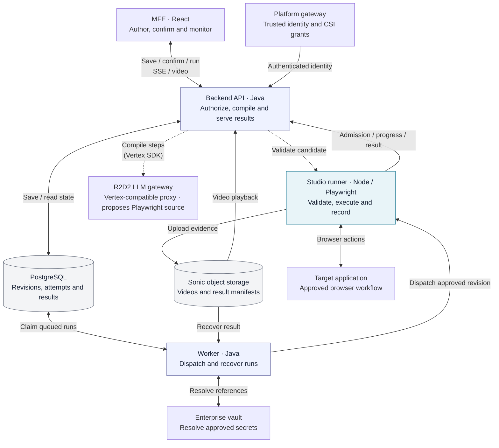

# Checks UI Studio — Architecture

**Version:** 2.1 · **Date:** 2026-09-10 · **Status:** Design baseline; staging validation outstanding

**Compiler amendment (2026-09-16):** [Studio inference contract v1](studio-inference-contract-v1.md) supersedes affected §§4/8 compiler decisions for the remediation stories: explicit unsupported outcomes, strict verdicts, atomic request/candidate identity, bounded inference, and versioned full/incremental authoring. Its [versioned OpenAPI](../specs/studio/inference.openapi.yaml) is declared, not yet deployed. Existing positional runner artifacts/routes remain unchanged.

This document defines component ownership and technical contracts. [PRD §5.2](../../PRD.md#52-ui-testing-feature-checks-studio) and the [BRD](../brd/checks-ui-studio.brd.md) define product scope and GA criteria; [Epic 10](../epics/EPIC-10-EXECUTION.yaml) and its stories contain implementation order and acceptance tests. The [review](studio-execution-review.md) and [SSE assessment](studio-sse-viability.md) retain decision rationale.

## 1. Overview

A support engineer writes an English checklist, reviews the proposed actions and Playwright source, confirms a revision, and runs it. Studio shows live step/log progress and private video evidence. Confirmed instructions remain immutable; application state and browser timing can still change outcomes.

The editor, polling UI, video player and backend CRUD exist. Compilation, real execution, SSE and evidence storage remain to be built. Identity and vault code still contain temporary behavior; production-capable integrations are prerequisites for the credentialed pilot.

## 2. Scope

| Capability | V1 | Later / excluded |
|---|---|---|
| Authoring | CSI-scoped English steps, variables/secret references, confirmed TypeScript artifact | No runtime AI or hand-written English translator; Python export retired |
| Execution | On demand, Chromium, one page, initially one run per pod and 1–2 runner replicas | Scheduling, larger pools, other browsers, iframe/popup/multi-page workflows |
| Progress | SSE current-state snapshots with GET recovery/fallback | Lossless event replay, WebSockets and live video |
| Evidence | Native webm, private storage/download, attempted-step seek, 30-day expiry | Screenshots, transcoding and public video URLs |
| Platform integration | Studio history and last-run summaries by CSI | Unified UI_TEST catalog/application-component/dashboard/report projections |

Unsupported workflows must be explained before confirmation where detectable and fail explicitly otherwise. Pilot applications must support the approved single-page login flow; enterprise MFA is not assumed to work.

## 3. System architecture

Each box below is a stack component; its subtitle states its core responsibility. Dashed arrows are authoring-time calls. Solid arrows carry user requests, execution, state or evidence. Platform identity/CSI grants arrive through the trusted gateway contract; the diagram does not prescribe an additional identity service.



**Create:** MFE → backend → LLM proposal → runner validation → persisted candidate → user confirmation. The backend owns the approval and revision; no browser starts during compilation.

**Execute:** backend commits accepted work → worker claims it and resolves authorized references → runner obtains admission, runs Chromium and uploads evidence → backend persists reports and serves SSE/video. The worker reconciles lost results from storage. The MFE never talks directly to the runner.

The backend API and worker share the Java codebase but run under separate profiles with dedicated Studio limits. The new `studio-runner/` has its own image/Deployment and is the only component launching Chromium. The compiler is a logical capability split between API orchestration and runner validation, not another service. PostgreSQL is authoritative across API replicas. The Checks squad owns operations, supported by Platform/SRE for cluster, ingress and storage.

## 4. Studio Step Compiler

### 4.1 Principles

Compile on source changes or explicit recompile, never on execute. Draft persistence is independent of gateway availability; source/configuration changes follow §4.2.

The R2D2 LLM gateway proposes source. Static validation enforces permitted operations; it cannot prove the locator matches the application or the assertion captures the user's intent. The application DOM is not an input in V1. Representative internal workflows and observed runs/video are required to measure translation quality.

R2D2 is a proxy in front of Vertex-hosted models, so the backend integrates through the **Google Vertex AI SDK** rather than a bespoke HTTP client: use the Vertex generative-model client with its endpoint/base URL, project and location pointed at R2D2, and the service credentials issued for the Studio compile workload. Endpoint, project, location and credentials are deployment configuration (§8.5); none are hardcoded. Keeping the SDK contract means request/response shapes, structured output and timeout handling stay standard, but the proxy remains the authority on which models, parameters and quotas are actually reachable. Verify the supported SDK version, model identifiers and structured-output behavior against R2D2 in staging (§10) before relying on them, and disable SDK-level automatic retries that could exceed the bounded compile attempts in §4.3.

### 4.2 Revision and confirmation lifecycle

- `sourceRevision` advances on step edits; `configurationRevision` advances on execution-affecting configuration changes. Optimistic concurrency rejects stale saves with 409.
- Compilation states: `STALE | COMPILING | AWAITING_CONFIRMATION | READY | NEEDS_REVISION`.
- Persist a compile request identity with source revision before asynchronous work. Publish its result only if both still match; discard out-of-order results, including an older compile for the same text.
- Successful validation creates an immutable candidate revision containing source, source hash, artifact hash, nonsecret configuration, token references, and provenance. It becomes `AWAITING_CONFIRMATION`; invalid candidates remain unrunnable with per-step diagnostics.
- Confirm with `{ revisionId, artifactHash, sourceRevision, configurationRevision }`. A conditional transaction verifies that this is still the current valid candidate and records `confirmedBy` and `confirmedAt` before setting `READY`. A stale tab gets 409.
- Configuration-only changes create a new candidate using compatible validated source and require reconfirmation. Changes include environment, variable values/references, viewport, timeout, browser, and target policy selection. Name/description changes do not invalidate confirmation.
- Vault value rotation does not require embedding a value or recompile; execution records a nonsecret vault version identifier when available. Artifacts pin references, not secret contents.

### 4.3 Prompt inputs and limits

Inputs: the ordered source steps fenced as data, the versioned Playwright syntax reference, and the output/allowed-language contract. Secret and variable references remain opaque (`<secret ID>`, `<var NAME>`). Never supply resolved values or dump request bodies into gateway audit logs.

Enforce input/output byte and step limits, gateway timeouts, bounded compile concurrency, and a maximum of two repair attempts. Inline credentials are prohibited in authoring; guide users to vault references and reject known credential patterns before gateway submission. Pattern checks cannot detect every pasted secret and must not be described as a proof that arbitrary text is secret-free.

Pin model, prompt, language-policy, syntax-reference, Playwright package/browser image and trusted-executor versions; CI validates reference examples against that runtime. Temperature zero/structured output reduce variance but do not guarantee reproducibility. A future cache must key all ordered source/context/version inputs and isolate CSIs.

### 4.4 Source artifact

```json
{
  "version": 1,
  "steps": [
    {"stepIndex": 0, "originalText": "Go to \"https://www.citi.com\"", "code": "await page.goto('https://www.citi.com');"},
    {"stepIndex": 1, "originalText": "Type \"<secret LOGIN_PW>\" in the \"Password\" field", "code": "await page.getByLabel('Password').fill(vars.secret('LOGIN_PW'));"}
  ]
}
```

Exactly one entry per source line, index aligned, with identical `originalText`. Playwright source is the canonical artifact; §4.5 defines the accepted language and its trusted executor.

### 4.5 Default-deny validation and execution

| Surface | Permitted V1 form |
|---|---|
| Statements | Bounded sequences of awaited permitted calls; every other statement/node is rejected |
| Navigation | `page.goto`, `page.waitForURL`, with validated arguments and destination policy |
| Locators | Approved receiver chains from `page`: `getByRole`, `getByText`, `getByLabel`, `getByPlaceholder`, `getByTestId`, CSS `locator` |
| Actions | `click`, `fill`, `press`, `check`, `uncheck`, `selectOption`, `hover` |
| Assertions | `expect(locator).toBeVisible / toContainText / toHaveValue`; `expect(page).toHaveURL / toHaveTitle` |
| Arguments | Per-method typed schemas: bounded literals/options, permitted locator expressions, approved variable references, constrained regex literals. Reject arbitrary expressions, spreads, getters, computed properties and unknown option keys |
| References | `vars.get('NAME')`, `vars.secret('ID')` only for declared references corresponding to the source; secret values only in approved action argument positions/destinations, never selectors, URLs, assertions or log messages |

Reject all unlisted nodes, including assignments/declarations, callbacks, loops, dynamic member access, prototype/constructor access, imports, process/filesystem APIs, arbitrary evaluation, `page.evaluate`, browser/context management, and unsupported TypeScript constructs. Bound AST depth, statements, selector lengths, and regex forms; unsafe regex constructs are rejected rather than executing arbitrary patterns.

The harness invokes trusted Playwright functions from validated nodes; it never uses `eval`, `Function`, async IIFEs, or Node VM as a security boundary. Runner revalidation uses the same policy and rejects incompatible artifacts before browser launch. Browser work runs in a killable child process with a parent-enforced deadline; control/validation endpoints have separate bounded resources.

**Text-entry role equivalence (executor 2.1.0, VAL-031).** For `fill` and `press`, a terminal `getByRole` with role `textbox`, `searchbox` or `combobox` (options limited to `name`/`exact`/`disabled`) means "the text-entry control with that accessible name". The authored role is always tried first and wins whenever it matches. Only after it has matched nothing for `min(2 s, timeout/4)` does the runner try the other two roles with the same options, and it acts only when exactly one element matches. Several matches are refused, and the runner never picks the first one. Every use is logged to the operator. This is a versioned, documented executor semantic, not a silent reinterpretation: an artifact that resolves on its authored role behaves exactly as under 2.0.0, with one exception: visible-only resolution, described next. See `studio-runner/README.md`.

**Visible-only resolution of actions (executor 2.1.0, VAL-040).** For the action operations (`click`, `fill`, `press`, `check`, `uncheck`, `hover`, `selectOption`), the runner narrows the locator to its visible matches (`filter({ visible: true })`) before applying strict mode. Hidden elements can't be acted on, so they no longer make a step ambiguous. Two or more visible matches still fail with the strict-mode message, where N is the visible count. Exactly one is acted on. If none is visible by the deadline, the step fails as "not visible", or as "no element matched" when nothing matched at all. The runner never uses `.first()`. Assertions resolve the unfiltered locator and are unchanged. `force: true` opts out. Under text-entry equivalence, the same filter applies to the authored role and to the alternatives. Each time the filter changes the outcome, the runner logs one operator line, `visible-only-resolution: step=<i> total=<n>`.

This restriction limits executable capabilities, not semantic mistakes or all prompt injection. Valid browser actions can still be harmful; destination and secret-use policy in §9 remain mandatory. [Node VM documentation](https://nodejs.org/api/vm.html) explicitly excludes VM contexts as a security mechanism.

### 4.6 Readiness and runtime compatibility

Execute only when the current confirmed revision matches the draft's source/configuration revisions and artifact hash, all steps validated, and current target/runtime policy permits it. Otherwise return `409 COMPILE_REQUIRED` or `409 RUNTIME_INCOMPATIBLE` as applicable. Server enforcement is authoritative.

Model changes never rewrite existing revisions. Runtime upgrades revalidate compatibility and run a fixture corpus before release; record actual runtime versions on executions. A revoked policy may block an old revision. Preserve it for history, and explain why it is blocked. Do not silently reinterpret it or keep a vulnerable runtime indefinitely to preserve replay.

### 4.7 User experience and failure handling

Show the original step, a readable action/target/assertion summary derived from validated operations, and expandable executable source. Unsupported/ambiguous instructions receive actionable diagnostics; observed execution/video verifies the proposed interpretation.

Gateway outage saves the draft and leaves compilation `STALE` with an error. Exhausted repair yields `NEEDS_REVISION`. Recovery of an abandoned compile request marks it retryable without replacing the confirmed history. All gateway calls carry audit metadata (test, CSI, user, model/prompt versions, latency, outcome), never resolved values.

## 5. Execution & runner

### 5.1 Acceptance and dispatch

1. `POST /tests/{id}/execute` checks identity, CSI execute permission, readiness, input limits, execution-enabled flag, and global/per-CSI pending quotas. Preflight variable/secret references without persisting values. Disabled execution returns `503 DISPATCH_DISABLED`; full admission returns 429.
2. In one transaction, snapshot the confirmed revision, CSI, environment, nonsecret configuration, principal and references; insert `PENDING` history plus its globally unique dispatch ledger row. Persist idempotency-key/request-digest mapping here, scoped to principal and route, so retry across API replicas returns the same execution. Existing in-memory idempotency middleware alone is insufficient. Return 202 only after commit.
3. The dedicated worker dispatcher claims queued ledger rows transactionally with a lease. Recheck current execution/secret authorization and resolve values immediately before dispatch. A vanished secret or revoked permission becomes a terminal `ERROR` with an explicit code. Values are ephemeral and sent over encrypted internal transport.
4. Persist an attempt ID and `DISPATCHING` state before the HTTP send. `POST /v1/runs` is a short admission request. The runner reserves capacity and performs an authenticated admission CAS through the API before launching Chromium. Only one `(runnerInstanceId, admissionId)` can own an attempt; duplicate identical admission is idempotent and competing admission gets 409. A failed admission handshake never starts a browser.
5. Runner responds 202 after admission, then starts execution. `RUNNING` is written only on an authenticated browser-start report, not when an HTTP call starts. An admitted-but-not-started run has a bounded start deadline.

Runner 429 means definite nonacceptance: no durable admission and no browser started. Retry it with `Retry-After`/jitter within the pending deadline. Timeouts, connection loss, or 5xx are ambiguous: consult admission/progress/manifest state and await recovery; do not resend browser work. Disable automatic POST retries in clients and proxies. Expired leases may reclaim work only when no dispatch attempt was issued; a dispatcher crash between recording an attempt and sending it may intentionally end as unknown rather than risk duplicate effects.

### 5.2 Runner lifecycle

Validate request/artifact → acquire slot → admission handshake → launch Chromium → create one context/page with native recording → report browser start → execute permitted operations with step-start/finish reporting. Default step timeout is 30 seconds and total browser runtime 120 seconds, configurable within server limits. Stop on the first step failure; remaining steps become `SKIPPED` with null timings. Unexpected popups are closed and reported as unsupported rather than silently continuing on another page.

The runner refuses to launch after the server-issued admission/start deadline; the parent enforces total deadline and kills the child process tree on a hang. Close context to flush video when possible, upload evidence, publish the terminal manifest/result, then clean scratch files and release capacity on every path. Launch and close a browser per run. Initial `POOL_SIZE=1`; measure before increasing it.

### 5.3 Durable progress and results

- Internal reports carry execution/attempt/admission identities and increasing `runnerSequence`. Progress uses cumulative step/log state, bounded and redacted. API verifies ownership and sequence, applies changes conditionally, and increments its own `revision` for every visible state change, including reaper/evidence updates.
- Terminal reports use the same path. Before delivery, runner writes a redacted terminal result manifest to a deterministic Sonic key containing attempt/revision identity, result, timings, runtime versions, and evidence state. No resolved variables/secrets enter manifests.
- Retry terminal delivery until acknowledged within a bounded delivery window. The API acknowledges only after commit. If a process dies after manifest upload, recovery reads the known key and applies the result idempotently. No bucket listing or durable callback URL is required.
- If Sonic is unavailable, still deliver the final result directly with evidence failure. If both API delivery and durable storage fail before runner loss, no complete result can be guaranteed; the reaper records infrastructure failure.
- Conditional transitions prevent delayed progress/results from overwriting a finalized execution or another admission. Recovery checks the manifest before finalizing an ambiguous timeout. A manifest arriving after finalization is recorded for investigation; it cannot silently change history or trigger a new run.

### 5.4 Recovery and backpressure (V1)

| Condition | Action |
|---|---|
| Queued without issued attempt, dispatcher lease expired | Reclaim within pending deadline |
| Pending deadline exceeded without admission | `ERROR / DISPATCH_FAILED`; use `DISPATCH_UNKNOWN` if send outcome is ambiguous |
| Admitted but browser start deadline exceeded | Reconcile matching report/manifest, otherwise `ERROR / START_TIMEOUT` |
| Running beyond fixed runtime + finalization/delivery margin | Reconcile manifest, otherwise `ERROR / STALE` |
| Outcome known but evidence/delivery not settled by deadline | Preserve check outcome, settle evidence as failed/unavailable and set `streamComplete` |

Both pending and running reapers plus finalization recovery ship in V1 on the worker profile. Derive deadlines from persisted timestamps; heartbeats never extend the maximum run deadline indefinitely. Bound dispatcher threads/connections, compile work, pending rows per CSI/globally, callback body size, and SSE subscriptions. Test overload while ordinary REST/check traffic continues.

Disabling `studio.execution.enabled` rejects new executes, closes queued undispatched work as `ERROR / DISPATCH_DISABLED`, and lets admitted work finish and report. Keep callbacks, recovery, reads and video serving available. Drain before removing a runner Deployment.

### 5.5 SSE progress

`GET /executions/{id}/events` returns `text/event-stream` using Spring MVC `SseEmitter`. Initial and reconnect delivery is a full current execution snapshot. Event type is `execution.snapshot`; `id` is the API snapshot revision. The MFE replaces current state, ignores older revisions, and never re-executes because a connection failed.

Each API replica batches DB reads for its locally watched execution IDs every 500–1000 ms and broadcasts only changed snapshots. Share a read across viewers of a run; no sticky sessions or broker are required. Intermediate transitions may coalesce, but final step status, timings, and bounded retained logs survive. `Last-Event-ID` supports reconnect identification; V1 promises current-state recovery, not lossless event replay. Include `logsTruncated` when the configured retained-log cap is reached.

Send heartbeat comments every 15 seconds. Use an explicit bounded stream lifetime (initially 60 seconds) and reconnect to refresh identity/CSI authorization. Set `Cache-Control: no-store`; disable buffering through the actual gateway/ingress; idle timeouts must exceed heartbeat cadence. Native EventSource uses the approved session-cookie route; a bearer-only platform requires a header-capable client inside the centralized API service. No credential query parameters. Verify cross-origin cookie/CORS behavior where applicable.

Use bounded dedicated senders and coalesced per-client pending snapshots; slow clients must not block callbacks, DB readers, or ordinary check workers. Clean up on error/timeout/completion and component unmount. One subscription per actively viewed execution. Close explicitly on `streamComplete=true`, after evidence is settled. On persistent transport failure use the authorized GET snapshot with bounded polling; distinguish 401/403 via the normal client and stop rather than falling back around denied access.

Validate streaming through the actual proxy/auth route before rollout; a demonstrated incompatibility uses GET fallback without changing the execution contract. [Spring MVC](https://docs.spring.io/spring-framework/reference/web/webmvc/mvc-ann-async.html) supports this streaming model.

## 6. Video proof & playback

### 6.1 Recording and evidence state

Record native webm on the single page's context. Await context closure to finalize the file; sudden process death may leave no playable recording. Explicitly configure video resolution so the text needed for evidence remains readable. [Playwright video documentation](https://playwright.dev/docs/videos) describes context finalization and per-page recordings.

Keep outcome (`PASSED | FAILED | ERROR`) separate from evidence: `PROCESSING | AVAILABLE | FAILED | UNAVAILABLE | EXPIRED`. Upload failure never overwrites a known assertion outcome. `UNAVAILABLE` covers runs without a usable recording; `FAILED` covers evidence production/upload failures. Expose `videoError`, `videoExpiresAt`, and whether an available recording is partial. `streamComplete` means run processing/evidence delivery is settled, not that retention can no longer change availability.

### 6.2 Storage

Private keys:

- Video: `studio/{csiId}/{testId}/{executionId}/{attemptId}.webm`.
- Result manifest: `studio/{csiId}/{testId}/{executionId}/{attemptId}.result.json`.

The API derives expected keys from immutable execution identity; client-supplied keys are never trusted. Runner writes only this prefix; API/recovery read only. Runner has no Get/List permissions. Use encrypted transport/storage under platform policy. Manifests and videos expire after 30 days via lifecycle rules; verify versioning/noncurrent-object and incomplete-upload cleanup semantics on Sonic. Enforce logical video expiry in the API at `videoExpiresAt` even if physical lifecycle deletion is asynchronous. Track deletion compliance; do not claim exact-time physical deletion before Sonic behavior is verified.

### 6.3 Playback and download

`GET /executions/{id}/video` checks the execution's immutable CSI, including for soft-deleted tests, then streams from Sonic. Support ordinary 200, single byte Range/206, valid `Content-Range`, and invalid/unsatisfiable range 416. Return a clear expired/unavailable response when appropriate. `?download=true` uses the same authorization with an attachment filename derived by the API. Store object keys only; expose the protected API path to the browser.

An authenticated ambient session/gateway route is required for `<video>` and download requests; same-origin alone does not supply a JavaScript bearer header. This is a staging prerequisite shared with SSE. Presigned redirects are post-V1, contingent on desktop reachability and access policy.

### 6.4 Step seek

For each attempted step persist `offsetMs` (start on recording timeline) and `durationMs`. Use a monotonic runner clock and calibrate its origin against the pinned recorder's first frames. V1 acceptance target: seek within 500 ms of the visible step start on the controlled fixture, including initial navigation and failure cases; validate this target in staging before claiming it for real applications. Clicking a wait/assertion seeks its start, not necessarily the later instant its condition becomes true. `SKIPPED` steps have null timing and disabled seek. No synthetic index-times-ten mapping remains.

## 7. Scheduling and platform integration (post-V1)

Legacy `ui_tests.schedule`/status fields remain nonoperational. STUDIO-SCHED-001 implements the post-V1 scheduling extension through dedicated typed schedule/activation/occurrence records, server recurrence, and the existing Studio acceptance/readiness/authorization/quota/dispatch ledger. The producer defaults off and production grants remain release gated. See [ADR-003](ADR-003-studio-test-scheduling.md), the [approved specification](../stories/STUDIO-SCHED-001/spec/spec.md), and [operations](../specs/studio/scheduling/operations.md). Scheduled work never compiles implicitly; due readiness refusals explicitly record `COMPILE_REQUIRED`. Ambiguous UI attempts never enter generic automatic retry.

STUDIO-SCHED-002 consolidates recurring check/Studio production under shared `SchedulingCoordinator`/`SchedulingTargetWorker` and `CronRecurrence`, with existing `CronDispatcher` and `StudioScheduledTarget` adapters. See [ADR-004](ADR-004-shared-check-scheduling.md). Catalog executors and Studio acceptance/ledger/runner remain domain-owned; no public contract or storage change is implied.

V1 owns Studio history and last-run summaries by CSI. The association between `UI_TEST` checks and Studio definitions, application/component metadata, and unified dashboard/report projections must be specified in the later integration story; updating a Studio row alone does not populate those views. Preserve optional `checkId` in history for that integration. Scheduling and unified reporting controls must not imply that an unsupported path is operational in V1.

## 8. Data model & API contracts

### 8.1 Drafts and immutable revisions

Add forward-only migrations; retain legacy history without pretending it had confirmed artifacts.

| Entity | Required data |
|---|---|
| `ui_tests` | Non-null registered immutable `csi_id`; source/configuration revisions; compile request ID/status/diagnostics; current candidate and confirmed revision IDs; existing metadata/steps/variables/configuration |
| `ui_test_revisions` (new) | Immutable UUID; test/CSI; source/configuration revisions; ordered source/hash; artifact/hash/schema version; nonsecret configuration and declared references; model/prompt/reference/validator/executor/runtime compatibility provenance; creator/time and write-once confirmation identity/time |
| Execution history | Immutable revision reference and CSI; nonsecret execution snapshot/principal; actual runtime versions; timing, outcome, evidence and logs |
| Dispatch ledger (new, unpartitioned) | Globally unique `execution_id`; history partition locator; persistent execute-idempotency key/digest; attempt and admission identities; claim lease/state/deadlines; last runner sequence and API snapshot revision; deterministic manifest key |

`artifactHash` covers canonical artifact bytes; the immutable revision binds source and configuration. Ordinary test CRUD cannot alter revision history. Legacy executions retain their provenance limits rather than acquiring fabricated confirmation metadata.

### 8.2 Execution migrations and states

- Status constraint: `PENDING | RUNNING | PASSED | FAILED | ERROR`.
- Keep legacy `started_at` as an immutable acceptance/partition timestamp for existing monthly partition compatibility. Public `acceptedAt` maps to it. Add nullable `browser_started_at`; public `startedAt` maps to that. Never change the partition key when the browser begins.
- Make `ended_at` and `duration_ms` nullable in both SQL and Java types. `durationMs` measures browser execution when it started; queue duration is separate.
- Add immutable CSI/revision reference, `step_results` JSONB, structured bounded log storage, video key/state/error/expiry/partial flag, runtime provenance and snapshot metadata. Backfill legacy CSI only where ownership is known; quarantine ambiguous/null-CSI history from user access pending explicit migration resolution.
- The current table has `(id, started_at)` as its primary key. Ledger `execution_id` is globally unique and carries the partition locator; repositories must honor the physical composite key for update/recovery. Do not introduce an invalid single-column foreign key to the partitioned table.
- Add pending/running/deadline indexes on the ledger and verify migration behavior on historical, current, future and default history partitions.
- Widen `ui_tests.last_run_status` to include `ERROR`; update last-run projection only when the finishing execution is newer by `(acceptedAt, executionId)` than the projected one. An older late completion must not overwrite a newer run.

Per-step states: `PENDING | RUNNING | PASS | FAIL | SKIPPED`. Return one result entry per original step. Skipped/unstarted timings are null. `PENDING` is accepted but not yet browser-started; `RUNNING` means an authenticated runner-start report was committed. Timeouts are `ERROR` with a code, not a distinct execution status. A step locator/assertion timeout is `FAIL` and execution `FAILED`; a parent-enforced total timeout is `ERROR / TIMEOUT`.

### 8.3 Public API (base `/api/v1/studio`)

| Route | Contract |
|---|---|
| `GET /tests`, `GET /tests/{id}` | Typed test DTOs; lists filter all results by readable CSI, even without `csiId` |
| `POST /tests`, `PUT /tests/{id}` | Registered CSI required; immutable CSI; typed steps/configuration; optimistic revisions; persist draft only; preparing the saved revision is the Run action's explicit compile request |
| `DELETE /tests/{id}` | Soft delete; reject new execute/compile; retain authorized history |
| `POST /tests/{id}/compile` | 202 plus compile request identity; bounded async retry for current source |
| `POST /tests/{id}/confirm-compile` | Exact revision/hash/source/configuration body from §4.2; 409 on stale candidate |
| `POST /tests/{id}/execute` | Durable principal-scoped idempotency key; 202 `{executionId}`; 409 readiness/runtime conflict, 400 invalid references/configuration, 429 quota, 503 disabled |
| `GET /executions?testId=` | Paged history; `testId` optional; always filter by immutable execution CSI |
| `GET /executions/{id}` | Current snapshot including revision, step results/logs, evidence state and `streamComplete` |
| `GET /executions/{id}/events` | Authorized SSE snapshots; same data contract as GET |
| `GET /executions/{id}/video` | Protected video stream; optional `download=true` |

Freeze one OpenAPI/JSON-schema contract and MSW fixtures in story 10.1 before wiring frontend/backend. Use `steps: string[]`, typed `variables` (`plain` or `secretRef`), `configuration: {browser, viewport, timeoutSeconds, waitStrategy}`, and `environment` in test requests. The server generates structured artifacts; clients never submit executable code as authoritative.

Canonical browser value is `chromium`. A migration adapter accepts legacy `chrome` and normalizes it; other engines reject before execution. Migrate the DB browser constraint/current rows explicitly. Convert legacy structured `TestIR` to ordered `originalText`, JSON strings to typed DTO fields, flattened viewport fields to `configuration.viewport`, and legacy `COMPLETED/TIMEOUT` to the canonical outcome contract. Remove client grammar validation and Python generation as authoritative paths. Include schedule/status editing only when that capability ships.

### 8.4 Internal HTTP contracts

All internal routes require restricted service identity and encrypted transport; they are not exposed through public ingress.

| Route | Behavior |
|---|---|
| Runner `POST /v1/validate` | Browser-free schema/AST/policy validation plus per-step diagnostics |
| Runner `POST /v1/runs` | Short admission: 202 admitted; 400 invalid, 401/403 unauthorized, 409 competing/expired admission, 429 definite nonacceptance. A 5xx or transport loss is ambiguous |
| API `POST /internal/studio/executions/{id}/admission` | CAS exclusive ownership by attempt + runner instance + admission identity; duplicate same identity acknowledged; no browser starts without success |
| API `POST /internal/studio/executions/{id}/progress` | Cumulative STARTED/PROGRESS/FINAL snapshots; validate ownership, sequence, transitions, redaction and limits; acknowledge after commit |
| Runner `GET /health`, `GET /ready` | Liveness and ability to admit safely; capacity saturation alone keeps readiness true and returns 429. Draining sets readiness false |

Job fields: `executionId`, `attemptId`, `revisionId`, `artifactHash`, immutable artifact/source/configuration/CSI, approved target/secret-use policy, ephemeral `resolvedVars`/`resolvedSecrets`, deadlines, and server-derived video/manifest keys. Callback destination is deployment configuration, never arbitrary job-supplied URL.

Reports include `executionId`, `attemptId`, `admissionId`, `runnerSequence`, report kind, timestamps, cumulative steps/logs, actual runtime versions, outcome/error and evidence state. The API assigns its own snapshot `revision`. A final report settles evidence and completion even when video failed; record the manifest key when successfully stored. Never accept arbitrary video keys or overwrite finalized history with delayed reports.

### 8.5 Configuration

Use deployment configuration for the R2D2 gateway endpoint (Vertex SDK base URL, project and location), runner/callback URLs, service credentials, Sonic endpoint/bucket/path-style access and the execution kill switch. Per-component concurrency, payload and retention limits are specified in §§4–6; keep their implementation values in one configuration source.

Additional dispatch starting values: 10 s admission HTTP timeout, 600 s pending SLA and 30 s admitted-start deadline. Recovery deadline is the browser runtime cap plus bounded finalization/delivery margins. Tune against staging measurements; queue time and browser runtime are separate budgets. Compile cache stays disabled in V1.

## 9. Security

### 9.1 Identity and CSI access

Readers may view tests/history/SSE/videos/downloads for their CSI. Owners (or explicitly authorized platform administrators) may create/edit/compile/confirm/execute. Enforce permission checks on the server; scope list endpoints before paging. CSI cannot be moved by updating a test. Historical access uses execution CSI, not a mutable parent lookup.

Before the credentialed pilot, replace production admin bypass and vault stubs. The trusted gateway must strip/replace identity headers and prevent direct-backend impersonation; absent identity fails closed. Cookie-authenticated mutations require a documented CSRF control. SSE refreshes authorization on its bounded reconnect lifetime; media is checked per request. These prerequisites may be delivered outside Epic 10 but must be verified through the real ingress.

### 9.2 Secrets lifecycle

The worker may access the vault, DB, runner and result manifests. The runner may receive per-run values, write Sonic objects and report to the API; it has no platform user session or DB/vault/CSI/LLM credentials. The MFE receives neither resolved secrets nor service credentials.

References persist in authoring/artifacts; resolved values exist only briefly in worker/runner/browser memory and the intended target request. Never persist them in jobs, retry queues, manifests or diagnostics. Runner scrubs known values and tested encoded variants from every outbound diagnostic before persistence. Scope secret use to approved origins and action arguments. Secret reference names alone grant no permission.

On-screen secrets or confidential page content can appear in video. This is a disclosed limitation requiring Security acceptance before GA, not an already-obtained approval. Use approved test accounts and masked fields; protect video as sensitive evidence. No video blurring/transcoding is introduced in V1.

### 9.3 Browser destinations and isolation

Define approved origins per CSI/environment, including required authentication providers and subresources. Enforce schemes/origins and secret destinations for redirects and browser-initiated traffic, not just initial `goto`. Reject local files, metadata/control endpoints, unapproved destinations and policy changes that make an artifact unsafe. Resolve variable URL destinations against policy at dispatch and again during execution.

Standard Kubernetes NetworkPolicy operates at network layers, not URL paths. Platform must identify the supported network/proxy mechanism for required domain controls and DNS behavior. Browser routing checks complement network isolation but cannot alone prove containment of all browser traffic. Permit runner access to the callback API, Sonic, approved targets, and controlled DNS only. See [Kubernetes NetworkPolicy documentation](https://kubernetes.io/docs/concepts/services-networking/network-policies/).

Run non-root with the Chromium sandbox enabled, compatible seccomp, no privileged mode, restricted service-account access, CPU/memory limits, writable per-run scratch and `/dev/shm`, and process reaping. Prove sandbox startup in staging; do not disable it silently to make the image run. The [Playwright Docker guidance](https://playwright.dev/docs/docker) explains root/sandbox implications. Clear scratch on every path and at startup; drain admitted work on SIGTERM. Dedicated browser pods isolate failures, while quotas and bounded shared-service use protect API/DB resources.

## 10. Delivery and validation

[Epic 10](../epics/EPIC-10-EXECUTION.yaml) owns the build order, story dependencies and estimates; its stories own the acceptance tests. Recovery, reference/runtime CI checks, SSE, sandbox/egress controls and the runbook are V1 deliverables. The separate [SSE assessment](studio-sse-viability.md) explains its incremental effort and staging spike.

Before staging acceptance, verify the facts this document cannot establish locally: R2D2 gateway/Vertex SDK and model capabilities, authenticated SSE/media delivery through ingress, Sonic manifest/lifecycle behavior, destination enforcement and DNS, Chromium sandbox compatibility, and measured video seek quality. Exercise the epic's revision-race, restart, duplicate-delivery, secret-canary, CSI-access and bounded-overload cases against the integrated stack.

Staging technical acceptance is separate from GA. Security, Platform/Infra and Business Sponsor sign-offs remain governed by the BRD; documentation adoption does not assert that tests or approvals have occurred.
