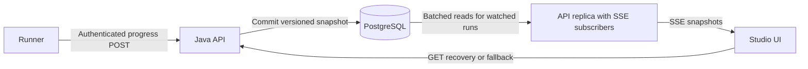

# Checks UI Studio — SSE viability

Date: 2026-09-10. Status: adopted as the preferred V1 transport in Studio architecture v2.1; ingress/authentication validation outstanding; not implemented.

SSE is viable for V1 and is a modest addition over **working live polling**. The larger shared task is getting progress from the runner into persistent execution state. The completion-only runner protocol assessed in v2.0 could not supply live progress through either transport. [Studio architecture §5](studio-execution.md#5-execution--runner) now specifies admission, progress and durable result reporting.

Keep Spring MVC, HTTP runner communication, PostgreSQL, and the existing execution GET endpoint. Use SSE for browser progress, with GET as recovery/fallback. A broker, WebFlux migration, WebSockets, and a durable event replay service are unnecessary for the proposed V1 scope.

## Repository evidence

| Observation | Implication |
|---|---|
| Backend uses Spring Boot 3.3.5 and `spring-boot-starter-web` in [build.gradle.kts](../../backend/build.gradle.kts). | Use MVC `SseEmitter`. Spring documents SSE support and the need to manage blocking writes and disconnects in its [async MVC documentation](https://docs.spring.io/spring-framework/reference/web/webmvc/mvc-ann-async.html). |
| [ChecksStudioPage](../../frontend/src/pages/ChecksStudioPage/ChecksStudioPage.tsx) already consumes execution snapshots every 700 ms. | Reuse the snapshot rendering logic behind a transport abstraction. Preserve timing fields and align terminal statuses during the existing contract migration. |
| [Production Helm values](../../helm-chart/put-checks/values-prod.yaml) configure three API replicas, scaling to six. | A callback and browser subscription can reach different pods. An in-memory emitter registry alone cannot distribute progress correctly. |
| [API client](../../frontend/src/services/api/apiClient.ts) enables credentials and supports Axios authorization headers. Frontend/backend production hosts differ. | Confirm the actual gateway/session route. Native EventSource does not inherit Axios interceptors or bearer defaults. |
| Ingress uses the `nginx` class, with configurable annotations but no explicit streaming settings. | Validate buffering, idle timeout, and any additional platform proxy. The repository does not establish the deployed ingress behavior. |
| The idempotency filter wraps mutations only; GET bypasses it. | No immediate response-buffering conflict there. Still test Servlet async dispatch through the real security/filter chain. |

## Smallest recommended design



1. Add an internal, service-authenticated progress reporting contract carrying `executionId`, `attemptId`, and a monotonically increasing runner sequence. Report browser start, step start/completion, bounded redacted logs, and evidence progress. Persist accepted updates before acknowledging them. Duplicate deliveries must not duplicate logs; older attempts or updates must not regress state. Intermediate updates can be cumulative snapshots so a later update repairs a delivery gap.
2. Add `GET /api/v1/studio/executions/{id}/events`, authorized against the execution's immutable CSI. Return `text/event-stream`. The API assigns a monotonically increasing snapshot revision when committing progress. SSE event IDs use that revision; payloads reuse the execution DTO, including step timings and video availability.
3. Each API pod batches DB reads for its locally watched execution IDs approximately every 500–1000 ms and sends only changed snapshots. Share each read across local viewers of the same execution. This retains a small amount of backend polling but provides SSE to the browser without cross-pod messaging or sticky sessions. Bound watched runs, subscriptions, payload size, and DB work; hold no transaction or DB connection for the stream lifetime.
4. Send a current snapshot on every connection/reconnection. Use full current state, with a bounded retained log buffer and explicit truncation metadata, instead of requiring exact replay of every intermediate event. A fast step can advance between snapshots; its final status, timing, and retained log still appear. This is near-real-time progress, not a lossless event transcript.
5. Keep SSE as an observation channel. Closing the tab or losing the stream never cancels or re-dispatches the test. Terminal result durability, lost-attempt handling, and reapers remain execution responsibilities. Studio architecture v2.1 additionally adopts short HTTP admission, exclusive admission ownership and durable terminal reporting. Those reliability changes are separate from the SSE transport overhead; the synchronous dispatch option assessed earlier is not the implementation baseline.

Suggested event shape:

```text
id: 17
event: execution.snapshot
data: {"executionId":"...","revision":17,"status":"RUNNING","stepResults":[],"logs":[],"videoStatus":"PROCESSING","streamComplete":false}

```

The real payload contains the current steps and retained logs. `streamComplete` becomes true after the outcome and evidence disposition are settled, including evidence failure. An execution outcome becoming terminal must not close the stream while video availability still needs an update. The browser explicitly closes EventSource on completion; ending the HTTP response alone normally triggers reconnection. Native EventSource reconnects with `Last-Event-ID`; our snapshot contract restores current state rather than promising event replay. See the [HTML SSE specification](https://html.spec.whatwg.org/multipage/server-sent-events.html).

## Authentication, connection lifecycle, and ingress

- Prefer the platform's authenticated same-origin gateway route with a session cookie. For an approved cross-origin cookie route, use `withCredentials: true`, exact-origin credentialed CORS, and verify cookie scope/policy. If the platform requires browser-attached bearer headers, use a header-capable SSE client behind the centralized API service instead. Do not put credentials in the event URL. These client capabilities follow the [EventSource interface](https://html.spec.whatwg.org/multipage/server-sent-events.html#the-eventsource-interface).
- Put subscription creation/cleanup and authentication handling in the API service layer; the component should not create unmanaged network connections. The existing Axios 30-second request timeout must not govern a long-lived stream. On native EventSource errors, use the normal GET endpoint to distinguish auth failure, terminal completion, and transient disconnection; bound reconnect attempts before falling back to polling. Never fall back around a 401/403.
- Authenticate and authorize each connection. Define a bounded authorization refresh interval for open streams so revoked CSI access or expired sessions terminate delivery. Async writers must use explicitly captured subscription identity and refreshed authorization, not assume the request's thread-local security context remains available.
- Start with heartbeat comments every 15 seconds and an explicit stream lifetime, for example 60 seconds with reconnect/snapshot recovery. Choose the lifetime against actual platform auth and proxy limits. Clean up emitter registries on timeout, error, completion, and unmount/scenario switch.
- Set `Cache-Control: no-store`; disable buffering for this route throughout the proxy chain. `X-Accel-Buffering: no` is supported by NGINX unless configured to ignore it. Configure upstream idle timeouts longer than the heartbeat interval and test actual delivery through ingress. See [NGINX proxy buffering and timeout behavior](https://nginx.org/en/docs/http/ngx_http_proxy_module.html#proxy_buffering).
- Use a dedicated bounded sender executor; Servlet writes can block. Do not perform sends on the runner callback, DB reader, or ordinary check-execution thread. Coalesce pending snapshots for slow readers, cap concurrent streams per user and pod, and disconnect stalled clients. Prefer HTTP/2 and one stream per actively viewed execution to limit browser connection pressure.

## Effort assessment

| Work | Needed for live polling too? | Assessment |
|---|---|---|
| Runner progress reporting, redaction, ordering, and persisted state | Yes | Main shared implementation effort; currently absent |
| SSE endpoint, batched snapshot broadcaster, bounded senders | No | Small to medium addition |
| Frontend subscription, reconnect, auth handling, GET fallback | No | Small to medium addition; reuses current rendering |
| Proxy configuration and streaming/reconnection tests | No | Modest code work; external gateway coordination is the uncertainty |
| Durable terminal results, attempt safety, reapers | Yes | Existing execution reliability work, independent of transport |

Planning estimate: **roughly 3–5 additional engineering days over an already working live-polling path**, including focused integration tests, assuming an engineer familiar with this stack and a compatible authenticated proxy route. This is an estimate, not a measured delivery commitment. It excludes building the runner/compiler and fixing the existing identity/vault prerequisites. Platform changes or a requirement for lossless event replay would increase it.

## Validation and document changes

Before committing the estimate, run a small streaming spike through the actual platform route: two timed snapshots must reach the browser separately before response closure; an idle interval must survive via heartbeat; reconnect to another API replica must restore current state. Check unauthorized/wrong-CSI requests, access revocation, slow consumers, terminal/video ordering, duplicate callbacks, and API restart. Add a mocked transport scenario to the frontend development path and real HTTP streaming tests for the backend; a buffered mock-controller response does not prove SSE delivery.

The PRD, Studio architecture v2.1, platform architecture, BRD and Epic 10 now adopt SSE as the preferred V1 transport with GET snapshot recovery/fallback. The staging spike validates deployment compatibility before rollout; a demonstrated gateway incompatibility is recorded and uses GET fallback. This note records the transport assessment and conditional effort estimate, while [Studio architecture](studio-execution.md) owns the current admission, state, authorization and result contracts.

Assessment performed: repository inspection and primary documentation verification. No SSE implementation, runtime spike, or staging test was performed during this review.
