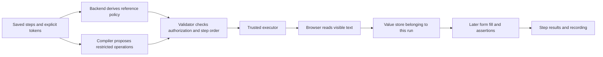

> Superseded for the user experience by [the token-free observed-authoring consensus plan](../../../specs/studio-observed-authoring/consensus-plan.md). This earlier proposal is retained as review history.

# Studio: capture page text and reuse it in later steps

Status: **proposed; awaiting user approval before implementation**. Reviewed against checkout `00da28e1a4857bebf8150c813433f0709664bb99` on 2026-10-07. No application code was changed during this review.

## Outcome and evidence

Add execution-local captured values so a Studio check can read text from a page and fill a later form with that exact value. Declared variables remain saved inputs. Authoring context remains static compiler input. Captured values are produced by the browser during one execution.

Live validation already proved declared-variable searches with two values, navigation/assertions, recordings and step seeking. It did **not** prove runtime reuse: test `da9e3555-a0bc-44e6-848a-de0868af44cd` is `NEEDS_REVISION` with `UNSUPPORTED_CAPABILITY` on capture/use steps. Execution returns 409 `COMPILE_REQUIRED`. See [report.json](report.json) and [follow-up.json](follow-up.json).

## Recommended user experience

An author writes ordinary steps with explicit capture/reference tokens, consistent with existing `<var NAME>` inputs:

1. Go to `<var BASE_URL>`.
2. Capture the visible text of the “Order reference” element as `<capture ORDER_REFERENCE>`.
3. Click “Continue”.
4. Fill the “Reference” field with `<captured ORDER_REFERENCE>`.
5. Verify the “Reference” field has value `<captured ORDER_REFERENCE>`.
6. Click “Submit” and verify the confirmation.

The first release supports **visible text**, reuse in **fill, value assertions and text assertions**, and reuse on the **same origin** (scheme, host and port). Navigating between pages of that origin is supported. These scope choices satisfy the requested earlier-step-to-later-step flow.

Input-control values, attributes, API responses, transformations, interpolation, capture-based selectors/URLs, cross-origin sharing and persistence between runs are outside this first release. Input-value capture would be a separate explicit operation; visible-text capture will not silently read an input's value instead.

Help remains accessible when steps already exist. The Variables dialog explains that variables are saved inputs, while captures are created during a run. The compiled-step summary names capture producers and consumers. Capture values are never editable in the Variables table.

## Architecture



The proposed compiled syntax is:

```ts
await context.captureText('ORDER_REFERENCE', page.getByTestId('order-reference'));
await page.getByLabel('Reference').fill(context.get('ORDER_REFERENCE'));
await expect(page.getByLabel('Reference')).toHaveValue(context.get('ORDER_REFERENCE'));
```

These calls are parsed into typed operations; generated JavaScript is never evaluated. The three calls above belong to separate authored steps.

### Source authorization and ordering

- Names are case-sensitive and use `[A-Za-z0-9_.-]{1,64}`.
- `<capture NAME>` authorizes a producer; `<captured NAME>` requires a consumer. They are separate from `<var NAME>` and `<secret ID>`.
- Backend reference policy v3 derives exact per-step `captureDefinitions` and `captureReads` from saved source tokens. The model cannot define or consume an unrequested name or omit a required capture/read.
- Legacy authoring without structural policy enforces the same token alignment in the runner. There is no weaker legacy capture route.
- A whole-artifact validation pass requires each read to have exactly one producer in an **earlier step**. Duplicate definitions, missing producers, forward references and same-step reads are rejected before launch.
- Reordering, deleting or editing a producer revalidates the complete artifact. Existing planner/assembler behavior is preserved; this work does not add incremental compilation to the live path.
- Extend structural reference validation; do not restore the retired English-derived expected-intent engine. Reference validation proves authorized names and permitted operations, not semantic correctness of a model-selected DOM element.

### Runtime behavior

- Create a fresh capture store within each execution, shared only by its steps and discarded on every exit. Values do not enter compile prompts, saved variables, compiled artifacts, JSON manifests or inter-process messages. Persisted video can contain visible captured text, as described below.
- Resolve exactly one visible match of the authored locator, excluding hidden matches. Wait for a visible match within the deadline; multiple visible matches fail. Pin the source element and document so visibility, origin and `innerText` refer to the same source; a detached target or changed document fails safely, without selecting another page or an alternate role. Preserve returned whitespace exactly; reject empty or whitespace-only values. Never silently trim or truncate.
- Use the existing action timeout, execution deadline and cancellation path. Bound the complete visible-wait/read operation by the remaining time, rather than granting each phase a fresh timeout. Check cancellation before and after reading and before committing the value; a late read cannot publish a capture after cancellation.
- Proposed configurable limits: **32 captures**, **4,096 UTF-8 bytes per value**, **65,536 UTF-8 bytes total**, and the existing 64-character name limit. These are new defaults for approval, not claims about existing configuration. Carry them through validated runner configuration and execution admission to the child.
- A failed capture fails that step and skips subsequent steps under the existing stop-on-failure behavior. Missing runtime reads fail explicitly; they never become empty strings or fall back to saved variables.
- Bind producer origin to the actual pinned document read and record it with each value. Both fill and assertion consumers require that same origin; fills use the existing origin-check/pinned-target approach. This prevents reuse on a different origin but cannot restrict a page's own network requests or form submission destinations.

### Diagnostics and confidentiality

The initial proposal's “extend the redactor” sentence was insufficient. The current adapter truncates observed values before executor redaction; page-location reporting normalizes text first. The QA review reproduced leakage of a truncated long canary and a whitespace-normalized multiline canary in memory.

For artifacts containing captures, determine capability from trusted validated operations (never a model-supplied flag) and activate a run-wide data-free diagnostic policy **before browser launch**:

- Preserve structured status, step index, authored capture name, fixed error code and timing. Omit browser-derived expected/actual readings, page title/path and observed host strings from emitted diagnostic payloads.
- Replace unexpected child run/close faults with fixed error descriptions. Do not relay raw child stdout/stderr for these runs. Keep existing output behavior for runs without captures.
- Sanitize child-produced structured messages before IPC; captured values never need to be sent to the parent redactor. Dynamic child-local redaction is defense in depth, not the sole confidentiality guarantee. Do not claim confidentiality for arbitrary page data, untested encodings, network traffic or video.
- Verify every affected output boundary: adapter errors, executor failure suffixes, browser host observations, child faults, reporting, manifests and raw output relay. Reduced browser-content detail in failure messages is an explicit trade-off of capture runs.
- Video continues to record what is visible, including captured and filled text. This is **not** a secret vault or a promise of recording redaction. Existing evidence access and retention behavior remains in force.

## Code findings and implementation scope

| Area | Current evidence | Required change |
|---|---|---|
| Accepted operations | `studio-runner/src/executor/operations.ts`; `validator/ast.ts` | Add a capture operation and narrowly permitted runtime-reference arguments; keep other language forms rejected. |
| Source authorization | `backend/.../compile/StepReferencePolicyDeriver.java:22`; `studio-runner/src/validator/references.ts:28` | Add producer/read tokens and exact policy alignment, including legacy fallback. |
| Immutable policy | `backend/.../compile/VersionedIntentDeriver.java:22`; `IntentRevisionVerifier.java:20` | Version and rederive structural capture policy; retain authoring identity checks. |
| Step dependencies | `studio-runner/src/validator/index.ts:67` | Validate producer/consumer order across all lowered steps. |
| Runtime values | `studio-runner/src/executor/executor.ts:93` and `:182`; `executor/adapters/BrowserAdapter.ts` | Isolated capture store, adapter read seam, allowed consumer resolution and bounds. |
| Browser behavior | `studio-runner/src/run/playwrightAdapter.ts:578`, `:889`, `:1001` | Strict visible read, origin-aware consumers and one deadline budget. |
| Output handling | `playwrightAdapter.ts:287`; `executor/pageLocation.ts:89`; `run/childRuntime.ts:465`; `run/outputRelay.ts:135` | Data-free diagnostics and child output handling for capture-capable runs. |
| Frontend | `frontend/src/pages/ChecksStudioPage/ChecksStudioPage.tsx:889,1243`; `components/studio/review/artifactSummary.ts:320` | Accessible help, separate terminology, readable capture/use summaries and actionable diagnostics. |
| Compile assembly | `backend/.../compile/CompilePipeline.java:309` | Whole-artifact validation remains authoritative. This path currently forces FULL assembly, despite separate planner support for suffix reuse. |
| Compatibility | `studio-runner/src/compat/compatibility.ts:60`; backend `CompilePins.java` | Coordinate language/runtime/policy pins and update fixtures, schemas and deployment overrides. |

Also update runner policy/configuration and child protocol, API reference-policy schema, compiler syntax/output resources, fixture manifests and tests. No database table is needed for runtime values; they remain transient. Existing revision storage continues to hold source and policy, not captured data.

## Versioning and deployment

Proposed coordinated versions: policy 3; policy derivation `3`; validator `3.0.0`; executor `2.2.0`; syntax reference `2.2.0`; prompt `2.4.0`. Keep the artifact JSON envelope at version 1 because its shape need not change.

The runner compares validator, syntax and Playwright versions exactly; executor compatibility permits compatible minor upgrades. Do not relax these rules. Existing revisions affected by new pins must be recompiled and reconfirmed through the established workflow; scheduled tests must not silently resume against a different revision.

Drain active executions and coordinate backend/pins plus runner rollout, then recompile/reconfirm affected tests before running them. Do not claim a zero-disruption independent rollout. Rollback restores the matching component/pin set and requires compatible confirmed revisions.

## Verification and acceptance

1. Unit tests cover tokens, required/extra definitions/reads, allowed consumer positions, ordering, duplicate names, configuration bounds and preserved legacy input/secret behavior.
2. Executor/real-Chromium tests cover visible strict targets, empty/whitespace values, exact retained whitespace, Unicode byte limits, failed capture, same-origin enforcement, navigation races, cancellation, deadlines and cleanup.
3. Consecutive and concurrent executions prove the capture store is isolated. A failed new execution cannot obtain a prior execution's value.
4. Canary tests cover long, multiline, encoded and Unicode values across every diagnostic/output boundary, including unrelated later assertion failures and child faults. Recordings are excluded from text-redaction claims.
5. Backend tests cover policy persistence/rederivation, save/compile/confirm/execute binding, compatibility rejection, and full assembled-artifact validation after edits. Planner tests cover producer edits/reorders without claiming live suffix reuse.
6. Frontend tests cover always-accessible guidance, readable summaries and actionable missing/forward-reference diagnostics. Existing MSW contracts are updated alongside live integration checks.
7. Live acceptance uses a local fixture with a fresh unpredictable reference generated only when the runner visits it. One check combines saved input variables with capture, navigation, later form fill, submission and an assertion. The fixture independently verifies submitted versus issued values and records receipts.
8. Run the **same confirmed artifact twice without recompiling**, then verify different issued values, matching submission receipts and identical revision/artifact hashes. Neither value may appear in authored source, declared variables or compiled literals. Include parallel runs for isolation.
9. Verify per-step results, logs, playable video and producer/consumer seeking through Studio. Repeat existing declared-variable and navigation checks to show they still work.

## Review disposition and approval

Architecture, product/frontend and QA/security reviewers support a restricted capture operation with a separate run-local namespace. This revision incorporates their identified gaps. Architecture and QA performed a final read-only review and found no blocking design contradictions after the explicit pinned-document, origin and output-policy clarifications. Product/frontend recommendations are incorporated; the coordinator resolved token naming and exact-whitespace semantics consistently with the architectural policy. It is a reviewed design proposal, not an implementation gate PASS.

Approval requested: implement the visible-text, same-origin scope above, including explicit source tokens, output protections, UI guidance, coordinated version changes and the live acceptance test. Input-value capture and cross-origin sharing can be considered separately if needed.
