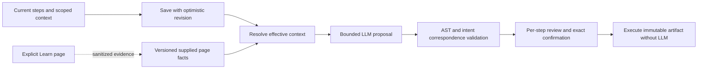

# Spec: Context-aware English-to-Playwright authoring

> **Spec ID:** STUDIO-CONTEXT (planning identifier; not an implementation story)  
> **Generated:** 2026-09-18  
> **Complexity:** COMPLEX, 20/25  
> **Status:** QA approved for planning (iteration 2, 4.8/5); proposed architecture amendment, no product implementation

## 1. Overview

The current mechanism is not yet sufficient for the requested page-specific intelligence. The compiler receives stored English steps and generic syntax guidance, while the available local Run path interprets the original English separately. Global context, local context, actual page evidence and exact action-value checks are missing. A better prompt alone would leave the displayed AI source disconnected from execution. This conclusion comes from static source inspection, not a measured live-model failure rate. [CS-01–CS-13 in current-state.md; R-07–R-09 in research.json]

The proposed outcome is a single authoring flow: save the current checklist and scoped context, build a bounded effective context for every stable step, propose allowed Playwright, independently validate explicit action values and supported syntax, show the interpretation, confirm the immutable revision, and execute that exact artifact. The supplied-context path is complete without a live browser. User-requested explicit **Learn page** capture is a separate authoring extension; ordinary compilation remains browser-free and execution remains LLM-free. [FR-1–FR-11; CON-2–CON-4]

This specification does not implement the feature, certify existing code, introduce a new model vendor, schedule tests, add runtime self-healing, enable frames/popups or assume screenshot capture. Existing unfinished Epic 10 foundations remain prerequisites. Global context means context for one CSI-scoped test; organization-wide memory is not proposed. The user explicitly selected both supplied context and live page inspection. The browser stage is included in this proposed design, while test-scoped global context remains a documented assumption. [CON-1–CON-6; ASM-1, ASM-3; complexity.flags]

## 2. Requirements summary

The full source, assumptions, Given/When/Then criteria and glossary are in [requirements.json](requirements.json). All acceptance criteria below are proposed future implementation gates, not passing results.

| ID | Requirement | Acceptance |
| --- | --- | --- |
| FR-1 | Scoped context persistence and current-editor save | AC-1, AC-2 |
| FR-2 | Precedence and conflict handling | AC-3, AC-4 |
| FR-3 | Page grounding with observed/predicted state | AC-5, AC-6 |
| FR-4 | Stable step identity and dependency state | AC-7 |
| FR-5 | Immutable context/revision identity | AC-8, AC-9 |
| FR-6 | Readable effective-intent review | AC-10 |
| FR-7 | Exact literal and reference preservation | AC-11, AC-12 |
| FR-8 | Minimal resilient policy-valid code | AC-13, AC-14 |
| FR-9 | Clarification and bounded repair | AC-15, AC-16 |
| FR-10 | Page-backed semantic evaluation | AC-17 |
| FR-11 | Bounded explicit live learning workflow | AC-18, AC-19, AC-20 |

| ID | Category | Requirement | Metric |
| --- | --- | --- | --- |
| NFR-1 | reliability | Measure semantic translation correctness separately from JSON/AST validity and distinguish uncertainty from successful compilation. | All critical literal/context-isolation/revision-race cases pass; publish task-success and clarification rates on a pinned corpus. No unsupported aggregate success target is assumed. |
| NFR-2 | security | Apply existing CSI, destination, secret-reference, redaction and allowed-language boundaries to all added context and page evidence; treat page text as untrusted data. | No resolved secret in gateway payload/artifact/diagnostics; cross-CSI evidence access denied; malicious context cannot introduce prohibited operations in fixture tests. |
| NFR-3 | performance | Bound context bytes, step count, evidence size, compile concurrency and repair attempts; measure added context cost before setting production budgets. | Explicit configured bounds reject oversized input with diagnostics; repairs <=2; benchmark p50/p95 latency and input/output size against current baseline. Numeric context caps and latency SLO require measurement. |
| NFR-4 | usability | Keep context optional for existing drafts and make resolution, conflicts and evidence limitations understandable to users without Playwright knowledge. | Representative nontechnical reviewer can identify target, literal and context origin in AC-10; legacy load/save retains instructions in AC-2. |

- **CON-1:** This task delivers review, specification and implementation planning, without modifying product behavior or starting an implementation cycle. Identify gaps and proposals; create no application changes.
- **CON-2:** Preserve authoring-time generation and immutable confirmation; confirmed execution must remain independent of the LLM and must never silently regenerate code. Context affects compile/revision identity; runtime remains fixed-artifact execution.
- **CON-3:** Existing V1 architecture states no browser starts during compilation and application DOM is not an input; user-requested authoring-time live inspection is an explicit scope extension requiring an architecture amendment. Supplied-context compilation remains functional on its own. Included explicit Learn page inspection is a separately bounded authoring stage; ordinary compilation starts no browser and execution calls no LLM.
- **CON-4:** Retain Chromium single-page V1 and approved restricted TypeScript/executor policy; screenshots, popups, iframes, runtime self-healing and scheduling remain outside this review extension unless explicitly agreed. Page optimization cannot assume arbitrary Playwright capabilities.
- **CON-5:** Use existing frontend/backend architecture, centralized API and MSW development with versioned API/artifact contracts and forward-only data migrations. Plan coordinated frontend, backend, mock and runner changes rather than an isolated prompt patch.
- **CON-6:** Preserve the current uncommitted product work and distinguish locally observed implementation from planned architecture. Review the working tree as evidence without claiming planned protections already exist.

## 3. Technical approach

### 3.1 Authoritative lifecycle



Save/compile must identify the editor revision. Compilation against an older persisted test ID is rejected or preceded by an optimistic update; a compile result applies only to its still-current request and source/configuration/context revision. A relevant edit clears readiness without deleting historical confirmed revisions. Run sends or resolves the exact current confirmed identity; the server, not the displayed button state, enforces the gate. The independent regex runner and frontend Python interpretation cease to be authoritative when the artifact path ships. No generated-source `eval`, arbitrary Node execution or local regex fallback can bridge a missing trusted executor. [FR-1, FR-5; CON-2; CS-05–CS-11; R-08–R-09]

Context identity is part of immutable revision provenance. A canonical context digest covers ordered stable step identities/text, global/local context, typed value references, selected immutable evidence revisions and relevant nonsecret configuration. Compiler/prompt/syntax/policy/runtime compatibility versions remain pinned. A context-only edit, evidence replacement, reference/default change or reordering invalidates the current candidate. Artifact hash alone does not identify intent. Keep compile caching deferred until the complete identity and CSI isolation rules exist. [FR-4, FR-5; NFR-2; current-state.md recommendations 2 and 8; architecture §§4.2–4.3]

### 3.2 Scoped context contract

The domain contract comprises the following fields; the recommended `authoringSchemaVersion: 2` body uses `steps: [{id, text, context}]` plus global context on the existing endpoint, with an explicit legacy adapter. Reject mixed formats, duplicate IDs and unknown v2 fields. Assign legacy IDs once on persisted migration/save, not on render. Keep artifact version 1 unchanged: derive ordered strings and store the ID mapping/context in immutable revision metadata. Freeze this in OpenAPI before implementation. No database migration or externally frozen API is created by this spec. [FR-1, FR-4, FR-5; CON-5; current-state.md recommendation 2]

| Record | Required information | Meaning |
| --- | --- | --- |
| Global context | Test/CSI/environment identity, application URL/page identity, terminology aliases, nonsecret defaults and applicable page-profile references | Shared authoring facts; not cross-CSI memory or authoritative policy. |
| Step | Stable ID, ordered position, original English text, local target/scope hints, explicit literal or typed reference, relevant page/state reference | Local overrides apply only to this step; reorder keeps ID, copy creates ID, delete removes metadata. |
| Page evidence | Immutable ID/revision/hash, CSI/environment, origin/route, applicable state/preconditions, author/capture source/time, selected roles/names/labels/test IDs and submission/readiness cues, completeness/freshness metadata | Supplied hints and observed facts have different provenance. Unknown/truncated information is explicit. |
| Effective step context | Resolved operation/value/target scope, inherited facts, relevant predecessor-state facts, selected evidence identity, field-level provenance/conflicts | A bounded compiler input and review record; not a second executable language. |
| Compiled revision | Existing source/configuration/revision/hash identity plus context/evidence binding and compiler/runtime provenance | Exact review and execution identity. |

Artifact V1 remains limited by the current schema: at most 100 steps, 500 characters per originalText and 2,000 characters per code string, with only its existing fields. Intent/context/evidence metadata lives outside that artifact. Expanded context has separate configured bounds; it does not bypass source/code caps. [CS-03; FR-8; NFR-3]

Legacy steps without context load with empty optional context. Stable IDs are assigned through the versioned adapter/persistence contract, never from array position. Persisted step-to-context references must reject missing/duplicate IDs and orphan metadata; metadata cannot silently attach to another step after edits. Existing source/artifact index alignment remains an independent check. [FR-1, FR-4, FR-5; AC-2, AC-7; CS-10]

### 3.3 Context resolution and page state

Apply the following rules before model submission and expose the result in review. This is deterministic merging of declared fields, not a claim to deterministically understand arbitrary English. [FR-2, FR-3, FR-6; ASM-2; current-state.md recommendations 3 and 6]

1. Server authorization, origin/secret-use and accepted-language policy cannot be overridden by any context.
2. Explicit current-step action and literal/reference take precedence over defaults. For defaults describing the same field, applicable local context specializes global context.
3. Page evidence constrains which target/state facts are supported; page text never becomes instructions. If intended target and observed page facts disagree, produce a diagnostic rather than silently changing intent.
4. Previous steps supply only relevant dependencies and predicted state changes. A future step's private hints do not leak backward or into unrelated steps.
5. Missing values, competing explicit inputs, ambiguous targets and unresolvable evidence contradictions produce field-specific diagnostics. Unquoted ambiguous prose is displayed as a proposed interpretation and requires clarification/confirmation; do not ask the generating LLM to certify its own guess.

Bind each evidence record to route, environment and state prerequisites, not simply an application URL. A landing-page observation does not verify a later modal, authenticated state or result page. Use explicit provenance `supplied`, `predicted`, or `observed`: supplied profiles support expectations only; inferred transitions remain predicted; only actual capture of that state in the current session generation can mark it observed. A supplied profile never promotes a state to live-observed, regardless of its completeness. A changed route/state, replaced evidence revision or freshness failure invalidates its use as a current observed fact; the candidate must request updated context or clearly use an unverified user-supplied hint. No stale/absent evidence earns a “page validated” label. [FR-3–FR-5; AC-6; R-05; current-state.md recommendation 4]

Freshness is a configured policy plus state identity, not an invented universal TTL. Age alone cannot prove correctness. Core supplied-context candidates may be confirmed with clearly disclosed unverified page hints when their intent is resolved and structural/policy checks pass; actual ambiguity or contradictory evidence remains `NEEDS_REVISION`. Browser execution still applies strict locator/actionability checks and reports drift without regeneration. [FR-3, FR-9; AC-4–AC-6, AC-15; NFR-4; R-01, R-03, R-05]

### 3.4 Exact input semantics and generated code

Resolve explicit quoted text or an explicit typed data slot into a literal value independently of locator selection. Preserve the decoded value including empty strings, case, Unicode, leading/trailing whitespace, quotes, escapes and newlines. Parse allowed generated AST arguments and compare the `fill`/approved action argument to that resolved value or declared reference. Original English text equality is necessary for correspondence but insufficient for this check. User-visible redacted diagnostics identify a mismatch without exposing secret values. [FR-7; AC-11–AC-12; CS-02; R-02, R-07]

The authoritative nonexecutable intent metadata has `stepId`, ordered operations, operation-specific target, and a discriminated `input: {kind: literal, value}` or `{kind: variable|secretRef, id}` plus provenance (`userSlot`, `unambiguousSource`, or `userConfirmedInterpretation`). A model-proposed field is not authoritative until reviewed. Typed slots preserve raw text and never apply JavaScript escape decoding. Only an explicitly recognized operation pattern can map a quoted source span to its input argument; multiple plausible value spans, mismatched delimiters or ambiguous escape notation require a typed slot/clarification. An explicit slot that contradicts source text blocks readiness until the user resolves the conflict, rather than silently overriding either. [FR-2, FR-6–FR-7; AC-4, AC-10–AC-12]

Validate the complete ordered AST action signature against the reviewed operation list: method, target binding, typed options and the correct input argument position. A matching string somewhere else in the AST does not satisfy correspondence; extra click/press/fill calls or omitted operations fail. For free-form English, explicit reviewed intent is the boundary of the deterministic guarantee, not a claim to independently prove natural-language meaning. [FR-7–FR-9; R-02, R-07; current-state.md literal decision]

A target locator's `exact: true` is about name matching, not exact input preservation; Playwright text matching normalizes whitespace. A fixture for newlines uses a compatible textarea so a browser control's own normalization is not mistaken for compiler preservation. Explicitly diagnose an incompatible target/value rather than quietly change input semantics. [FR-7; NFR-1; R-02]

Prefer evidence-supported role/name, label or test-ID locators, scoped through receiver chains allowed by the current validator. An action must target a unique control. Do not add `.first()`, positional fallbacks, forced actions, arbitrary sleeps, broad CSS guessing or unlisted APIs. Playwright auto-waiting handles actionability; explicit user-requested assertions use retrying supported assertions. Do not invent an assertion, submission or readiness condition to make the script look more complete. [FR-8, FR-9; CON-4; R-01–R-03, R-09]

Keep one artifact entry per original source step, with a bounded sequence of allowed awaited calls when that one instruction explicitly requests multiple actions. Align the current single-statement prompt with the existing documented sequence policy and validator. This resolves fill-plus-submit without weakening step mapping or inventing a new execution engine. All generated calls, options, chains and arguments must pass the trusted validator; basic snapshot APIs are never added to generated test language for capture convenience. [FR-8; AC-14; CS-02; R-04, R-09]

### 3.5 Worked search example

The following is an illustrative fixture, not an observation of a real target. The global context names the application page, provides an alias “search” → application search and a default query `daily totals`. Step-local context restricts the search to the header. Applicable page evidence identifies a unique header searchbox named `Search applications` and documents Enter submission. The step says: **Search for "quarter-end exposure" and submit with Enter**. [FR-2, FR-3, FR-7, FR-8; AC-3, AC-5, AC-14; R-01–R-03]

The effective value is exactly `quarter-end exposure`; it overrides the global default. The target is the evidenced header control. Under the documented allowed receiver chains, the candidate for that single source-step entry is:

```typescript
await page.getByRole('banner').getByRole('searchbox', { name: 'Search applications', exact: true }).fill('quarter-end exposure');
await page.getByRole('banner').getByRole('searchbox', { name: 'Search applications', exact: true }).press('Enter');
```

This source remains illustrative until accepted by the actual pinned validator/executor. If the step only says “Enter the text”, the second statement is absent. If the evidence identifies button submission, the user’s requested search must resolve to that supported behavior or clarify a conflict with explicit Enter intent. If the user separately asks to verify result text, add that assertion under its own source step using the supported page-state evidence; no result assertion is inferred from the sample alone. [FR-2, FR-7–FR-9; R-03, R-09]

### 3.6 Bounded prompt assembly and diagnostics

Serialize resolved source, context, evidence and diagnostics as clearly delimited untrusted data separate from the pinned compiler instructions/output contract. This organization improves fidelity; it is not the security boundary. Default-deny AST execution, CSI isolation, approved origins and secret-use policy remain authoritative. Exclude resolved secrets, cookies, bearer tokens and authentication storage from model context. [FR-7, FR-9; NFR-2; CS-04; R-06, R-09]

Deterministically select relevant page facts and deduplicate global facts across steps. Count full serialized input, including repairs/evidence. Reject an oversized essential literal/context instead of silently truncating its meaning; disclose any omitted nonessential evidence. Apply the existing maximum of two repair proposals and a compile-wide elapsed/call/byte budget accounting for transport retries. Numeric context and latency targets await measurements; do not treat a per-request cap as the aggregate budget. [FR-9; NFR-3; CS-12; architecture §4.3]

Diagnostics bind to stable step identity and field, with a safe reason, needed clarification and provenance. Distinguish missing context, conflicting value, ambiguous target, incompatible state/evidence, literal mismatch, unsupported operation, stale revision and exhausted repair. These are diagnostic categories to freeze in the shared contract, not already-existing error codes. Repair uses bounded redacted diagnostics, never silently alters confirmed history, and never runs during execution. [FR-5, FR-6, FR-9; AC-8–AC-10, AC-15–AC-16]

### 3.7 Included Learn page architecture amendment

The complete feature accepts user-supplied context/profiles and live observations; supplied-context-only compilation remains operational when inspection is unavailable. The user selected live inspection as part of this specification. Add a separate explicit authoring capture workflow with CSI/environment/route/state identity, authorized account references, bounded collection and redaction. Ordinary Compile consumes already captured evidence and launches no browser. Run consumes only the confirmed artifact and calls no LLM. [CON-2–CON-3; ASM-3; OQ-1, OQ-3; R-04–R-06, R-09]

The explicit learning state machine is `starting → observing → captured`, with `partial`, `failed`, `cancelled` and `expired` terminal outcomes. For a later step requiring interaction, use `observed → proposed action → validated and within authorized scope → acting once → observing; pause for clarification/new approval when scope or state changes`. Only a successful capture earns observed provenance. Navigation must be an approved destination; Start learning authorizes the displayed draft revision and action scope once. Unambiguous validated actions matching that authorization may progress automatically; changed or unclear intent, new actions, stale state or failure pauses for clarification/new authorization. Each executed action records its exact hash and scope binding. No hidden prior-step replay, repeated submit, repair-driven action retry or automatic recovery of an ambiguous action is allowed. A failed/uncertain attempt pauses learning and asks for a new deliberate state/action decision. [FR-11; AC-18–AC-20; R-05–R-06; current-state.md learning design]

Capture is performed by trusted isolated browser infrastructure, not API/worker code or generated artifact methods. Its authenticated session binds to CSI, principal, environment and approved authentication-profile references. The authorized backend/worker resolves vault references ephemerally and transfers only narrowly scoped values over encrypted service transport. The capture runner has no vault, CSI-store or LLM credentials; it receives only the per-session values required for the approved destination. Never expose storageState, cookies, tokens or resolved secrets to the model. End/cancel/timeout closes the browser, clears session material and temporary raw capture, and releases capacity. Persist only authorized sanitized bounded evidence and its lifecycle metadata; retention/expiry and authorization are checked on retrieval as well as capture. A sanitization failure publishes no reusable raw evidence. [FR-11; NFR-2–NFR-3; CON-2–CON-3; R-06; OQ-3]

The backend owns an authoring-session ledger and a dedicated trusted runner protocol, extending the existing planned one-shot runner rather than pretending it already supports long-lived sessions. Bind session ID, principal/CSI, start source/context/configuration revisions, stable step ID, monotonically increasing state generation, approved action hash and evidence identity. An idempotent advance request is admitted once for that generation; duplicated/stale callbacks cannot reapply actions or replace evidence. Never give a model browser/page handles. [FR-5, FR-11; current-state.md live-learning orchestration decision]

Observations accumulate in a session-local draft without publishing every intermediate capture into the canonical test. On completion, publish selected sanitized evidence and a new context revision atomically only if the test still matches the session's start revisions; otherwise retain no runnable candidate and request reconciliation. This one publication invalidates earlier readiness; final compilation preferably assembles/revalidates the same learned per-step source and needs ordinary exact confirmation. Bind behavioral evidence to each exercised step action/code hash plus pre/post state generation. If final compilation regenerates any code or changes dependencies, clear behavioral verification for those changed/dependent steps or learn them again; locator/profile evidence alone cannot prove the new source was exercised. Expired/cancelled/partial sessions cannot become ready through a late callback. [FR-3–FR-5, FR-11; AC-8–AC-9, AC-18–AC-20; current-state.md live-learning orchestration decision]

One session has configured hard limits for wall-clock time, observed steps/actions, collected bytes, concurrency and LLM proposal/repair calls; limits apply across the entire loop rather than reset per step. Numeric values require measured platform acceptance, but no capture request can start without explicit nonzero bounds. Exhaustion ends with a precise partial/error result; it does not cause extra exploration. Each observation records page/environment/state identity, step association, timestamp/hash, evidence coverage/truncation and whether it is current or stale. Missing future modal/auth/result state stays predicted, never observed. [FR-3, FR-11; AC-18–AC-20; NFR-3; R-05]

Use capabilities of the pinned capture runtime: inspected local Playwright 1.57.0 supports basic ARIA snapshots, not newer AI/depth/box/JSON snapshot options. A snapshot is partial evidence, not business-rule knowledge. The capture reference must exclude secret-bearing fields and unneeded page text before model submission, expose coverage gaps, and allow supplied hints when observation is unavailable. User approval of learned actions does not confirm a runnable test; after selecting evidence, normal Compile → review → exact revision confirmation still applies. [FR-3, FR-5, FR-11; NFR-2; R-04–R-06; CON-2]

## 4. Dependencies and compatibility

| Dependency | Verified state | Use / limit |
| --- | --- | --- |
| Playwright | Local lockfile/installation 1.57.0; declared range ^1.57.0 | Existing semantic locators/actions and basic capture capability. No upgrade is proposed; production runner pin/assertion adapter remain unverified. |
| Vertex/R2D2 gateway | Existing local client/request/parser classes | Extend typed payload and bounded assembly; production model/prompt behavior requires fixture/staging verification. |
| React/MUI + centralized API/MSW; Java 21/Spring | Existing repository stack | Context editing, persistence, DTO/API validation and mock coverage; no new stack. |
| Epic 10 contracts/revisions/reference/validator/runner/confirmation | Planned foundations, incomplete in audited path | Required for exact-artifact execution and truthful readiness; comments or story references are not proof of implementation. |

Dependency facts trace to research.dependencies, R-07–R-09, CS-01–CS-13, CON-5 and `docs/epics/EPIC-10-EXECUTION.yaml`. Specifically align with 10.1–10.5, 10.8–10.10 and the 10.6/10.7/10.11/10.12 execution path. No new library or production runtime version is selected here.

Relevant primary sources: [Playwright locators](https://playwright.dev/docs/locators), [input](https://playwright.dev/docs/input), [auto-waiting](https://playwright.dev/docs/actionability), [ARIA snapshots](https://playwright.dev/docs/aria-snapshots), [authentication](https://playwright.dev/docs/auth), and [version 1.57 locator reference](https://raw.githubusercontent.com/microsoft/playwright/v1.57.0/docs/src/api/class-locator.md). Detailed claim/source mapping and unverified production assumptions are in [research.json](research.json).

## 5. Expected implementation surfaces

These are planning targets, not files modified in this task. New file names and forward migration numbers are assigned when stories/contracts are finalized. [FR-1–FR-11; CON-1, CON-5; complexity.scope; current-state.md dependency sequence]

| Surface | Expected work |
| --- | --- |
| `frontend/src/pages/ChecksStudioPage/ChecksStudioPage.tsx`, studio types/store/API and `frontend/src/services/mocks/` | Global/local authoring context, stable IDs, save-update before compile, effective-context review, stale/clarification states and exact confirmation/run contract. |
| Studio `UITestRequest`/DTO/entity/service/controller and forward migrations | Versioned context persistence, revision/concurrency validation, immutable evidence/context bindings and legacy adaptation. |
| `StudioGeminiService`, `CompileRequest`, `GatewayPayloadSerializer`, artifact schema and compiler tests | Effective-context assembly, structured data fencing, bounded sequence prompt, provenance, semantic/literal diagnostics and aggregate budget. |
| Planned trusted validator/executor and pinned syntax reference | Default-deny AST validation plus independent intent/value correspondence; execute confirmed artifact with aligned step reporting. |
| `LocalStudioExecutionRunner`, `frontend/scripts/run-studio-test.mjs`, frontend legacy parser/Python generator | Migrate authoritative execution/preview responsibility to the approved artifact path; no premature deletion before replacement is validated. |
| Context-focused fixture corpus and frontend/backend/runner integration tests | Exercise AC-1–AC-20 and NFR-1–NFR-4; real-model evaluation separate from deterministic contract tests. |
| `PRD.md`, `docs/architecture/studio-execution.md`, Epic 10 follow-up planning | Record proposed context/page-evidence amendment and exact dependencies when approved for implementation. |

## 6. Validation strategy

### 6.1 Acceptance matrix

Full Given/When/Then criteria remain canonical in requirements.json.

| Criterion / requirement | Observable gate |
| --- | --- |
| AC-1–2 / FR-1 | Round-trip scopes; compile current saved revision; load legacy empty context. |
| AC-3–4 / FR-2 | Exact step term wins over global default; unresolved conflict blocks readiness. |
| AC-5–6 / FR-3 | Choose evidenced scoped control; wrong route/environment/later state cannot claim observation. |
| AC-7 / FR-4 | Reorder retains context; copy gets fresh ID; deletion removes only its metadata. |
| AC-8–9 / FR-5 | Context/evidence edits invalidate confirmation; late older compilation cannot overwrite newer. |
| AC-10 / FR-6 | Nontechnical review exposes action, target, literal/reference, scope/provenance and diagnostics. |
| AC-11–12 / FR-7 | Decoded AST input equals explicit typed/quoted value, including empty/Unicode/escaping; secrets stay references. |
| AC-13–14 / FR-8 | Unique supported locator; no arbitrary sleeps/first-match; compound action stays one bounded source-step entry. |
| AC-15–16 / FR-9 | Ambiguity diagnosed; at most two repairs with unchanged original intent/context. |
| AC-17 / FR-10 | Separate literal fidelity, target correctness, task success, ambiguity, syntax, latency and input/cost metrics. |
| AC-18 / FR-11 | Capture records scoped current-state provenance and partial coverage; future states stay predicted. |
| AC-19 / FR-11 | Validate exact next action against authorized draft/action scope; auto-progress matching actions once, pause on change/ambiguity; no hidden replay. |
| AC-20 / FR-11 | Cancel/timeout/bounds/auth/sanitization failure cleans session and preserves honest partial/error status; compile/run never start learning. |

### 6.2 Test layers and gates

- **Unit:** Context precedence/provenance and conflict resolution; step ID edit/reorder/delete/copy; canonical hashes; explicit literal extraction/escaping and AST argument equality; bounded evidence selection and payload budgeting. These verify business rules, not a mocked model's self-reported correctness. [FR-1–FR-5, FR-7–FR-9; NFR-2–NFR-3]
- **Integration with MSW/backend/validator:** Save-current-editor then compile; context round trip; legacy empty context; stale and out-of-order results; context-only invalidation; exact review/confirmation/run binding; cross-CSI access denied; unauthorized references/redaction; unsupported AST and prompt-like page content. [FR-1–FR-9; CON-5; NFR-2, NFR-4]
- **Controlled browser fixtures:** Search fields without `name=q`, duplicate header/content searchboxes, fill-only versus Enter/button submission, explicit empty/Unicode/quoted/whitespace values, textarea multiline values, route changes, delayed results, modal/auth states, stale profiles and intended assertions. Assert actual target/value/outcome; verify the runner consumed the confirmed artifact/hash. [FR-3, FR-7–FR-10; NFR-1]
- **Pinned real-model evaluation:** Record model/prompt/runtime/context versions, fixture inputs, generated artifact hashes, failures, latency and input/output cost/size. Report literal fidelity, target correctness, task success, safe ambiguity handling and syntax success separately; compare to the current baseline. Mocked proposals establish contract behavior only. [FR-10; NFR-1, NFR-3; R-07–R-08]
- **Release gates:** All critical exact-value, context-isolation and stale-revision cases pass; meaningful semantic/task-success targets and measured latency/input caps are explicitly set before production acceptance. Reviewers can identify value, target and context origin without reading TypeScript. Live capture has separate environment/security acceptance. [NFR-1–NFR-4; OQ-2–OQ-4]

No product test suite, browser fixture, live model benchmark or staging validation was run by this specification task. The measured quality baseline and production SLOs remain open. [CON-1; current-state.md validation performed; researchNotes]

## 7. Risks and rollout

| Risk | Impact | Mitigation / gate |
| --- | --- | --- |
| AI preview differs from actual Run | A correct proposal provides no execution guarantee. | Establish confirmed-artifact execution before end-to-end quality claims; no regex fallback. [CS-05–CS-08; FR-5] |
| Context silently changes value or target | Wrong browser action with plausible-looking code. | Independent explicit-value comparison, visible resolved intent and conflict diagnostics; strict unique locators. [FR-2, FR-7, FR-9] |
| Stale or landing-page evidence reused after transitions | Selector seems grounded but belongs to another state. | State/route provenance, predicted-vs-observed distinction, freshness checks and explicit missing context. [FR-3; R-05] |
| Page text or context carries secrets/instructions | Leakage or unintended permitted browser action. | Redaction, opaque references, CSI/origin controls, untrusted-data framing and restricted executor independent of model. [NFR-2; R-06, R-09] |
| Helpful language features exceed actual runner grammar/version | Proposal compiles conceptually but cannot execute. | Pinned reference tests and default-deny policy; no runtime upgrade assumptions. [CON-4; R-04, R-09] |
| Repairs and transport retries multiply cost/latency | Per-call limits hide aggregate work. | Compile-wide budget and measurements; preserve existing two-repair maximum. [NFR-3; CS-12] |
| Included inspection creates unexpected side effects | Browser navigation/submission during authoring surprises users. | Stage supplied-context delivery first; complete the explicit bounded learning workflow and architecture amendment before claiming full scope. [CON-3; ASM-3] |

Roll out in bounded work packages aligned to Epic 10: first freeze context/identity/intent/evidence contracts and architecture amendment; then implement persistence and revision invalidation; then browser-free context assembly and semantic validation; then context editing/review plus the authoritative Run path; then fixture/model quality gates. The explicit capture package follows its contracts/platform prerequisites and is included in completion scope; supplied-context delivery can ship first without claiming the entire scope complete. Each implementation package must be assigned a valid story and acceptance criteria; this spec ID is not a replacement for that workflow. [current-state.md dependency sequence; complexity.flags; CON-1, CON-5]

Rollback disables new context-aware candidates/capture and leaves confirmed history readable. It must not silently execute a context-authored test through the old regex path, discard context to regain readiness or modify immutable artifacts; incompatible revisions are blocked pending explicit regeneration/reconfirmation. [FR-5; CON-2; architecture §4.6]

## 8. Open questions and assumptions

| ID | Question | Blocking status | Owner |
| --- | --- | --- | --- |
| OQ-1 | Resolved: user selected both supplied context and live inspection. | Included specification scope | user |
| OQ-2 | Which representative internal pages and success/error search workflows may be used to establish locator/task-success baseline? | No for this review; see requirement-specific implementation/production gate | product owner |
| OQ-3 | What approved retention, sanitization and authentication model applies to any stored page evidence or included authoring inspection session? | No for this review; see requirement-specific implementation/production gate | architect/platform |
| OQ-4 | What measured context/token/latency bounds and minimum corpus task-success rate are required for release? | No for this review; see requirement-specific implementation/production gate | product owner/platform |

Proposed defaults: global context is test-scoped; explicit step intent/value wins over contextual defaults; local context specializes global context; “optimized” means reliable minimal allowed actions and bounded prompts. Live inspection was explicitly selected by the user and is included in this specification. None of these assumptions licenses silent action changes, unmeasured reliability claims or an implementation start. [ASM-1–ASM-4; CON-1]

## 9. Implementation checklist

- [ ] Freeze versioned context, stable identity, literal/intent and evidence contracts and amend the architecture baseline. [FR-1–FR-5; CON-3]
- [ ] Confirm prerequisite trusted executor, immutable revision, confirmation and execution stories are actually implemented. [CON-2; R-08–R-09]
- [ ] Implement context persistence, optimistic save, invalidation and legacy adaptation. [FR-1, FR-4, FR-5]
- [ ] Implement bounded scoped-context assembly, provenance and intent/AST correspondence. [FR-2, FR-3, FR-7–FR-9]
- [ ] Implement nontechnical context/intent review and exact-artifact Run. [FR-5, FR-6]
- [ ] Run acceptance corpus, real-model baseline comparison and all four NFR gates. [FR-10; NFR-1–NFR-4]
- [ ] Implement explicit bounded learning, session cleanup, evidence lifecycle and its acceptance cases after resolving environment-specific prerequisites. [FR-11; CON-3; AC-18–AC-20; OQ-3]

## Metadata

Generated by @pm via spec-write-spec. Inputs: requirements.json, complexity.json, research.json, current-state.md. Iteration 2 (user-selected live inspection and first-critique clarifications). Every substantive design statement traces to requirement/constraint IDs, source observations CS-*, research findings R-* or cited existing architecture. This document is a reviewable proposal; Independent QA approved iteration 2; see critique.json and plan.json for the gate and implementation sequence.
