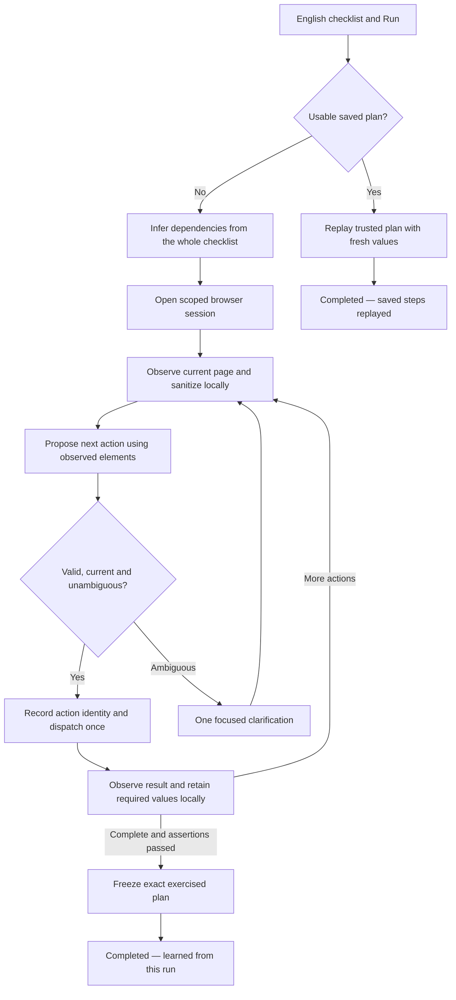

# Studio: plain-language tests grounded in live pages

**Status: approved wave design; OBS-001–004 closed, OBS-005 readiness amendment pending independent review.**

Original proposal: 2026-10-08 UTC. The initial review performed no product implementation; subsequent story gates record implementation separately. INPUT-POLICY-01 branch A was subsequently approved by the user; see the [decision record](../../../.aiox/waves/STUDIO-OBSERVED/input-policy-01.json) and [OBS-005 translation design](translation-design.md). An existing unrelated change to `backend/src/test/java/com/citi/put/checks/studio/compile/gateway/GenAiLlmGatewayClientTest.java` was left untouched.

## 1. Decision and intended experience

Replace required capture commands with natural-language authoring and automatic observation of the actual application. The user writes a checklist, selects the application/environment and presses **Run**. Studio understands page structure, resolves references to earlier results, and carries out the checklist in one isolated browser session.

Example:

1. Open the orders page.
2. Find the latest order and remember its order number.
3. Open the tracking page.
4. Enter that order number and search.
5. Check that the matching order appears.

Also support an implicit later request such as “Enter the number from earlier” when there is one evidenced, relevant predecessor. No `<capture>`, `<captured>`, selector, variable declaration, DOM upload or code review is required in the normal flow. Existing saved inputs remain optional advanced functionality.

**First Run is the actual first execution.** It learns while acting, then automatically saves exactly the exercised actions when successful and still bound to the same authoring/scope. It does not silently execute again to prove replay. A later deliberate Run replays saved operations, reading new values at their source steps, with no LLM call. Schedules stay off until explicitly enabled.

This supersedes the required-token UX in `docs/qa/evidence/ui-studio-live-20261007/reviewed-capture-proposal.md`. It retains execution-local values, bounded trusted operations, isolation and evidence protections, but replaces token-derived capture authorization with an explicitly reviewed scoped interpretation contract.

## 2. Alternatives and consensus

| Alternative | Strength | Why selected or rejected |
|---|---|---|
| Compile once using uploaded/static page HTML | Smallest extension to translation | Does not observe later authenticated pages, dialogs, results or changing values; manual uploads increase user effort. Available supplied hints may remain optional, never substitute for observed state. |
| First Run observes and learns; later runs replay | Grounds each action in reached state, supports implicit dataflow, preserves repeatability | **Selected.** Requires a session protocol, data-safe observation, an action ledger and explicit changes to first-run confirmation semantics. |
| LLM directs every execution | Can adapt on every run | Not selected for initial implementation: higher and variable cost/latency, less reproducible checks, especially for schedules. Unexpected replay drift stops and offers a new guided run instead. |

UX/product, architecture and QA/security reviewers reached consensus after two discussion rounds and a final document review. The coordinator reconciled differences: one Run instead of separate Learn/Run; automatic exact-plan adoption instead of another happy-path confirmation; both visible-text and positively classified nonsecret input-value reads; bounded DOM supplementation instead of accessibility-only evidence; durable locators instead of ephemeral snapshot references. See [review-record.json](review-record.json).

## 3. What is true today

- `PromptAssembler.java` and `GatewayPayloadSerializer.java` send source, context and compile contracts, not live pages. Authoring evidence metadata is not an implemented browser observation service.
- `ContextPromptSection.java` already fences global/per-step context. `ContextCompileInputs.java` and revision identities bind immutable inputs. These are reusable foundations.
- `studio-runner/src/validator/*` and `executor/*` enforce a restricted typed-operation engine. The actual runner exists; historical documents claiming no runner are stale.
- `ADR-SC-003-structural-reference-policy.md` removed the hand-written English intent grammar. Do not reintroduce regex translation or claim structural validation proves arbitrary English semantics.
- `CompilePipeline.java:309–314` currently forces full assembly on the reviewed path. Do not claim live incremental reuse from planner unit support alone.
- `docs/specs/studio-context/spec.md` §3.7 and `login-protected-navigation.md` already describe sequential observation/learning, but require separate Learn, review and confirmation. Their lifecycle must be explicitly amended for the new one-Run path. Their old 10.39 blocker and Playwright 1.57 notes are historical, not current gates.
- The current repository pins Playwright **1.63.0**. A sandboxed, isolated fixture probe exercised both `page.ariaSnapshot({mode:'ai'})` and `ariaSnapshotJSON`. It produced usable references and different observations for two page states.
- **The raw AI accessibility snapshot exposed the synthetic password input value**, ordinary input value, visible reference and injected page instructions. Hidden inputs/text and script contents were absent in this fixture. This proves that raw ARIA is not a safe gateway payload. See [snapshot-feasibility.json](snapshot-feasibility.json); all values are synthetic canaries.

This is code inspection and a snapshot API feasibility result, not proof that the proposed end-to-end product works.

## 4. One Run, two internal execution paths



### Planning before leaving a source page

A bounded initial model request sees the full checklist, stable step IDs and saved nonsecret context. It proposes relationships such as “the order number visible after step 2 is needed by step 4.” It does not fabricate a value or claim an unvisited page is observed.

That proposal establishes pending information needs. At the actual source state, Studio binds the need to an observed node and performs a trusted local read before navigating away. A later use reads an opaque execution-local binding. There is no copied sample literal in the saved plan.

Two plausible source fields cause one question using safe labels/regions. If a dependency is discovered only after its unobserved source disappeared, stop and explain the missing information. Do not silently navigate back, recreate an order, replay a submission or invent a historical value.

### State-dependent actions

Each source step may contain several internal actions, preserving its stable step ID and assigning action ordinals. After any state-changing action, observe the reached state before resolving the next action. A pre-submit snapshot cannot authorize a target in the resulting page or modal. Existing per-step statement bounds remain enforced; no silently omitted actions.

## 5. What the translation LLM receives

Each step/action proposal request contains:

- Versioned permitted operation/output contracts and the immutable authored task scope.
- Current authored step, stable step/action identity, relevant global context, and dependency needs derived from the full checklist.
- A bounded **sanitized observation of the current real page**, including opaque current-generation node IDs, allowed role/name/label metadata, element type, visibility/actionability facts, associated field/region/form relationships and approved stable selector hints.
- Relevant predecessor facts: which earlier step succeeded, which semantic value handle exists, its source field and permitted type. Resolved saved-variable values, account/secret bytes and runtime/page captures are excluded from every gateway channel. Deliberately authored nonsecret literals may be sent under INPUT-POLICY-01 branch A; trusted backend materialization and the runner retain their separate private input boundary.
- Coverage, truncation, session/document/state generation and observation identity. Missing information is represented explicitly.

Before materialization, a separate typed source-plan response proposes exact immutable source spans or authorized configuration references, never generated input bytes or server IDs. The subsequent response is a schema-constrained proposal referencing observed node IDs and opaque data bindings. It includes a durable replay locator and typed operation. It is not an executable arbitrary JavaScript program.

**Dated runner-boundary note — 2026-10-21 (AUTHORED-ECHO-01 local candidate).** For guided learning observations only, authored `nonsecretText` and `destination` values with `provenance.referenceKind = sourceSpan` are no longer registered for node withholding at initial context installation or append. Every value-bearing `configuration` input, resolved `secretRef`, `knownSecrets` entry and captured business value retains strict protection. Independent sensitive-DOM/current-control provenance still protects coincident bytes; authored provenance is not a global allowlist. No strict or token-bounded source-literal echo scrub is added, including after fill/select dispatch (A10 AE-4). Replay is unchanged. Existing hash-bound provenance supplies this decision: no wire, schema, contract-version or vocabulary change. Page metadata equal to a deliberately authored nonsecret literal may therefore appear in sanitized observations unless independently private.

The original A10 process gate required U13 before writing/proving code. The [2026-10-21 bounded architectural amendment](../../../.aiox/sdc/STUDIO-OBSERVED-ORCH/recovery-20261020/resume-close64/authored-echo-design.md) reconciles that gate with the latest user-authorized local implementation: a reviewable working-tree candidate and synthetic loopback proof are permitted locally, without real sensitive workflow use, merge or shared rollout. **U13 Security & Compliance acknowledgement remains pending and required before merge, shared deployment or real sensitive workflow use.** This note records neither external approval nor completion of AC-7.

**Snapshot policy:** start with accessibility and semantic DOM information; supplement an insufficient view with a narrow sanitized DOM neighborhood around relevant candidates. Include associated labels, input types, placeholders, stable IDs, form/region and permitted neighboring structure. This provides actual DOM context without attaching an entire raw document. A saved/uploaded profile, if offered later, is marked supplied and never promoted to observed evidence.

ARIA snapshot refs are useful local collection inputs. They are joined to actual DOM attributes/sensitivity policy before export: a password can appear as a generic textbox in ARIA. Snapshot refs belong to one document/state generation and cannot be replay selectors.

### Collection and privacy boundary

**Approved INPUT-POLICY-01 branch A:** immutable nonsecret checklist text, including literals deliberately written by the author, may reach the translation gateway. Saved variable references remain opaque; permission does not include their resolved values, credentials, account material or captured page values. Source provenance and configured model-data policy, with existing credential-pattern screening, govern classification before transmission; model confidence cannot classify source as safe. This is not universal secret detection or arbitrary-English semantic proof. The concrete production projection/classification and repair rules are in [translation-design.md](translation-design.md).

Use fixed trusted read-only collector code in the browser boundary. Never accept model-authored evaluation or DOM traversal programs. Collector additions may require a narrow reviewed extension to the current browser abstraction/confinement rules; they do not widen the authored executable language to arbitrary script.

Collect bounded relevant subtrees, not an unlimited whole-page dump followed only by truncation. Strip scripts, handlers, hidden content, input/value attributes, authentication material, cookies/storage, network bodies and unapproved attributes before transmission. Exclude sensitive fields/regions. Current input values and candidate business-data slots become opaque local handles; selected names and descriptions pass the same sensitivity policy and known-value scrubbing.

When label/value structure cannot be safely separated, mark the region withheld and expand permitted structural context or ask a focused clarification. Do not silently send raw text to make inference easier. Do not claim universal PII detection: approved labels can contain unknown sensitive text. The target/environment must have a configured model-data policy, and gateway-spy tests verify actual outbound bytes. Video is a separate sensitive evidence channel and may show on-screen values.

Page content is untrusted data. It cannot grant destinations, choose credentials, add steps, alter policy or request extra capabilities. Fencing alone is insufficient; proposed operations face independent validation and adversarial semantic tests.

## 6. Hidden dataflow and trusted operations

Introduce a versioned internal learned-plan contract, with server-issued stable binding IDs, producer step/action/read recipe, consumer step/action/argument slot, and provenance. Include its canonical hash in immutable revision identity. Derive hidden-reference policy from that bound learned plan plus recorded admission/Run provenance, not from the retired requirement for source capture tokens. This is invisible in ordinary authoring; an optional readable explanation can say “Order number from step 2 → Reference in step 4.”

Two distinct local read operations support the experience:

- Visible text from exactly one eligible observed source.
- Current form value from a positively classified nonsecret text control. Being `type=text` or merely not being a password is not sufficient authorization; field/region policy and source intent must permit the read.

Do not read password or hidden controls. Preserve accepted strings exactly, reject empty/whitespace-only values, reject oversize values rather than truncate, and keep one isolated value store per run. Same-origin reuse is the default; cross-origin value transfer requires a separately configured reviewed application policy, never model inference. This does not control a page's own form-action/network behavior.

The initial semantic interpretation is an LLM proposal under the user's recorded Run scope, not independent proof of English intent. Server validation enforces stable step association, operation vocabulary, authorized destinations/accounts, current evidence, binding types/order, allowed argument positions, action limits and immutable revisions. Genuine ambiguity pauses; a model confidence score never overrides these checks. No regex English grammar is introduced.

### Durable replay

A proposed action carries both a current-generation node reference and a durable replay locator. Immediately before dispatch, trusted code verifies that the locator resolves uniquely to the same target/document as the observation reference. Pin target/document for sensitive reads and fills; a changed target invalidates the proposal and triggers bounded re-observation before dispatch.

Freeze the **exact executed** locator, operation, read kind and dependency edge. Deterministically lower this canonical plan to the restricted replay artifact and verify operation equivalence. Do not regenerate code with another LLM and call it previously exercised. Ephemeral refs and sample values cannot appear as executable replay targets/data.

Future execution reads fresh source values at producer steps and resolves the same typed edges. Replay never invokes the model. Failed target/state guards stop and offer a deliberately initiated guided run; they do not silently self-heal or restart mutations.

## 7. Session, authorization and recovery contracts

The backend owns a durable authoring-session/action ledger bound to principal, CSI, environment, approved application origins/account, immutable source/configuration revisions, capabilities and expiry. The trusted runner owns the isolated live browser and raw values. The gateway remains backend-side; workers receive no model credentials or model-controlled browser handles.

Proposed commands/events are explicit versioned contracts: start guided run; return sanitized observation; propose/validate next action; admit action; advance once; report outcome; clarify; cancel/expire; finalize. Each action binds session ID, source step, ordinal, state generation, observation hash, canonical operation hash and idempotency identity. Authenticate these boundaries and recheck entitlement before advancement/finalization.

Persist admission before dispatch. Duplicate requests, reconnects and delayed callbacks retrieve the existing action state, never cause another dispatch. Use fenced session ownership so an old worker cannot act after takeover. If a dispatched action times out or acknowledgment is lost, mark `UNKNOWN_OUTCOME` and stop. Do not automatically repeat a click, submit, create, delete or fill after uncertain dispatch. This promises **at-most-once dispatch**, not exactly-once business effects on arbitrary websites.

Schema/proposal repair and read-only observation retries are allowed before dispatch within shared budgets. Retries that could interact with the application require a fresh justified action admission. Cancellation/expiry revokes future advancement, tears down the browser and drops local values; late callbacks cannot publish readiness.

### First-run confirmation amendment

The user's Run authorizes guided interpretation/execution within the displayed checklist and configured application/account scope. It does not authorize unrelated exploration. Policy-required confirmations remain; there is no extra technical confirmation for every normal click.

After successful requested assertions, whole-plan validation and unchanged source/scope, atomically publish the exact exercised plan and record its scoped Run authorization/provenance. This explicitly replaces the old separate Learn → compile → manual confirmation cycle for this path only. Failed/partial/uncertain sessions cannot publish a ready plan. If editing or publication conflict occurs after successful browser work, say **“Run completed; steps not ready to repeat.”** Never rerun to fix finalization.

The guided execution record and saved-plan replay record are distinct. “Learned from this run” does not mean “replay verified.” Do not link historical green evidence to a changed artifact. Schedules require separate explicit activation against the chosen revision.

## 8. Authentication, limits and caches

Use configured approved account references or a real connected same-session sign-in handoff. Authentication material remains inside the trusted browser/account boundary. No password paste into steps/chat, no inferred import of the user's local browser storage, and no cookies in evidence.

A “Sign in securely” or point-to-element UI is offered only if the product actually provides a trusted connected view of that same session. This is a required implementation workstream for interactive auth, not an existing capability. If there is no configured account or supported connection, stop with an actionable connection requirement before further steps. Pauses expire under the session budget.

Initial supported surface: the existing Chromium single top-level page, ordinary DOM controls and same-page dialogs/navigation, including later authenticated states once an account connection is configured. Frames/popups/canvas/closed-shadow workflows require separately implemented observation/action support; raw HTML attachment cannot solve them.

Cache only sanitized selector/profile hints within CSI, environment, application, principal/account-access scope and source/configuration identity. A timestamp, same URL or prior DOM hash never makes evidence current. Reobserve before acting; never cache/reuse runtime values, cookies, ephemeral refs or live sessions as compile examples. Defer cross-run evidence caching until this isolation is tested; static syntax/prompt prefixes may keep existing caching behavior.

Proposed initial configurable bounds (to verify in the feasibility phase, not measured capacity claims):

```yaml
studio:
  guided-authoring:
    max-session-seconds: 600
    max-actions: 200
    max-observations: 400
    max-model-proposals: 100
    max-model-input-tokens-total: 128000
    max-model-output-tokens-total: 32000
    max-observation-bytes: 32768
    max-observation-nodes: 500
    max-observation-depth: 8
    max-sanitized-evidence-bytes-total: 1048576
    max-runtime-values: 32
    max-runtime-value-bytes: 4096
    max-runtime-values-bytes-total: 65536
```

Enforce action and model budgets over the entire session, including repair, clarification and fallback, not anew for each step. Existing source-step/statement limits remain. Concurrency is bounded by configured worker/session capacity. Persisted sanitized evidence uses the existing authorized evidence lifecycle with an explicit retention policy selected before pilot deployment; raw snapshots are ephemeral and are not persisted. Report model calls, token usage and elapsed time without page values.

### 8.1 Amendment — authentication (2026-10-09)

The user/product owner decided that authentication in guided runs is **author-written login steps** that reference credentials as `<secret ID>`, exactly as nonsecret values use `<var NAME>` in the legacy compile flow. The "configured approved account reference", "same-session sign-in handoff", "Sign in securely" and "connection requirement" mechanisms above are withdrawn; the `AWAITING_AUTH` state and `AUTH_CONNECTION_REQUIRED` code are removed, and a run that reaches a sign-in page without login steps ends `LOGIN_REQUIRED` with guidance to add them. Secrets resolve by reference at dispatch through the existing Vault path and are filled only into password controls. Canonical design: [secret-login-design.md](secret-login-design.md). Other sections of this plan are unchanged.

### 8.2 Amendment — per-session input bound recalibration (2026-10-13)

**Decision (@architect, DECISION-1 in [architect-rulings-d1-d2.json](../../qa/evidence/STUDIO-OBS-012A/root/architect-rulings-d1-d2.json)); acknowledged by @pm (Morgan) on 2026-10-13 ([pm-ack-d1.json](../../qa/evidence/STUDIO-OBS-012A/root/pm-ack-d1.json)).** The `max-model-input-tokens-total` value in the §8 block above changes from `128000` to **`262144`**. This is both the product default and the upper bound. It covers `GuidedSessionProperties` (the `@DefaultValue` and the `limits` fallback) and `contracts/v3/limits.schema.json` `maxModelInputTokensTotal` (`maximum` = `default` = 262144). Every other §8 bound is unchanged, including `max-model-output-tokens-total: 32000`, the per-call output cap of 4096, the per-request input cap of 65,536 (hard max 131,072), the byte-as-token reservation with its +2048 allowance, and no-refund settlement.

Why: the §8 values were "proposed initial … to verify in the feasibility phase", and the STUDIO-OBS-005 joined fixture is that verification. Before STUDIO-OBS-007, the controlled 3-step clarify-plus-restart flow already reserved 121,589 of 128,000 (95.0%). The secret-login output contract that OBS-007 requires (+701 bytes, plus the v3 response schema) is sent on every request. With it, 7 proposals reserve 112,277, and the 8th cannot fit (projected about 128,320). As a result, `GuidedPlanningIntegrationTest` `[1] chosenIndex=0`, `[2] chosenIndex=1` and `[4] mutation=assertion` stop with `BUDGET_EXCEEDED` ([baseline-residual ledger](../../qa/evidence/STUDIO-OBS-012A/baseline-residual/ledger.json) DECISION-1, runs r0/r10). The ruling rejected changing the accounting, the prompt, the test flow or a test-only ceiling.

Limits of this value:
- **262,144 is not a measured real-workload capacity.** It is a byte-denominated reservation ceiling, equal to 4 × the per-request input cap of 65,536. It has been checked only against fixture flows, where the joined flow uses about 49%. Real-provider evaluation has not been run.
- **Recalibration is required from STUDIO-OBS-009 real-model runs (ADR-SC-005 D-C).** That work covers the input total and the output total together. Under production defaults, the output total (32,000 / 4,096 per call) limits a session to 7 proposals (`GuidedDefaultModelReservationIT`), so `max-model-proposals: 100` is not reachable (architect finding F-1). Raising the input ceiling does not change that. The calibration item is recorded in STUDIO-OBS-009 Dev Notes, and that story's ACs are unchanged.
- **Ownership:** STUDIO-OBS-012A owns this per-session ceiling (Lane C regenerates the schema and re-anchors pins; the baseline-residual @dev lane updates the Java default and test pins). STUDIO-OBS-014 AC-8 adds per-CSI concurrent-session and daily token budgets *in addition to* the per-session budgets. It does not own this ceiling.
- **Cost:** the worst-case reserved input per session rises by 2.048×. That is a ceiling, not expected spend, and flows that already fit cost the same. The USD 500 wave ceiling is the development/coordinator spend authorization and is unaffected. Aggregate production spend is capped by the STUDIO-OBS-014 AC-8 per-CSI daily token budget, which has to be Done before the OBS-009 pilot under the existing story order.

The `128000` figure in the §8 block is kept as the original proposal and is superseded by this amendment. Other sections of this plan are unchanged.

### 8.3 Amendment — per-session model budget sizing (MODEL-SIZING, 2026-10-18)

**Decision (@architect, STUDIO-OBS-009 MODEL-SIZING ruling, option A-ii, [ruling-draft.md](../../qa/evidence/STUDIO-OBS-009/execution-20261018/model-sizing/ruling-draft.md) §2-§7 and §10); acknowledged by @pm (Morgan) on 2026-10-18 (same file, §9.1).** In the §8 block above, and superseding §8.2 where they differ:
- `max-model-output-tokens-total` changes from `32000` to a default of **`98304`**, with a schema `maximum` of **`131072`**.
- `max-model-input-tokens-total` changes from `262144` to a default of **`786432`**, with a schema `maximum` of **`1572864`**.

These cover `GuidedSessionProperties` (the `@DefaultValue`s and the `limits` fallback) and `contracts/v3/limits.schema.json` (`maxModelOutputTokensTotal`, `maxModelInputTokensTotal`). Unlike §8.2, **the maximum is above the default.** Every other bound is unchanged: the per-call output cap of 4096, the per-request input cap of 65,536, `max-model-proposals: 100`, byte-as-token input reservation with the +2048 allowance, reserve-before-send, no-refund settlement, and the STUDIO-OBS-014 AC-8 per-CSI daily budget (640,000 output / 5,242,880 input).

Why: at 32,000 output and 4096 reserved per call, a session holds 7 proposals. The STUDIO-OBS-009 B7 fixture measured 13 for a 10-step base learn with an ideal model, so the AC-7 benchmark would fail by configuration whatever the model's quality. The sizing target is 24 proposals per session (13 measured, × about 1.85 for repairs and clarifications). Output and input move together, because raising output alone would make input the next wall. The ruling rejected a smaller per-call ceiling (truncation risk, since thoughts count as output), chunked learning (a product redesign) and a model change (no effect on the envelope).

Limits of these values:
- **24 proposals is a planning value from fixture data plus contingency, not a measured capacity.** STUDIO-OBS-009 T4 publishes the real distribution (proposals, repairs, reserved versus reported tokens per call, session wall time), and the ruling's §10 re-rule trigger (T-1..T-6) decides whether these values stand before STUDIO-OBS-010.
- **The maxima exist so recalibration needs no further contract change.** They are not a licence: running any deployment above the defaults needs a new @architect ruling with @pm acknowledgement, recorded in the AC-7 pinned-version block. No chart key sets these values.
- **Per-CSI capacity is set by calls, not sessions:** about 156 calls per CSI per day on the output side, and about 160 at a 32 KB input average. That is about 12 ten-step base learns, or 6.5 full-envelope sessions. The `application.yml` comment is corrected to match.
- **A first learn in one session covers about 20 steps with an ideal model,** and fewer with repairs. STUDIO-OBS-010 discloses this limit with the T4-derived figure. `max-source-steps` is unchanged.
- **Cost:** the worst-case reservation per session rises about 3×. The expected reservation per learned step is unchanged (per call), and daily spend per CSI stays bounded by the unchanged per-CSI budget.
- **Deployment:** the session schema epoch and the runner schema bundles change, so the backend and runner images roll out together.

The `32000` and `262144` figures in §8 and §8.2 are kept as history and are superseded by this amendment. Other sections of this plan are unchanged.

## 9. User-facing states

| State | Experience |
|---|---|
| Ready | Write checklist, choose application/environment, Run. Account uses configured connection. |
| Preparing | “Preparing your steps.” |
| Observing | “Understanding this page.” Automatically gather sufficient permitted context. |
| Acting | “Running step 3.” Live progress and recording. |
| Ambiguous | “Which order number?” with safe page labels/regions; one focused choice. |
| Authentication needed | Approved account choice or supported same-session sign-in; otherwise connection prerequisite. |
| Evidence insufficient | “I couldn’t identify that field.” Offer supported page selection/clarification, not selectors or DOM upload. |
| Guided success | “Completed — learned from this run.” No hidden replay. |
| Saved replay success | “Completed — saved steps replayed.” Fresh data, saved behavior. |
| Unknown action result | “Stopped — submission outcome unknown.” No automatic restart/retry. |
| Publication conflict | “Run completed; steps not ready to repeat.” Preserve execution evidence. |
| Replay drift | Explain affected step; offer an explicit guided run from the intended start. |

## 10. Implementation work packages and dependencies

1. **Contract and lifecycle design:** new ADR amending ordinary compile/learning boundaries and first-run confirmation; versioned learned-plan, observation, binding, session/action and result schemas; capabilities, auth, output policy, limits and API/MSW fixtures. Preserve legacy runs.
2. **Trusted observation:** extend `studio-runner/src/run/browser.ts`/adapter boundary with fixed collector; local sanitization, node/document mapping, narrow DOM fallback, coverage and outbound data tests. Use current pinned Playwright, not historical assumptions.
3. **Session execution:** backend durable ledger and scoped start/advance/finalize services; runner keepalive/control protocol, cancellation, ownership fencing, deadlines, at-most-once dispatch, same-session account integration. Do not retrofit this as untracked loops around `/execute`.
4. **Grounded translation and dataflow:** backend gateway prompt/schema methods for whole-checklist dependency planning and next-action proposals; trusted validation; current-node/durable-locator correspondence; local typed reads and consumers; no runtime values in model requests.
5. **Publication and replay:** exact operation/graph assembly, immutable identity/provenance, coordinated version pins and readiness checks; extend restricted runner language/policy for hidden references; LLM-free replay and fresh value acquisition. Keep gateway access confined to authoring services, preserving normal replay's no-LLM invariant.
6. **Studio UX:** extend `ChecksStudioPage`, `useRunGate`, API transports, progress/evidence views, clarification UI, optional readable flow summary and account/session states. No mandatory token UI. Mirror contracts in MSW; tests exercise actual live flow too.
7. **Integrated validation and pilot:** run the gates below; use approved fixture/staging applications first. Coordinated deployment and drain procedure, exact version compatibility and rollback rules must be written before rollout. New language/policy pins can require recompilation/relearning of affected tests; never relabel incompatible artifacts as ready.

Work packages 2 and 3 can progress independently after contracts; 4 joins both; 5 and 6 integrate after the session/dataflow contract is stable. Final live proof waits for the full joined path. Implementation proceeds through the user-authorized SDC gates; OBS-005 remains Draft pending independent readiness revalidation.

## 11. Validation plan and release evidence

Plan review is complete; implementation validation is pending. Freeze corpus, versions and thresholds before seeing real-model results. Contract tests alone cannot validate interpretation quality.

| Gate | Required evidence |
|---|---|
| Plain-language workflow | No tokens/manual variables/selectors; full novice checklist completes with implicit and explicit references to earlier data. |
| Fresh dynamic reuse | Fixture issues an unpredictable value after a prior action. Guided run and at least two later replays submit their own values; independent session-bound server receipts match; replay artifact hash stays identical. |
| No hidden replay | One receipt from first guided submission; finalization creates zero additional receipts. |
| Future-state grounding | Login/protected page, dialog, delayed results and changed later page prove observation at the reached state, including compound steps. |
| Binding correctness | Wrong-node/durable-locator mismatch, stale generation, ambiguous earlier values, missing source and copied sample literals do not perform the incorrect dependent action. |
| Semantic correctness | Independently verify action, target, value and assertion. Planted wrong-target, reversed-assertion, missing-submit and literal-substitution mutations must fail. No acceptance based only on model consistency. |
| Isolation | Overlapping runs and differing CSI/account/access scopes exchange zero values or observations. |
| Recovery | Duplicate requests/reconnects/stale callbacks produce zero repeated dispatches. Crash or lost acknowledgment after dispatch yields unknown outcome without replay. |
| Publication | Edited scope/source, failed/partial session, changed finalized code and late callback cannot produce an incorrectly bound ready revision. |
| Prompt injection | Page instructions cannot widen destinations/accounts/actions, override checklist, redirect dataflow or choose another plausible Submit. Test manipulation within the permitted vocabulary too. |
| Data boundary | Actual outgoing gateway bytes contain the deliberately authored nonsecret positive canary when required for interpretation, and zero planted resolved-secret/saved-variable/runtime-capture canaries, including password labels, descriptions, visible echoes, fallback DOM and truncation. Also verify diagnostics, raw output and manifests. Video is explicitly outside textual-redaction claims. |
| Authentication | Account selection/handoff uses the same isolated session; storage/secrets absent from prompts/profiles; unavailable connection is reported honestly. |
| Runtime bounds | Unicode byte boundaries, per-value/aggregate limits, action/observation/model limits, cancel/timeout and teardown behave predictably. |
| UI evidence | Guided vs replay identity is honest; recordings play and seek to source and consumer steps; ambiguity is understandable without technical syntax. |

Proposed pilot gate, to approve before running the benchmark: at least 30 held-out supported workflows across simple forms, multi-page dataflow, auth, ambiguity and dynamic state, with 3 real-model repetitions each; at least 90% end-to-end completion for unambiguous supported cases without clarification, and 100% safe pause/clarification in planted ambiguous cases. At least 98% replay completion over 100 stable-fixture runs. Zero false passes, unauthorized actions, duplicate dispatches or sensitive-canary leaks in the test corpus are hard gates. These sample-based thresholds do not prove arbitrary-site correctness.

Report denominators, seeded failure cases, p50/p95 latency, clarification rate, model calls, tokens and configured-provider cost per run. Do not promise a latency or cost target from unmeasured data. Separately run a formative test with at least five nontechnical users: each completes the supported workflow and resolves a grounded clarification without learning tokens/selectors or receiving developer instructions. Failures feed back into design before rollout; a simulated novice test is not a substitute for human validation.

## 12. Remaining limits and decisions accepted in the proposal

- Natural-language interpretation remains fallible. Structural checks, observed targets and independent outcomes improve confidence; they do not mathematically prove intent.
- Selected labels may contain unknown sensitive data, and application pages may attempt prompt injection. Minimized scoped observation and approved model-data policy are required.
- Same-origin value reuse does not prevent an application's own outbound requests. Existing application/network controls remain relevant.
- Video can show page data. Evidence access/retention must reflect that.
- Poor accessibility can often be resolved through bounded semantic DOM context; some custom controls remain unsupported until a trusted collector/action method exists.
- First-run semantic planning, observation and model calls add latency and infrastructure scope. The proposal is a new authoring/execution lifecycle, not a prompt-only adjustment.
- Interactive auth/session viewing and nontechnical usability results are implementation/pilot gates, not available or validated capabilities today.

## Sources and review basis

Repository: current `studio-runner` validator/executor/browser and backend compile/context paths; `ADR-SC-003`; historical `docs/specs/studio-context` requirements cross-checked against code; previous live test evidence. Snapshot probe: pinned Playwright 1.63, sandbox enabled, synthetic local page, no LLM or external account.

Primary references: [Playwright accessibility snapshots](https://playwright.dev/docs/aria-snapshots) describe accessible structure capture; [locator documentation](https://playwright.dev/docs/locators) explains semantic locators and their fresh resolution; [actionability documentation](https://playwright.dev/docs/actionability) describes built-in readiness checks. Those APIs support the collector and action mechanics; they do not provide this proposal's privacy policy, intent validation or once-only orchestration.
