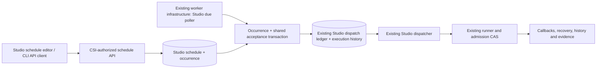

# Studio scheduling: proposed brownfield architecture

Status: **planning proposal; no production implementation or release approval**. Reviewed against the working tree on 2026-10-05, including pre-existing uncommitted Studio changes. Aria architecture analysis for Orion's delegated planning workflow.

## 1. Requirements and boundaries

The governing requirement is [Studio architecture §7](../../../architecture/studio-execution.md#7-scheduling-and-platform-integration-post-v1), especially lines 227–231: extend worker due-work selection and schedule administration; reuse acceptance, readiness, authorization, quotas and the existing dispatch ledger; never compile implicitly; expose `COMPILE_REQUIRED` for unready scheduled work; never send ambiguous UI attempts through generic automatic retry. [ARCH.md:373](../../../../ARCH.md#71-core-tables) explicitly says current schedule/status fields do not establish working scheduling. PRD lines 78, 111 and 115 classify Studio scheduling as post-V1. The present request authorizes planning this extension, without changing those historical V1 boundaries.

The proposed first delivery schedules one saved individual test, with one schedule per test. Suites, dependency graphs, arbitrary execution overrides, another scheduler product, and unified check/dashboard/report integration are outside this first delivery. Individual-test scope and one-schedule cardinality are planning assumptions for product validation, not requirements already established by the current Studio contracts.

Every decision marked **proposed** below must be adopted in the scheduling product specification and reviewed before implementation. Existing behavior is marked **observed**. References name working-tree source lines, which can move as existing work is committed.

## 2. What exists and what is missing

| Area | Observed source evidence | Consequence |
| --- | --- | --- |
| Legacy Studio scheduling metadata | `backend/src/main/resources/db/migration/V5__story_3_schema_additions.sql:7`; `studio/entity/UITest.java:70`; `studio/dto/UITestDto.java:62`; `docs/specs/studio/openapi.yaml:2306` | `status` and a JSONB column exposed as a string have no typed operational scheduler contract. Do not activate legacy metadata automatically. |
| Ordinary check scheduling | `scheduling/entity/Schedule.java:23`; `scheduling/ScheduleService.java:59`; `scheduling/ScheduleRepository.java:60`; V1 `schedules.check_id` FK; V9 `check_type` | Schedule creation requires a real `checks` row. Selection is by check type. A Studio test UUID cannot be used as `checkId`. |
| Ordinary check dispatch | `scheduling/CronDispatcher.java:167`, `:205`, `:228`, `:231`, `:269` | Due rows become ordinary `CheckExecutorDispatcher` executions after commit. There is no call to Studio acceptance, no durable Studio occurrence and no atomic history/ledger insertion in this path. |
| Check retries | `scheduling/RetryDispatcher.java:139` | Retry creates a fresh execution UUID and invokes the ordinary executor again. It must remain outside Studio browser scheduling. |
| Studio atomic admission | `studio/dispatch/StudioAcceptanceService.java:164`, `:170`, `:195`, `:233`, `:235` | Reusable test-row lock, readiness gate, immutable revision selection, reference preflight, quotas and history+ledger+idempotency transaction. It does not yet record a schedule occurrence or source. |
| Readiness | `studio/readiness/ExecutionReadinessService.java:91`, `:149`, `:181`, `:199`, `:225`, `:246` | Current draft must match its confirmed revision, hashes, reference policy and runtime pins. `compile_status` is deliberately absent. Failed optional recompilation of unchanged content does not itself invalidate readiness. |
| Immutable revisions | V12 lines 16–38 and 52–92; `studio/dispatch/StudioAcceptanceService.java:240`; `:359` | Runs retain the confirmed revision and nonsecret configuration accepted for that run; later edits must never change an accepted run. |
| Worker execution | `studio/dispatch/StudioDispatchScheduler.java:33`, `:47`, `:68` | Existing worker/local execution infrastructure and bounded dispatcher pool can be reused. API-profile processes do not own the Studio dispatch poller. |
| Browser safety | `studio/dispatch/StudioDispatcher.java:336`, `:369`; `studio/recovery/PendingReaper.java:19`; Studio architecture §5.1/§7 | Commit attempt identity before send; requeue only definite refusal or pre-send conditions; ambiguous attempts remain under recovery. |
| Quotas and selection | `studio/dispatch/StudioAcceptanceService.java:299`; `studio/StudioExecutionProperties.java:125`; `studio/dispatch/StudioDispatchLedgerStatements.java:153` | Global/per-CSI bounds count all ledger rows whose state is not `DONE` (despite “pending” terminology). Dispatcher selects oldest accepted claimable work. This is not a demonstrated CSI-fair scheduler. |
| Authentication | `studio/StudioService.java:930`; `studio/dispatch/ProvisionalDispatchAuthorization.java:10`, `:33` | Manual execution intentionally permits every authenticated application user; CSI ownership remains required for authoring/read/cancel. Dispatch recheck is provisional and does not resolve live background principal entitlements. |
| Secrets | `studio/secrets/ConfiguredSecretUseAuthorization.java:8`; `studio/secrets/VaultStudioReferenceResolver.java:79`, `:117` | Secret-use policy is a separate, fail-closed decision. Current configured entitlement implementation is development-only; PUT Core production principal policy is unwired. |
| Cancellation | `studio/StudioService.java:965`; `studio/dispatch/StudioDispatcher.java:205`; V20 migration | Existing cancel closes queued work or records/relays cancellation for dispatched work. Schedule pause and cancellation of a run are different actions. |

All shortened Java paths above are under `backend/src/main/java/com/citi/put/checks/`; migration names are under `backend/src/main/resources/db/migration/`.

## 3. Recommended integration and alternatives

**Proposed:** add typed Studio schedule administration and due-occurrence production on the existing Spring worker infrastructure. The due producer calls the existing Studio acceptance core; the existing Studio dispatcher, runner, callbacks, SSE, evidence and recovery own execution. No direct runner call from the schedule poller. No `failed_dispatches` record for a Studio occurrence.



| Option | Assessment |
| --- | --- |
| **Typed `studio_schedules` and `studio_schedule_occurrences` beside ordinary schedules** | **Recommended.** Reuses scheduler infrastructure and executable lifecycle without pretending a Studio definition is already a unified check. Preserves FKs, reliable indexed due selection and explicit occurrence audit. Requires a forward-only migration and typed API. |
| Extend `schedules` with mutually exclusive `check_id` / `ui_test_id` targets | Possible future consolidation, but changes the §7 ordinary-check schema, repository joins, visibility, CRUD, uniqueness and capacity selection. Requires a wider regression scope and an explicit target-model decision. |
| Turn `ui_tests.schedule` JSON/string into operational source | Can avoid a new schedule-definition table, but still needs typed server validation, concurrency/versioning, due indexes, occurrence audit and a migration of unknown legacy values. It does not remove the difficult work and carries more metadata ambiguity. |
| Create a `UI_TEST` check and use ordinary dispatch/retry | Depends on the currently unspecified unified association; ordinary retry semantics violate Studio ambiguous-attempt safety. Not suitable for this MVP. |
| Quartz or a new queue | Neither is necessary to solve durable occurrence acceptance with the existing PostgreSQL/worker architecture. ARCH line 130 mentions a historical Quartz scale direction while deployed code uses ShedLock plus Studio SQL claims; any framework transition deserves a separate ADR. |

“Reuse the scheduler” means reuse worker scheduling, configuration/health/metrics and cron parsing, **not** reuse the ordinary check execution/retry path. A `StudioSchedulePoller` under worker/local profiles is a due-work extension, not an independent execution engine. Prefer separate bounded polling work from browser sends; do not perform slow admission work on Spring's shared timer thread.

**Proposed rollout:** a separate scheduling capability flag defaults off and gates schedule mutation/activation plus worker due polling. Read-only schedule/occurrence state remains accessible for inspection; disabled clients display capability unavailable rather than apparent success. Existing `studio.execution.enabled` continues to govern acceptance, and the existing worker dispatcher/reapers keep running to close or recover already accepted work. Do not use disabling the dispatcher as the scheduling feature switch. API processes expose administration but never own due polling. Evidence: `application-worker.yml:11`, `:20`, `application-api.yml:8` and `helm-chart/put-checks/values.yaml:750` already distinguish roles and the acceptance/dispatcher switches. Expand schema first; update all API/worker instances before enabling scheduling; prove older authoring instances cannot save executable edits without schedule invalidation, or enforce safe invalidation in the database/shared readiness gates during overlap.

## 4. Proposed data and API contracts

The following describes conceptual records, not approved DDL. [Dara's database review](database-review.md) supplies ownership/state/index/linkage alternatives and retention findings. E-02 must close DB-05 ownership enforcement, DB-09 nominal-versus-eligible polling and DB-10 stable recreate anchor/replay horizon, including the circular-linkage option, before DDL. These are documented design choices, not silently adopted alternatives.

| Record | Required proposed fields/invariants |
| --- | --- |
| `studio_schedules` | Stable UUID/deduplication anchor across removal/recreation; unique `test_id` FK; immutable CSI copied/validated from the test; normalized cron; IANA timezone; requested enabled flag; effective state (`ENABLED`, `PAUSED`, `BLOCKED`); `blocked_code`; nominal `next_due_at`; separate eligible-poll `poll_after_at`; monotonic schedule version; activated confirmed revision ID; execution principal reference; creator/updater and activation audit. Never stores bearer tokens or resolved secrets. |
| `studio_schedule_occurrences` | Stable UUID; schedule ID/version; immutable test/CSI/principal/activation-revision snapshot; nominal `scheduled_at` UTC; local slot/zone/offset for audit; decision (`ACCEPTED`, `REFUSED`, `SKIPPED`, `DEFERRED`); stable decision code; optional execution UUID and history partition locator; accepted/decision timestamps; bounded redacted detail. Unique `(schedule_id, schedule_version, scheduled_at)` plus a version-independent unique `(schedule_id, timezone, local_scheduled_at)` for concrete slots, and immutable execution linkage. UTC uniqueness alone cannot prevent a second wall-clock slot after an activation/version change. |
| Existing `ui_test_executions` | Add immutable trigger attribution (`MANUAL`/`SCHEDULED`, nullable schedule ID/version/occurrence ID/nominal due instant). Existing revision and configuration snapshot retain their existing meaning. Legacy history has unknown/legacy trigger attribution, never fabricated activation metadata. |
| Existing ledger | Reuse globally unique execution UUID. Add nullable `scheduled_occurrence_id` UUID, unique and FK to the occurrence. For scheduled rows, both existing manual `idempotency_key` and `request_digest` must be null, enforced by a CHECK. Keep existing manual unique `(principal, idempotency_key)` unchanged. Internal typed `ManualIdentity` / `ScheduledOccurrenceIdentity` admission prevents public callers from selecting a scheduled identity. |

Index enabled schedules by eligible `poll_after_at` (with stable ID and reviewed CSI rotation support), plus CSI/test occurrence history and linked execution lookup. `next_due_at` remains the nominal occurrence cursor during deferral; bounded backoff changes only eligible polling and retry metadata. Preserve immutable revisions and avoid destructive cascades through schedule history. Keep a stable tombstone/anchor across removal/recreation or adopt the explicitly reviewed independent anchor option; fresh IDs cannot reset local-slot protection. Retention must preserve deduplication for the agreed replay horizon and handle pruned history locators honestly. Execution identity belongs to the durable unpartitioned ledger; the immutable history partition locator is a soft lookup value. E-02 must choose either a join through ledger's unique occurrence FK or duplicate occurrence linkage with a reviewed deferred occurrence→ledger FK and supporting unique locator pair. Avoid an FK into partitioned history that would obstruct retention/partition detach; an execution UUID alone is not that table's physical key `(id, started_at)`.

Do not allocate a Flyway version number now: V25 is already an uncommitted change in this working tree. Reserve the next available migration version when the implementation branch is finalized. Do not rewrite V1/V5 or prior deployed migrations.

**Proposed routes:**

- `GET /api/v1/studio/tests/{testId}/schedule`: typed schedule or `null`, authorized using the test's registered CSI.
- `POST /api/v1/studio/tests/{testId}/schedule`: create one schedule, with cron/timezone, initially paused by default; duplicate returns conflict.
- `PUT /api/v1/studio/tests/{testId}/schedule`: update with expected schedule version; stale version returns `409`.
- `PATCH /api/v1/studio/tests/{testId}/schedule/enabled`: pause or explicitly activate/resume; resume supplies expected schedule version and confirmed revision ID. Response discloses the revision and runtime/authorization verdict.
- `DELETE /api/v1/studio/tests/{testId}/schedule`: stop future scheduling and retain attribution/history.
- `POST /api/v1/studio/schedules/preview`: read-only normalized cron + timezone validation and next five UTC/local occurrences; same resolver as due producer.
- `GET /api/v1/studio/tests/{testId}/schedule/occurrences`: paged CSI-authorized history, including refused/skipped decisions without fabricated browser runs.

Schedule write operations require existing CSI `canWrite`; reads reuse `canRead`. Refuse nonexistent/inaccessible resources using Studio's existing nondisclosing resource behavior. The API is usable with CLI HTTP clients before UI delivery. A service principal is selected from platform-approved identities authorized for this CSI/environment; never trust an arbitrary client `principal` string. Canonical cron and typed response replace the string-shaped metadata as the operational source. Keep deprecated legacy fields nonoperational or project them explicitly; never maintain two writable schedule sources.

## 5. Atomic occurrence processing and idempotency

**Proposed transaction boundary:** occurrence decision, accepted history/ledger/idempotency and schedule advancement commit together. A process crash cannot advance a schedule while losing its accepted execution, and cannot create a new browser run when resolving the same occurrence again.

1. Poll a bounded set of candidate due tests, rotating across CSIs. Candidate discovery is advisory; the final transaction re-reads every relevant value.
2. Process one test per transaction, locking test then schedule then existing occurrence, followed by existing global and CSI quota locks when admission needs them. All schedule write/activation/deletion paths use the same order. Admission already locks the test first (`StudioAcceptanceService:170`). For concurrent worker selection, use native `FOR UPDATE OF test SKIP LOCKED` followed by the schedule lock; avoid holding a schedule lock while waiting for a test lock because save/delete/activation may take the opposite order. Explicitly test ORM persistence-context refresh and native lifecycle reads. Read overlapping ledger state without locking ledger rows while holding the test: callbacks may update execution/ledger before projecting test summaries, so an extra ledger lock could invert that order.
3. Under those locks verify enabled/version/due instant, lifecycle, current readiness and equality of the currently ready confirmed revision to the activated revision. Resolve any already-recorded occurrence to its existing decision/execution; do not evaluate a later revision as a new request.
4. Evaluate configured misfire and overlap policy. Create or update the unique occurrence record. A readiness refusal creates a terminal explicit `COMPILE_REQUIRED` occurrence outcome, blocks the schedule, and creates no synthetic confirmed execution or runner send. Other readiness failures keep their own codes.
5. For an eligible occurrence recheck the approved background identity and secret authorization, then call the shared acceptance core in the same transaction. Keep existing test lock, global then per-CSI quota-lock order, reference preflight, immutable snapshot and history+ledger guarantees. Supply typed `ScheduledOccurrenceIdentity(occurrenceId)` and enforce its unique nullable ledger FK; leave manual keys/digests null. A reserved string prefix alone is insufficient because manual callers can supply arbitrary public keys. Linkage ordering follows the E-02 choice: derive run linkage by joining the ledger occurrence FK, or preallocate occurrence/execution IDs and use a reviewed deferred occurrence→ledger FK to validate duplicate linkage at commit. Do not assume a temporary ACCEPTED occurrence without required linkage satisfies final schema constraints. Occurrence and all accepted work commit together.
6. On acceptance link the occurrence to the execution and advance to the first future eligible due slot. Browser dispatch happens later from the committed ledger. On pre-acceptance temporary saturation/infrastructure failure leave that same deferred occurrence with bounded retry time/grace cutoff and unchanged nominal cursor; advance only `poll_after_at`. Never create multiple executions for it. Once accepted, temporary dispatch saturation belongs to existing ledger/recovery, not occurrence re-acceptance. On pre-acceptance grace expiry settle the occurrence visibly and move to a future due slot.
7. Commit. SQL/constraint/infrastructure transaction failure rolls all modifications back. The next poll reuses the same nominal occurrence identity. Once an occurrence is `ACCEPTED`, only execution recovery can operate on its run; the due producer cannot create a replacement execution for that occurrence.

**Acceptance refactor trap:** existing `accept()` is `@Transactional` and throws exceptions for refusals. An outer scheduled transaction that catches those exceptions can still be marked rollback-only by Spring, so simply calling it and then saving `COMPILE_REQUIRED` in the same transaction is incorrect. Extract a shared admission core that returns a typed `Accepted | Refused | Deferred` result for expected business outcomes before writes, and have the manual HTTP adapter translate refusals after the transaction finishes. Unexpected SQL failures still roll back. Do not add `noRollbackFor` around arbitrary persistence failures or attempt to read after a unique-constraint violation. Preserve the existing manual request digest and idempotency race resolution (`StudioAcceptanceService:266`, `:279`, `:340`). A staged alternative may settle refusal in a fresh independently locked transaction after rollback; it must revalidate the same occurrence identity and schedule version and prove races before adoption.

The activated revision guards against silently adopting a newly confirmed artifact. Name/description edits leave scheduling ready. Execution-affecting edits block scheduling with a visible confirmation-required state. Confirmation alone never resumes a blocked schedule; an authorized explicit Resume acknowledges the exact new executable revision. Accepted runs remain on their earlier immutable revision, regardless of later draft edits or schedule versions.

## 6. Proposed clock, backlog and overlap policy

| Topic | Proposed first-delivery decision | Why / validation |
| --- | --- | --- |
| Cron format | Reuse Spring parser with five-field inputs normalized by prepending seconds `0`, return canonical six-field cron; reject nonzero seconds for minute-granularity MVP | Existing `ScheduleService:190` supports normalization. Prevent ambiguous client grammar or subminute Studio bursts. |
| Cadence | Minimum 60 seconds by default, configurable server constraint; require a next occurrence | Matches existing ordinary scheduling default (`ScheduleService:48`) as a starting assumption, not validated Studio capacity. Existing two-sample UTC gap test is insufficient for irregular cron minimums; test bounded year/cycle patterns and timezone behavior or constrain supported expressions. |
| Timezone | Persist valid IANA region or UTC; default UTC only when omitted; never infer browser/OS timezone | Avoid `EST` ambiguity. Display zone, UTC instant and actual offset in preview. |
| DST gap | Skip a nonexistent local slot; next valid calendar occurrence | Verified parser behavior below; do not move 02:30 to 03:30 and change the user's selected wall time. |
| DST overlap | One execution per matching local clock slot, choose the earlier offset | Spring parser does not implement this product policy automatically. Resolver must suppress the second overlapping local slot deterministically; previews and due selection use exactly this resolver. |
| Misfire | Skip historical backlog; at most the latest eligible due slot can be considered inside a proposed configurable five-minute grace. Older slots become a bounded skipped-range audit, not a browser catch-up burst | Handles ordinary poll delay while avoiding unattended replay after downtime. Explicitly report missed range/count. Exact grace requires PM/capacity approval. Bound cron iteration; do not enumerate years of missed minutes in one transaction. |
| Quota/temporary outage | Defer the same not-yet-accepted occurrence within grace; avoid repeatedly selecting that CSI in the same pass; settle expiration visibly | Does not inflate execution history or fill active quotas with errors. Once accepted, existing pending SLA governs queue time independently. |
| Overlap | Skip a scheduled occurrence while **any** run for that test has a non-`DONE` ledger state, including manual runs, admission/finalization and ambiguous attempts | Prevent scheduled work starting alongside ongoing manual work. Does not change manual execute authorization or promise to suppress deliberate concurrent manual runs. Checking and acceptance share the test lock. |
| Terminal uncertainty | Block future recurrence after a relevant run closes with `DISPATCH_UNKNOWN` or `STALE`; explicit investigation and authorized Resume acknowledge the execution and start only future slots | `DONE` is a ledger terminal state, not proof that browser side effects are known. Record the acknowledged uncertainty identity in activation audit. Due admission checks for unacknowledged uncertainty, including a raced manual run; closure must not silently restore recurrence. Scope of other uncertain codes requires review of their exact recovery semantics. |
| Pause/remove | Stops future acceptance after the pause transaction commits. An already accepted run remains governed by its immutable snapshot; explicit Cancel handles that run | Pause must serialize with occurrence acceptance. No implicit cancellation from pausing or deleting the schedule. |
| Test delete/quarantine | Stops future acceptance and preserves existing pre-send lifecycle denial for queued accepted work; already admitted work remains under current recovery/cancel | Distinct from schedule pause/removal: existing dispatch authorization rechecks deleted/quarantined drafts. Scheduling does not override that source policy. |
| Resume | Revalidate lifecycle, exact confirmed revision, runtime compatibility and background authority; acknowledge a revision; calculate next occurrence strictly after resume time | Does not execute missed paused work or automatically activate newly edited content. |
| Kill switch | New schedule acceptance obeys `studio.execution.enabled`; suspension/missed slots are observable; recovery/cancel continues | Existing dispatcher closes queued undispatched work on disable (`StudioDispatcher:180`). Re-enable does not resurrect closed runs. Schedule-intent state stays visible and resume/clock policy must be explicit. |

### Exact DST finding, independently reproduced

The working tree pins Spring Boot 3.3.5 (`backend/build.gradle.kts:3`) and the locally resolved Spring Framework jars are **6.1.14**. A read-only JShell probe on 2026-10-05 used cached `spring-context-6.1.14.jar` and `spring-core-6.1.14.jar` with Gradle's JDK 21.0.10. For `CronExpression.parse("0 30 1 * * *")` and `America/New_York`, successive `next()` calls produced:

```text
2026-11-01T01:30-04:00[America/New_York] -> 2026-11-01T05:30:00Z
2026-11-01T01:30-05:00[America/New_York] -> 2026-11-01T06:30:00Z
```

For `0 30 2 * * *` after `2026-03-08T01:00-05:00`, the next result was `2026-03-09T02:30-04:00`: the nonexistent spring-forward slot was skipped. This is direct verification of the installed dependency, not an assumption from library commentary. `CronDispatcher.java:332` claims fall-back never duplicates; it is incorrect for local clock slots. `DstBoundaryTest.java:69` only asserts two UTC instants increase, and its daily 02:00 test does not use the repeated 01:00 hour. Strengthen these tests before adopting the resolver. Reference the [official Spring CronExpression API](https://docs.spring.io/spring-framework/docs/6.1.14/javadoc-api/org/springframework/scheduling/support/CronExpression.html) for parser syntax, while the behavior above is established by the actual dependency probe.

ShedLock can reduce concurrent polling but is not an occurrence ledger. Its [official README](https://github.com/lukas-krecan/ShedLock) warns that exceeding `lockAtMostFor` can leave multiple processes holding the apparent lock. Database uniqueness and atomic acceptance remain mandatory even if a poller lock is retained.

## 7. Background execution identity and secrets

**Proposed production default:** execute under a platform-approved service principal scoped to CSI/environment, with the human schedule creator/activator recorded separately. The principal represents approved unattended browser activity; do not persist a user's session token or reconstruct stale interactive authentication. Identity type, grant reference, policy identity/version, creation/activation and revocation audit must remain explicit.

At create/activation check both the human's CSI schedule-administration permission and whether that approved execution principal may run unattended work and use each declared secret. At occurrence acceptance and immediately before runner send recheck the live grant. Unknown identity/grant lookup and revoked permissions fail closed. A withdrawn background grant blocks future scheduling with a visible reason; resumption requires explicit authorization repair and Resume. Do not silently change the execution principal when ownership changes.

This is a **real platform integration blocker**, not a capability already supplied by `ProvisionalDispatchAuthorization`: that implementation checks lifecycle/CSI/nonempty principal but does not resolve service principal grants. `ConfiguredSecretUseAuthorization` expressly documents development-only entitlements and says PUT Core owns production policy. Keep those adapters available for deterministic local/MSW demonstrations, without claiming production revocation acceptance has passed.

If PUT Core requires delegated human identity instead of service principals, adopt its renewable grant and revocation semantics after the platform decision. Record the grant reference and human subject; never a long-lived copied token. Owner departure/expiry must block visibly. This alternative changes identity integration, not occurrence/revision/browser-safety invariants.

Secret names are immutable revision declarations; resolution remains just before runner send with current Vault versions and allowed origins (`VaultStudioReferenceResolver:117`). Values are erased and absent from schedule/occurrence/history/ledger/SSE/logs. Current preflight does read and erase secret material (`:79`) within acceptance; any scheduled refactor retains its authorization and bounds and must use bounded Vault calls to avoid long-held global quota locks. Rotation should not require recompiling unchanged references; reference disappearance/withdrawal yields explicit authorization/reference outcomes using existing semantics. Do not introduce a default permissive scheduler entitlement.

## 8. Fairness, observability, recovery and checks

**Proposed:** bounded CSI-rotating due selection with per-pass per-CSI budget and an attempted/deferred exclusion set, plus existing active quotas. A full CSI must not monopolize the earliest due rows or block other CSIs; no immediate same-pass retry loop. Manual and scheduled runs share execution quotas and the existing dispatcher. FIFO dispatch remains observed behavior, so creation-side fairness does not establish guaranteed browser-start latency; add load-test evidence and consider a later shared dispatch fairness policy only if required.

Expose counts and lag for due, accepted, blocked, skipped-misfire, skipped-overlap, deferred-capacity and expired occurrences; active schedule state and next due time; trigger/source in run details; immutable schedule/revision/principal attribution; links from occurrence to existing run/video where a run exists. Keep labels bounded (do not tag metrics with every test/occurrence UUID). Separate nominal due time, acceptance time and browser start. A refused occurrence cannot have video or a fabricated browser duration.

No change is needed to the runner dispatch body for scheduling attribution: it executes the accepted revision. Do not add job-supplied callback URLs or arbitrary scheduler credentials. After acceptance the existing kill switch, admission CAS, cancel, manifest reconciliation, finalization and reapers remain authoritative. An ambiguous attempt may end unknown/stale; that is not a request to automatically repeat UI effects.

Existing tests are reusable evidence targets, **not newly run results**:

- `studio/dispatch/AcceptanceIT.java:72`, `:123`, `:219`, `:242`, `:253`: atomic history/ledger/idempotency, concurrent acceptance, unchanged confirmed readiness, changed content refusal and quotas.
- `studio/dispatch/DispatcherIT.java:116`, `:269`, `:378`, `:417`, `:483`, `:528`, `:574`: immutable artifact, skip-locked claims, multiple dispatchers, commit-before-send, ambiguity, revocation and pre-send Vault deferral.
- `studio/readiness/ExecutionReadinessTest.java`, `DeReadyCarryForwardTest.java`, `SweepDoesNotDeReadyIT.java`: reuse actual readiness rather than `compile_status` heuristics.
- `studio/recovery/RecoveryIT.java:115`, `:133`, `:226`, `:241`: crash before send, after admission, during execution and after manifest.
- `studio/CancelIT.java`, `studio/dispatch/LedgerCancelTransitionsIT.java`, `studio/RevisionRetentionIT.java`: cancellation serialization and historical revision retention.
- `scheduling/ScheduleValidationIT.java`, `ScheduleAuthzIT.java`, `ShedLockCronDispatcherIT.java`, `DstBoundaryTest.java`: ordinary scheduling regressions and stronger exact DST acceptance.

Test file names above are relative to `backend/src/test/java/com/citi/put/checks/`. New acceptance evidence must include two workers selecting the same occurrence, transaction rollback at every persistence boundary, schedule pause/edit/confirm races, activated-revision mismatch, deferred occurrence expiration, single local slot across DST overlap and activation changes, gap/month-end/year boundary, long downtime with bounded iteration, saturated CSI fairness, manual-run overlap, uncertainty closure without automatic recurrence, public keys unable to alias scheduled occurrence identities, service-principal revocation between acceptance/send, secret rotation, kill-switch suspension, partition retention, and migration of legacy metadata without unintended activation. Unit checks alone cannot establish multi-replica/PostgreSQL correctness.

## 9. Decisions and blockers for planning handoff

1. **Product adoption required:** individual tests/one schedule; minute-granularity cron; five-minute grace; skip backlog/overlap; one local DST slot; explicit Resume after revision change. These are proposed safe unattended defaults, not silently approved requirements.
2. **Platform/Security production dependency:** approved background identity and live grant/revocation/secret-use integration; destination controls and real external staging evidence remain governed by the existing Studio prerequisites. Local adapters cannot close this dependency.
3. **Schema/API decision:** typed Studio tables versus wider polymorphic schedule change, immutable trigger attribution, retention and refusal-occurrence presentation. Do not revive unspecified unified-check integration to sidestep the decision.
4. **Implementation-critical design:** shared acceptance returns business outcomes safely under an outer transaction; fixed test/schedule/quota lock order; durable occurrence identity independent of the poller lease; no generic browser retry.
5. **Verification gap:** existing DST test names overstate coverage. The dependency probe demonstrates the repeated wall time; the proposed overlap suppression needs exact automated tests before release.

Architecture planning can proceed to dependency-ordered stories after these assumptions are recorded. Production enablement remains contingent on real background authorization and externally gated Studio controls; this document does not claim those integrations or tests have passed.
