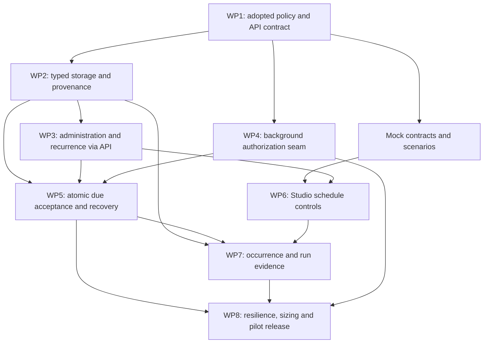

# Studio test scheduling — dependency-ordered build plan

Date: 2026-10-05. Owner: Morgan (PM), coordinated by Orion. Status: **Draft epic and work-package briefs; not approved specification or lifecycle stories.** Planning-only deliverable. No application code changed, release approved, implementation tests run or delivery dates estimated by this plan.

The baseline is the current dirty working tree, including existing Studio work. Reconfirm affected contracts and migration versions after that work lands. Read [discovery](discovery.md), [requirements and decisions](requirements.md), [architecture](architecture.md) and [UX](ux.md) together. Requirements IDs below refer to the scoped draft, so proposed requirements require validation before story readiness.

## Workflow and ownership

Use the declared `brownfield-fullstack` workflow in planning mode: Atlas discovery → Morgan requirements/epic → Aria architecture with Dara database review and Uma UX → Pax consistency/acceptance review → River lifecycle story drafting and Pax readiness validation. Implementation later follows story-driven development with Dex, Quinn's independent quality verdicts and Gage's repository/release authority. There is no claim the entire interactive workflow has completed.

**Proposed single epic: Scheduled execution of confirmed Studio tests.** The epic delivers trustworthy unattended execution, administration and evidence for individual saved tests. It crosses persistence, authorization, recurrence, Studio admission and UI, so a dialog-only story cannot deliver its acceptance contract. Suites, catalog/report projection and notifications remain separate.

PM owns the epic and these work-package briefs. SM/PO create the eventual story IDs/files and lifecycle status. Architect owns schema/API/transaction decisions, data engineer reviews database constraints and retention, Security/PUT Core owns production grants, QA owns quality gates, and DevOps owns push/PR/release. No Ready/Done status is assigned here.

## Entry gates versus release gates

| Gate | What closes it | Work allowed before closure |
|---|---|---|
| E-01 Product scope/policy | Adopt D-01, D-02, D-05–D-09, D-13–D-14; document numerical cadence/grace assumptions and ambiguity recovery. D-12 is a release interpretation, not an additional per-test enable guard. | Analysis, contract options and fixtures only on labelled assumptions. |
| E-02 Integration contract | Aria/Dara-reviewed API/schema, fixed test → schedule → occurrence → global quota → CSI quota order, nonlocking overlap lookup, safe acceptance-result design, cross-version local-slot occurrence identity, expected-version semantics and migration compatibility; reconcile older Quartz prose. Close DB-05 ownership enforcement (composite FK or reviewed constraint trigger), DB-09 nominal cursor versus `poll_after_at` deferral eligibility, and DB-10 stable recreate anchor/retention horizon. Choose ledger-joined linkage versus deferred occurrence→ledger FK before DDL; no FK into partitioned history. | Technical spikes and design review; no production behavior built against unresolved transaction invariants. |
| E-03 Execution identity contract | Agree service-principal/delegation model, live checks, grant ownership and fail-closed adapter boundaries with platform/Security. | Local contract/adapters can be designed; real platform integration work requires its agreed contract. |
| E-04 Story readiness | River/Pax create and validate scoped lifecycle stories with AC, dependency/File List and QA evidence plan. | These work-package briefs are planning inputs only. |
| R-01 Real on-demand trust | Obtain current real gateway, identity/vault, evidence storage, sandbox/egress and ingress pilot evidence required by existing Studio production-readiness scope. | Local scheduling implementation/demo may proceed behind defaults that cannot enable production accidentally. |
| R-02 Background authorization | Demonstrate principal entitlement/secret revocation at acceptance/send and owner/grant departure/expiry; prove fail-closed behavior against real approved integrations. | Deterministic local/MSW coverage does not close this gate. |
| R-03 Operational readiness | Adopt capacity/frequency/grace/retention configuration; run bounded load, multi-replica/crash tests, observe CSI isolation and ordinary-check/API responsiveness; rehearse rollback/disable. | No unattended production enablement until evidence accepted. |
| R-04 Independent acceptance/release | Quinn verdict, required repository checks and CodeRabbit gate; Gage-approved rollout with named operators, pilot CSI and disable/recovery procedure. | Draft PR/review through authorized owner after implementation is reviewable. |

Entry contracts can be accepted separately from external release evidence. An outstanding real integration dependency must remain visible; local stubs cannot turn it into a pass.

## Dependency map and sequencing

This map expresses dependencies, not dates or fixed staffing. WP2 and WP4 can proceed in parallel after their contracts are adopted. After WP1, frontend contract types and MSW fixture preparation can proceed alongside backend persistence/auth work. After API/terminal-operable administration and recurrence are available, WP6 develops against those MSW contracts while WP5 completes durable due acceptance. UI integration/delivery follows functional CLI/API operation; scheduling never requires the frontend to function. Terminal-runnable API flows satisfy the operational verification requirement without introducing a new product CLI by assumption. If a formal AIOX gate interprets “before any UI” more strictly, postpone WP6 component construction until WP5's terminal acceptance checks pass; independent type/fixture/UX preparation remains useful.

## Work-package briefs for SM/PO

### WP1 — Adopt policy and freeze versioned contracts

**Owner:** Morgan/Pax with Aria, Uma, Dara and Security; River drafts subsequent stories. **Depends on:** discovery. **Trace:** FR-01–FR-12, NFR-01–NFR-05, CR-01–CR-04 and D-01–D-14.

**Outcome:** an implementation-ready feature amendment and exact request/response/error semantics that backend, mocks and UI can share.

**Draft AC:** record stakeholder adoption/rejection of each proposed policy; choose unique per-test schedule cardinality, revision activation/resume and overlap/misfire/ambiguity rules; define principal and management/read permissions; freeze canonical cron/timezone, preview output and conflict semantics; specify schedule state/author intent separately from blocked eligibility; preserve legacy unknown attribution. Every feature statement has a requirement/constraint trace. D-12 requires established on-demand release evidence; do not invent a per-test prior-PASS guard. Local schema/API/MSW stories need an agreed fail-closed identity seam, not completed external production integration.

**Impacted paths:** this scheduling package; `docs/specs/studio/openapi.yaml`; scoped amendments/ADR references to `docs/architecture/studio-execution.md` and `ARCH.md`. No retrospective rewriting of V1 promises.

**Validation:** cross-document contract review with adversarial scenarios; OpenAPI syntax/schema checks and request/response examples. No speculative production test claim. **Rollback:** revert only the amendment if scope changes; preserve historical evidence. **Relative complexity:** moderate, decision-heavy.

### WP2 — Typed schedule/occurrence storage and immutable attribution

**Owner:** Dex with Dara/Aria design review; Quinn evidence review. **Depends on:** WP1/E-02. **Trace:** FR-01, FR-05–FR-07, FR-09–FR-10, NFR-02, NFR-04–NFR-05, CR-02.

**Outcome:** `studio_schedules` and `studio_schedule_occurrences` support unique current target, enabled intent, blocked/activation state, version/due selection and durable attribution. Existing execution rows gain additive trigger metadata.

**Draft AC:** enforce unique test target, per-version nominal UTC occurrence identity and version-independent unique `(schedule_id, time_zone, local_scheduled_at)` without offset in that local-slot key. Retain a stable schedule/tombstone or independently reviewed immutable deduplication anchor across removal/recreation; new random schedule IDs must not reset duplicate protection. Give scheduled ledger work a nullable unique `scheduled_occurrence_id` FK; scheduled work has manual key/digest null by DB constraint, so scheduled and manual identity cannot alias through a string prefix. Link execution identity to the unpartitioned durable ledger and retain the immutable `(execution_id, accepted_at)` history locator as a soft lookup value; no FK into partitioned history. Resolve E-02's linkage choice: join through the ledger occurrence FK, or preallocate IDs and use a reviewed deferred occurrence→ledger FK with commit-time consistency. Adopt composite ownership FKs or the documented constraint-trigger alternative for copied test/CSI/activation-revision ownership (DB-05). Accepted execution source/revision remains unchanged after test/schedule edits; legacy schedule JSON is never activated or parsed as live state. Model nominal `next_due_at` separately from indexed eligible `poll_after_at` (DB-09), with consistent intent/effective-state invariants. Adopt duplicate/audit/detail retention horizons and preserve linked occurrence identities independently of expired history/video (DB-10). Add indexed bounded due/CSI/test-history selection. Fresh install and upgrade from representative populated history both work. Reserve the actual next Flyway version after baseline consolidation; do not assume V25 is available.

**Impacted paths:** `backend/src/main/resources/db/migration/` (new forward-only migration); new Studio scheduling entities/repositories under `backend/src/main/java/com/citi/put/checks/studio/`; existing execution entities/DTOs, Studio repository reads and `docs/specs/studio/openapi.yaml`.

**Validation:** PostgreSQL/Testcontainers migration, ownership/linkage constraints, concurrent occurrence insertion, cross-version local-slot uniqueness, remove/recreate anchor reuse, selected deferred-FK or join-link consistency, partition detach/pruning with retained occurrence/ledger identity, deferral cursor/index eligibility and legacy-no-activation integration cases; query plans for bounded due/history selection. **Rollback:** disable producer; retain additive storage. A corrective forward migration follows any deployed schema defect; no destructive downgrade/drop. **Relative complexity:** high due to immutable and partitioned history.

### WP3 — Schedule administration and authoritative recurrence through API

**Owner:** Dex; Aria recurrence review; Quinn. **Depends on:** WP1, WP2. **Trace:** FR-02–FR-03, FR-05, FR-09, FR-12, NFR-03, CR-01–CR-02.

**Outcome:** terminal-operable create/read/edit/pause/resume/remove/preview contract with server-owned timezone semantics.

**Draft AC:** CSI read/write policy and nondisclosing denial are enforced; create defaults paused, then validated activation acknowledges current confirmed revision and approved identity; stale version or duplicate target returns a defined conflict. Affecting test changes atomically preserve author intent but require explicit Resume; metadata-only edits and failed optional recompiles of unchanged confirmed input do not accidentally block or resume. Confirmation alone cannot resume. Pause works independently of a form's invalid unsaved cron. Schedule pause/removal prevents future acceptance and preserves already accepted work under current dispatch policy. Test delete/quarantine prevents future acceptance and retains existing pre-send lifecycle refusal for queued accepted work; admitted runs remain under current recovery/cancel. Both lifecycle paths retain historical provenance. Resume computes a future slot without catch-up.

Normalize five fields to canonical six with zero seconds for adopted minute granularity. Preview and due selection share the resolver, including once per local fallback slot/earlier offset and skipped gap. Validate cadence on irregular expressions using bounded rules; do not copy the current two-UTC-sample minimum-gap heuristic as a correctness proof.

**Impacted paths:** new `studio/scheduling/` controller/service/recurrence policy; `StudioService.java` save/delete/confirm seams; Studio DTOs/OpenAPI; reusable pure policy near current `scheduling/ScheduleService.java` only if extraction is narrow and preserves generic behavior.

**Validation:** terminal/API happy-path and permission/conflict cases; deterministic clock cron boundaries, named weekdays, DST gap/repeated 01:30, month/leap/year boundaries, no-next-occurrence and bounded long-gap inputs; PostgreSQL edit/pause/resume/delete race tests; unchanged manual/generic scheduling regressions. **Rollback:** turn off schedule administration/activation as appropriate, leaving reads/audit available. **Relative complexity:** high around lifecycle/time correctness.

### WP4 — Fail-closed background execution authorization

**Owner:** Dex with Security/PUT Core identity/vault owners and Aria; Quinn integration assessment. **Depends on:** WP1/E-03; WP2 for persisted principal/activation references. **Trace:** FR-04, FR-11, NFR-04, CR-01.

**Outcome:** a platform-approved background principal or delegation reference can be reauthorized without a browser session.

**Draft AC:** schedule administration does not imply executable or secret permission; only approved CSI/environment principals can activate; record human activator separately. Acceptance and pre-send check live grants, lifecycle and current secret permission; lookup failure/revocation fails closed with a visible reason. Never store bearer/session tokens or resolved secret values. Creator departure, grant expiry/ownership change and secret rotation have adopted semantics. Deterministic local adapters are explicitly environment-limited; production default is denied until approved integration is wired.

**Impacted paths:** `studio/dispatch/ProvisionalDispatchAuthorization.java` seam; `StudioAcceptanceService.java`; `studio/secrets/StudioSecretUseAuthorization.java` and vault resolver integration; new identity adapter/properties and deployment configuration. Do not change manual-user eligibility silently.

**Validation:** revoked grant before tick and between acceptance/send; secret entitlement distinct from execution; lookup outage, expired/unknown identity, owner departure; secret rotation and redacted persistence/logs. Local and real-platform evidence are separate. **Rollback:** deny new scheduled admission, retain accepted-run recovery/cancel and audit. **Relative complexity:** high; external dependency dominates readiness.

### WP5 — Atomic bounded due-occurrence acceptance

**Owner:** Dex; Aria/Dara lock/transaction review; Quinn resilience review. **Depends on:** WP2, WP3, WP4 contract/adapters. **Trace:** FR-04, FR-06–FR-08, FR-11, NFR-01–NFR-04, CR-01.

**Outcome:** existing worker/local infrastructure creates durable scheduled work through shared Studio admission, with bounded CSI-aware selection and independent occurrence deduplication.

**Draft AC:** fixed test → schedule → occurrence → global quota → CSI quota lock order across poller and mutations, one candidate test per transaction, with test-first `SKIP LOCKED` acquisition and authoritative refresh/lifecycle reread. Overlap is a nonlocking indexed ledger `EXISTS` under the test lock; never take an existing ledger row lock there because final callbacks take ledger/history before the test-summary lock. Do not synchronously mutate/cancel an existing execution while holding a schedule transaction. Unique occurrence resolves to same execution/disposition under replicas or repeated polls, including cross-version repeated local DST slots. Occurrence decision, accepted execution/ledger/idempotency and schedule advancement commit together. Extract shared typed business outcomes so a readiness refusal can persist `COMPILE_REQUIRED` without Spring rollback-only traps; unexpected persistence failure rolls back everything. Manual adapter retains current digest/idempotency behavior.

Poller never calls the browser runner directly or ordinary `RetryDispatcher`/`failed_dispatches`; accepted work uses existing dispatcher/recovery. Backlog and cron traversal are bounded; latest eligible slot and same-occurrence pre-acceptance deferral follow adopted grace, expired work is visible. Deferral preserves nominal occurrence identity and `next_due_at`, advancing only `poll_after_at` and bounded retry metadata. Skip schedule overlap on non-`DONE` ledger work under the test lock. Terminal `DISPATCH_UNKNOWN` or `STALE` from relevant manual or scheduled activity durably blocks recurrence until investigation and audited Resume acknowledges uncertainty; never replay the ambiguous slot. A saturated CSI cannot monopolize the batch; bound grant/vault calls and no immediate same-pass retry loop. Kill switch suppresses new acceptance while independent recovery remains functional.

**Impacted paths:** new `studio/scheduling/StudioSchedulePoller` and occurrence service (names proposed); `studio/dispatch/StudioAcceptanceService.java`, ledger statements/repository; current `StudioDispatchScheduler.java` worker/profile wiring; execution properties/metrics. Generic check dispatcher remains behaviorally compatible.

**Validation:** two workers/same occurrence; crash before/after every commit seam; refusal persists with no execution; deterministic conflict rollback; pause/save/confirm/delete races; final-callback versus overlap lock interleaving; saturated-CSI fairness and shared quotas; long outage bounded iteration; deferred grace expiry with stable nominal identity and bounded `poll_after_at`; manual overlap, ambiguity and no automatic replay; ordinary-check isolation. **Rollback:** disable due producer and preserve Studio recovery for accepted work. **Relative complexity:** highest, due to transactional and browser-effect safety.

### WP6 — Mock-first Studio schedule controls

**Owner:** Dex with Uma; Quinn UX/accessibility review. **Depends on:** WP1, WP3; mocks prepared after WP1; functional API scheduling precedes UI delivery. **Trace:** FR-01–FR-03, FR-05, FR-09, NFR-03, NFR-05, CR-03–CR-04.

**Outcome:** saved-test editor and Tests row menus manage a schedule without coupling to `CheckEntity` or checks Redux refresh.

**Draft AC:** typed API adapter through centralized client; matching MSW fixtures/handlers precede UI component implementation. Use explicit timezone, accurate server preview and only allowed presets. Create paused by default; explicit Resume acknowledges revision/identity. If the form offers Active on creation, disclose activation acknowledgment and use paused create followed by validated activation. An activation failure displays the persisted Paused schedule and remedy, never falsely says nothing was created or says Active. Unsaved drafts cannot ambiguously create/activate saved content; pause/removal remain clear. Show author's Paused intent separately from Blocked/Ready to resume. Preserve inputs on failed save/version conflict and provide reload. No automatic save/compile/confirm or double-submit activation. Schedule removal copy preserves accepted-work behavior; test deletion copy explains future stop, pre-send lifecycle rejection and existing admitted-run recovery/cancel.

**Impacted paths:** `frontend/src/services/api/studioApi.ts`; `frontend/src/types/studio/studioTypes.ts`; `frontend/src/services/mocks/studio/` schedule handlers/fixtures; new pure form and Studio adapter under `frontend/src/components/studio/`; `frontend/src/pages/ChecksStudioPage/ChecksStudioPage.tsx`, `StudioTestsPage/StudioTestsPage.tsx`; `components/studio/tests/` menus/rows/delete dialog. Avoid broad changes to generic `ScheduleDialog.tsx` unless narrow shared form extraction is justified.

**Validation:** MSW-backed create/edit/pause/resume/remove, dirty draft, version/permission/readiness conflicts, cadence/timezone/DST preview parity and paused intent preservation; keyboard/focus/error/status announcements and responsive metadata; typed API/OpenAPI fixture parity. **Rollback:** hide new mutations/controls while leaving reads/audit and backend operational controls available. **Relative complexity:** moderate, interaction/state-focused.

### WP7 — Occurrence history and scheduled run evidence

**Owner:** Dex with Uma/Dara; Quinn. **Depends on:** WP2, WP5 and WP6 state surfaces. **Trace:** FR-07, FR-10, NFR-04–NFR-05, CR-02–CR-04.

**Outcome:** operators can explain whether a nominal scheduled slot accepted a real browser run, was refused, skipped or deferred, and open accepted-run evidence.

**Draft AC:** paginated CSI-authorized occurrence reads show due time, disposition/code and optional real run link; accepted Runs and drawer show scheduled source, activation/schedule version and actual confirmed revision. Due, acceptance and browser-start times are distinct. Refused/skipped work does not fabricate a failed run, duration or video. Legacy source is Unknown; unavailable/expired video does not change execution outcome. Pruned history link behavior is honest. Operator-facing latest-occurrence summary and history access satisfy FR-07 without a new navigation destination.

**Impacted paths:** occurrence controller/read models and execution DTO/repository mapping; Studio OpenAPI; `frontend/src/pages/StudioRunsPage/StudioRunsPage.tsx`; `components/studio/runs/RunRow.tsx`, `RunDetailsDrawer.tsx`, run presentation; schedule detail UI, types and MSW evidence fixtures.

**Validation:** cross-CSI read denial, accepted-vs-refused history, deep links and partition locator, immutable provenance after edit/removal, legacy rows and evidence-expired states; bounded pagination/filter behavior; MSW integration and critical-path Playwright flow. **Rollback:** remove optional visual projection while preserving stored evidence and compatible response fields. **Relative complexity:** moderate; broad compatibility surface.

### WP8 — Resilience, operational sizing and staged enablement

**Owner:** Quinn quality verdict; Gage rollout; Dex fixes; operations/Security evidence owners. **Depends on:** WP4–WP7 and release gates. **Trace:** all requirements, especially NFR-01–NFR-04 and CON-05.

**Outcome:** reviewable release evidence, configuration and operations runbook for a bounded real pilot.

**Draft AC:** run multi-replica/PostgreSQL/crash/revocation/DST and representative browser-load scenarios; agree frequency/grace/batch/retention settings and ordinary-check/API isolation evidence. Observe due lag, accepted/refused/skipped/deferred/expired/blocked counts with bounded metric labels. Production identity/vault and on-demand trust evidence is current. Runbook separates schedule pause, producer disable, global execution disable and explicit run cancel; names operators, pilot CSI/environment and investigation/recovery for ambiguous effects. A disabled producer cannot accept new work; accepted work is handled by existing ledger/recovery semantics. QA gate and approved staged rollout precede broad enablement.

**Impacted paths:** targeted backend integration tests, frontend Playwright cases, scheduling properties/profile configuration, observability wiring, deployment/runbook documentation and QA evidence artifacts; no new delivery dates assumed.

**Validation:** end-to-end real pilot plus required repository gates. From `frontend/`: `npm run type-check`, `npm run lint`, nonwatch Vitest via `npm run test -- --run`, appropriate `npm run test:e2e`, production `npm run build` and standalone build when its path changes. From `backend/`: `./gradlew test` and `./gradlew check`; use repository Testcontainers/JDK prerequisites. CodeRabbit review must have no critical issues, with independent Quinn verdict. Baseline failures are reported separately, not attributed to or hidden by scheduling.

**Rollback:** pause pilot schedules/disable producer first; preserve database and provenance; decide recovery/cancel for accepted runs using existing semantics. Code rollback follows backward-compatible additive schema; never re-enable with an incompatible downlevel binary. **Relative complexity:** high, evidence and real integration-dependent.

## Migration, rollout and recovery sequence

1. Consolidate the dirty baseline and reserve migration numbering with Dara/Gage. Capture existing schedule/history counts and representative legacy metadata; derive no live schedules from legacy strings.
2. Deploy additive migration and compatible API/read projections while scheduled producer activation defaults off. Old clients tolerate optional metadata; old binaries cannot become schedule producers.
3. Verify terminal/API administration, recurrence, occurrence/ledger atomicity and independent identity denial with local/staging fixtures. Run backend and frontend gates as their work packages land; broaden tests only for unresolved concerns or new changes.
4. Wire approved real background grants and confirm on-demand production prerequisites. Enable one bounded, agreed CSI/environment pilot only after R-01–R-04 evidence. Prefer explicit human activation, then inspect occurrence dispositions, actual immutable runs and evidence.
5. Expand within reviewed capacity limits after pilot evidence. No automatic import/activation of existing Studio tests and no catch-up burst after disable/outage.
6. On failure disable due acceptance first. Preserve accepted execution recovery and durable audit. Use explicit cancellation for individual runs; the global kill switch has its already-established queued-versus-admitted behavior. Repair deployed data/schema with forward migrations; resume schedules explicitly against supported confirmed inputs.

## Plan completeness and remaining decisions

This is a complete draft build plan with concrete recommendations, work dependencies, owners, acceptance drafts and review evidence. The remaining decisions are enumerated in D-01–D-14 and E/R gates rather than silently resolved. River/Pax should turn accepted briefs into appropriately sized stories; packages can split where transaction/identity/UI concerns exceed one story. No PM-written lifecycle story, Ready status, QA pass or production approval is implied.
