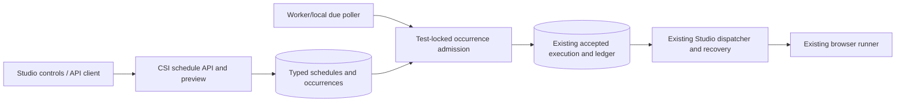

# Spec: Recurring scheduling for confirmed Studio tests

> **Story ID:** STUDIO-SCHED-001
> **Complexity:** COMPLEX (19)
> **Generated:** 2026-10-06T00:30:13.454374+00:00
> **Status:** Approved for local implementation — critique 2 APPROVED (4.85/5); PO story validation GO. Production activation remains release gated.

## 1. Overview

This specification defines the authorized local implementation of one recurring schedule per saved Studio test, using existing reviewed execution inputs, readiness, durable Studio acceptance/ledger, background authorization and truthful occurrence/run evidence. The current dirty working tree is the source baseline; preserve existing edits. No code, production grant or QA pass is established by this document. [FR-01–FR-16; CON-07]

Goals: terminal/API-operable schedule administration, authoritative timezone recurrence, atomic due acceptance, visible refusals, explicit activation after changes/uncertainty, and matching mock-first Studio controls. [FR-01–FR-16; CON-08]

Non-goals: suites, bulk/multiple schedules, environment matrices, unified catalog/dashboard/report projections, notifications/remediation, implicit save/compile/confirmation, new scheduler infrastructure and automatic ambiguous browser replay. Real production enablement is a later release gate. [CON-01, CON-05, CON-06; NFR-08]

The implementation defaults in the frozen [contract](implementation-contract.md) were adopted for engineering progress under the user implementation request. They are distinct from external production policy/integration approval. This file follows the declared spec template and No Invention gate; numbered FR/NFR/CON references trace requirements, and RF references below trace verified research. [CON-06; research.entryGates]

## 2. Requirements Summary

### 2.1 Functional requirements

| ID | Description | Priority | Acceptance |
|---|---|---|---|
| FR-01 | Support at most one recurring operational schedule per individual saved Studio test using its registered CSI and persisted environment/configuration, without creating a catalog check. | P0 | AC-01 |
| FR-02 | Expose typed schedule create/read/update/pause/resume/remove operations through the Studio API, with CSI read/write authorization, nondisclosing resource denial and optimistic schedule-version conflicts. Create paused by default. | P0 | AC-01, AC-02, AC-09 |
| FR-03 | Normalize five-field cron to six fields with zero seconds for minute granularity; persist an explicit valid IANA timezone or UTC default. Server preview and due selection share one recurrence resolver and return absolute UTC/local/offset times. | P0 | AC-03 |
| FR-04 | Every due occurrence reuses Studio readiness, deletion/quarantine, reference, runtime, authorization and global/per-CSI pending-quota checks. Never compile or confirm from scheduled work; record COMPILE_REQUIRED before acceptance when readiness requires it. | P0 | AC-04, AC-05 |
| FR-05 | Activate or explicitly Resume against the exact current confirmed executable revision. Execution-affecting edits durably require Resume after preparation/confirmation; confirmation alone does not resume. Preserve author enabled/paused intent and already accepted immutable inputs. | P0 | AC-05 |
| FR-06 | Give each nominal due occurrence durable identity and decision. Deduplicate concurrent polling/restarts/replicas, persist occurrence disposition plus accepted execution/ledger and schedule advancement atomically, and independently suppress duplicate repeated local-clock slots across schedule edits/activation/removal recreation. | P0 | AC-06, AC-07 |
| FR-07 | Persist and expose bounded paginated occurrence outcomes ACCEPTED, REFUSED, SKIPPED or DEFERRED with due time, stable reason and optional actual execution link. A refusal creates no synthetic browser run or video. | P0 | AC-04, AC-08 |
| FR-08 | Skip historical catch-up, consider at most the latest eligible due slot inside configurable grace, and defer the same not-yet-accepted occurrence on capacity/temporary outage until grace expiry. Record skipped-range/expired decisions without unbounded slot enumeration. Lifecycle interruption atomically settles any outstanding DEFERRED occurrence before pause, schedule configuration update, removal or input/revision/lifecycle invalidation supersedes its cursor, preserving immutable identity/audit and preventing orphan deferred history. While scheduling capability is off, persisted deferred work remains inspectable as suspended/expired; on reenable process that identity first, settle expired as GRACE_EXPIRED without send and advance future-only, or accept the same identity once if still within grace and all gates pass. | P0 | AC-07, AC-08 |
| FR-09 | Pause/removal stop future schedule acceptance after commit and retain audit. They do not cancel already accepted runs; explicit existing run cancellation remains separate. Test deletion/quarantine preserves existing pre-send lifecycle denial. Global Studio execution disable stops new scheduled acceptance independently. | P0 | AC-09 |
| FR-10 | Add immutable scheduled trigger, schedule/occurrence/version/activation and nominal due provenance to existing Studio run history/details, linking actual accepted executions and protected evidence. Distinguish due, acceptance and browser-start times; legacy attribution stays Unknown. Every successful activation/Resume creates an immutable human activator/time event linked to occurrences, including clean activations with no uncertainty; subsequent edit, Resume or removal/recreation never rewrites prior actor/principal/environment/revision provenance. | P0 | AC-10 |
| FR-11 | Use an approved CSI/environment background service principal or platform-approved renewable delegation with a separately recorded human activator. Verify current execution/secret grants at activation, acceptance and pre-send; missing/unwired/revoked authorization fails closed. Never retain login JWTs or secret values. Server-derived activation actor/time is recorded for every successful Resume in an immutable activation event, independently of uncertainty acknowledgment rows. | P0 | AC-11 |
| FR-12 | Operate and verify schedule management, recurrence, due acceptance, health and outcomes through API/terminal clients without requiring the frontend. Extend saved-test editor and Tests menu using centralized client, typed contracts and MSW-backed schedule scenarios. | P0 | AC-01, AC-12 |
| FR-13 | Skip scheduled acceptance while any run for the same test has a non-DONE ledger state, including manual, finalizing and ambiguous attempts. Check under the test lock without locking existing ledger rows. Do not implicitly narrow or serialize manual execution policy. | P0 | AC-13 |
| FR-14 | After a relevant manual or scheduled run closes with DISPATCH_UNKNOWN, START_TIMEOUT or STALE, durably block recurrence until operator investigation and explicitly audited authorized Resume acknowledges uncertainty. Resume schedules future slots only; never automatically replay an ambiguous attempt. | P0 | AC-14 |
| FR-15 | Skip nonexistent spring-forward slots and execute once per matching repeated fallback local-clock slot using its earlier offset. Apply the same policy to preview, dispatch and schedule-version changes. | P0 | AC-03, AC-07 |
| FR-16 | Provide schedule status/next due/reason surfaces, authoritative preview, separate pause/removal, explicit Resume and retained values on errors/conflicts. Dirty authoring drafts cannot ambiguously create or enable a saved schedule. Scheduling never implicitly saves, compiles or confirms draft changes. | P0 | AC-02, AC-05, AC-12 |

### 2.2 Nonfunctional requirements

| ID | Category | Requirement | Evidence target |
|---|---|---|---|
| NFR-01 | performance | Bound due selection/processing and preserve ordinary REST/check responsiveness; scheduled and manual executions share existing global/per-CSI active quotas and runner admission. | No quota overrun; bounded batch and per-CSI attempts; representative load evidence required before production. |
| NFR-02 | reliability | One occurrence cannot accept duplicate browser executions across replica races or crash/restart; no ambiguous execution is automatically replayed. | At most one durable accepted ledger link per occurrence/local slot; crash-boundary integration cases. |
| NFR-03 | reliability | Use injected clocks and deterministic shared recurrence with bounded iteration, including DST, irregular cron and long outage boundaries. | Preview/due parity and bounded long-gap test cases pass; no unbounded slot loop. |
| NFR-04 | security | Current execution and separate secret-use permissions fail closed; immutable source/evidence protection and transient secret handling remain. | Authorization denial at activation/acceptance/send; no resolved secret/token persistence or log leakage. |
| NFR-05 | usability | Paginated bounded schedule history, keyboard-operable accessible management and responsive summaries preserve current Studio list patterns. | Meaningful MSW/Playwright keyboard/focus/error and pagination scenarios pass. |
| NFR-06 | scalability | Rotate bounded due selection across CSIs, skipping saturated/deferred targets within the pass; retain bounded-cardinality metrics and no guaranteed browser-start SLA by assumption. | Saturated-CSI integration scenario permits other eligible CSI work; metrics do not label each UUID. |
| NFR-07 | reliability | Deploy additive forward-only migrations, preserve legacy inert scheduling metadata and immutable audit/dedup anchors independently of history/video retention. | Fresh/upgrade migration and retention/recreation duplicate tests pass; no unintended activation. |
| NFR-08 | security | Production scheduling is default off and cannot activate with provisional/local principal authorization; accepted-run recovery/cancellation remain operable when due producer is disabled. | Unwired production denies authorization; profile/feature-flag tests and rollback rehearsal demonstrate no new scheduled acceptance. |

### 2.3 Constraints

- **CON-01 (technical):** Existing generic schedules require a check ID; use typed Studio schedules/occurrences and reuse existing worker/ShedLock plus Studio acceptance/ledger/dispatcher. Do not create dummy checks or introduce Quartz/another queue. Impact: Preserve distinct schedule target and execution contracts.
- **CON-02 (technical):** Use current Java 21/Spring/PostgreSQL and frontend React/TypeScript/MUI dependencies and centralized API client; do not upgrade stack as part of scheduling. Impact: Research verifies current manifests instead of trusting historic prose.
- **CON-03 (technical):** Use one-test-per-transaction test -> schedule -> existing occurrence -> global quota -> CSI quota lock order, with nonlocking overlap ledger reads; preserve callbacks and manual admission idempotency. Impact: Prevents lock inversion and regression of manual execution.
- **CON-04 (technical):** Use DB-enforced scheduled occurrence identity: unique nullable ledger occurrence FK, with scheduled manual key/digest null; history partition locator is soft and accepted linkage targets durable ledger. Impact: Public arbitrary manual keys cannot collide via prefixes; retention is compatible.
- **CON-05 (business):** Exclude suites, bulk/multiple schedules, environment matrices, unified catalog/dashboard/report projections, notifications/remediation, implicit compile/confirmation and automatic ambiguous browser retry. Impact: Bound authorized MVP to individual saved-test scheduling.
- **CON-06 (business):** Established real on-demand trust and approved live background identity/vault grants are release gates; no per-test prior-PASS admission guard is added. Impact: Local fail-closed implementation/demos can complete without claiming production readiness.
- **CON-07 (technical):** Preserve dirty pre-existing code, existing manual permissions, pagination/deep links/evidence semantics and inert legacy schedule string; no automatic migration to enabled schedules. Impact: Implementation diffs must be attributable to scheduling and backward compatible.
- **CON-08 (technical):** Mock-first frontend consumes matching typed Studio/OpenAPI/MSW contracts; operational schedule functions must remain API/terminal-usable independently of UI. Impact: Independent frontend work must not bypass readiness/production gates.

### 2.4 Assumptions and adoption

- **ASM-01:** Working defaults: individual test, one schedule, create paused then explicit Resume, current confirmed activation revision, zero-second minute cron, UTC fallback, fixed 60-second minimum in this increment and configurable grace defaulting to 300 seconds. Adopted working engineering defaults by root; user may steer; production sizing not approved.
- **ASM-02:** Production chooses an approved CSI/environment service principal unless PUT Core requires renewable human delegation; local deterministic grants never enable production. Validation remains external where stated.
- **ASM-03:** Typed standalone Studio tables and durable ledger linkage are accepted integration direction; exact linkage constraints and retention will be finalized in architect research. Technical choices closed by implementation-contract.md and research.json, subject independent critique.
- **ASM-04:** No numerical throughput, browser-start SLA, delivery date or retention period is promised; capacity and retention configuration require pilot operations review. Validation remains external where stated.

## 3. Technical Approach

### 3.1 Research trace map

| Label | Verified input | Applied requirement |
|---|---|---|
| RF-01 | `research.json.dependencies[Spring Framework CronExpression]`: installed 6.1.14 normalization, exact DST probe and shared resolver | FR-03, FR-15; NFR-03 |
| RF-02 | `research.json.dependencies[Spring transaction management]`: nonproxied typed business core and REQUIRED rollback-only trap | FR-04, FR-06; CON-03 |
| RF-03 | `research.json.dependencies[PostgreSQL]` and `resolvedOpenQuestions[OQ-02]`: atomic test-first locking, ledger-owned linkage, ownership constraints and stable local-slot identity | FR-06, FR-13; CON-03, CON-04 |
| RF-04 | `research.json.dependencies[Java ZoneRules]`: earlier-offset local-slot canonicalization | FR-15 |
| RF-05 | `research.json.dependencies[ShedLock]`: poll efficiency only, not duplicate authority | FR-06; CON-01 |
| RF-06 | `research.json.dependencies[React/MUI/MSW]`: actual React18/MUI5/MSW2 manifests, centralized client patterns | FR-12, FR-16; CON-02, CON-08 |
| RF-07 | `research.json.dependencies[PUT Core background identity authorization]`: unwired production policy and fail-closed local seam | FR-11; NFR-04, NFR-08 |
| RF-08 | `research.json.recommendations[Uncertaintyset]` / `resolvedOpenQuestions[OQ-06]`: detached STARTED after browser launch requires DISPATCH_UNKNOWN/START_TIMEOUT/STALE uncertainty set | FR-14; NFR-02 |

### 3.2 Architecture and data flow

Use typed JDBC-backed `studio_schedules` and `studio_schedule_occurrences` beside generic check schedules. The existing worker/local infrastructure performs bounded due selection; a per-test transaction calls the shared Studio admission core and commits occurrence, actual execution/history/ledger and cursor together. The existing dispatcher/runner/recovery owns browser activity after commit. No direct runner send or ordinary failed-dispatch/retry entry is created by the poller. [FR-04, FR-06, FR-08; CON-01; RF-02, RF-03, RF-05]



### 3.3 API contract

The exact camelCase wire shapes are normative in [implementation contract API](implementation-contract.md#api-wire-contract). Every route below prepends `/api/v1`; test resources use existing nondisclosing CSI reads/writes. Preview is read-only authenticated recurrence validation and enumerates no principals. Schedule capabilities expose only the authorized test CSI/environment allowlist. [FR-02, FR-03, FR-07, FR-10–FR-12; RF-07]

| Method/path | Contract |
|---|---|
| GET `/studio/tests/{id}/schedule/capabilities` | `{enabled,canManage,availableExecutionPrincipals,localAuthorizationOnly,policy}`; policy is 60s min/300s grace/SKIP overlap/EARLIER_OFFSET DST. Empty principal list means no unattended authority. |
| GET `/studio/tests/{id}/schedule` | Schedule DTO or JSON null if absent/removed. |
| POST `/studio/tests/{id}/schedule` | `{cronExpression,timeZone,executionPrincipal}` → 201 Paused. Conflict on existing nonremoved schedule; recreated anchor/version survives. |
| PUT `/studio/tests/{id}/schedule` | `{expectedVersion,cronExpression,timeZone,executionPrincipal}` → updated schedule; changed configuration leaves Paused and requires Resume. |
| PATCH `/studio/tests/{id}/schedule/enabled` | `{expectedVersion,enabled,confirmedRevisionId?,acknowledgedUncertaintyExecutionIds?}`; enable validates exact current revision and uncertainty set; disable independent of unrelated invalid unsaved fields. |
| DELETE `/studio/tests/{id}/schedule?expectedVersion=N` | 204; retain paused tombstone/history. |
| POST `/studio/schedules/preview` | `{cronExpression,timeZone}` → normalized cron/zone, exactly next five UTC/local/offset slots and policy. |
| GET `/studio/tests/{id}/schedule/occurrences?page=0&size=20` | Existing `{data,page,size,totalElements,totalPages}`; size 1..100, page≥0; due descending then UUID tie-break. Removed history remains readable. |

Schedule DTO includes identity/test/CSI/version, cron/timezone/principal, requestedEnabled and effective ENABLED/PAUSED/BLOCKED state, blockedCode, activatedRevisionId, nextDueAt/pollAfterAt, immutable activationId/activatedBy/activatedAt, tombstone/audit timestamps, exact unacknowledged uncertainty IDs and latest occurrence. The current activated revision is separate from the accepted run revision. Paused/blocked cursors retained for audit do not promise an executable next run. [FR-02, FR-05, FR-09, FR-14, FR-16; RF-03]

Occurrence DTO includes nominal UTC/local date-time/zone/offset, schedule version/target environment/principal, activationId/activatedRevisionId/activatedBy/activatedAt from immutable activation event, ACCEPTED/REFUSED/SKIPPED/DEFERRED decision/code, nullable ledger-derived executionId/acceptedAt, retry/grace/audit and bounded missed-range summary. `missedCount` is null when exact counting would exceed the bounded iteration budget. Accepted/refused evidence remains distinct. [FR-06–FR-08, FR-10; NFR-03, NFR-05]

400 codes: INVALID_SCHEDULE, INVALID_TIME_ZONE, INVALID_SCHEDULE_VERSION, INVALID_PAGINATION. 409 codes: SCHEDULE_EXISTS, SCHEDULE_VERSION_CONFLICT, SCHEDULE_NOT_FOUND, ACTIVATION_REVISION_MISMATCH, UNCERTAINTY_ACKNOWLEDGEMENT_REQUIRED and established readiness codes. Background denial is 403; unavailable background authority and disabled scheduling are 503. Use established Studio error DTO with stable schedule code and redacted detail. Manual HTTP vocabulary remains unchanged. [FR-02–FR-04, FR-11, FR-16; CON-07; contract.API]

### 3.4 Storage, atomicity and lock rules

Reserve additive V26 against the baseline containing V25; verify version availability before writing. Keep legacy JSON/status nonoperational. A stable per-test schedule/tombstone survives recreation, with monotonic version. Composite ownership constraints bind test/CSI and activated revision to schedule/occurrence. Preserve separate nominal next_due_at and eligible poll_after_at; immutable grace belongs to the deferred occurrence. ENABLED/PAUSED/BLOCKED shape checks preserve author intent and effective denial. [FR-01, FR-05, FR-06, FR-09; NFR-07; CON-01, CON-07; RF-03]

Every successful Resume inserts immutable `studio_schedule_activations` even when uncertainty acknowledgment is empty. Fields are UUID id; owned schedule_id/test_id/csi_id; positive schedule_version; confirmed revision_id; immutable environment/execution_principal; server-derived human activated_by and activated_at. Restrictive ownership FKs and no-update/delete provenance rules preserve the event. Current schedule activation_id references the latest event across pause/block/removal; occurrences link activation_id and snapshots constrained to that event. DTO actor/time come from the event, never mutable schedule updater/current test. Uncertainty acknowledgments also reference the event. Clean Resume, later actors and removal/recreation cannot erase historical attribution. [FR-10, FR-11; CRIT-1; contract.Storage]

Each occurrence has immutable test, CSI, **environment**, principal, activation revision/version, nominal UTC and local slot snapshots. Background send authorization must read this accepted environment/principal, never a later mutable draft environment. Unique `(schedule_id,schedule_version,scheduled_at)` and `(schedule_id,time_zone,local_scheduled_at)` protect UTC request identity and version-independent repeated slots; the local key excludes offset. Stable anchors preserve dedup through removal/recreation. [FR-06, FR-11, FR-15; NFR-02, NFR-04; RF-03, RF-04, RF-07; contract.Admission]

Ledger nullable UNIQUE scheduled_occurrence_id FK owns the accepted execution link. Scheduled manual key/digest must be null by CHECK; public arbitrary keys cannot alias internal scheduled work. Occurrence execution/acceptedAt are derived from ledger JOIN, without circular duplicated fields or FK into partitioned history. Deferred commit-time constraint trigger requires exactly one matching scheduled ledger for ACCEPTED and none for other final dispositions. Matching validates test/CSI/principal and accepted revision/environment against the immutable activation, not only row count. New occurrence precedes accepted history/ledger; every write commits together. [FR-06; NFR-02, NFR-07; CON-04; RF-03]

One candidate test per transaction: test → schedule → existing occurrence → global quota → CSI quota → new history/ledger. Test-first `FOR UPDATE OF t SKIP LOCKED` includes deleted/quarantined lifecycle rows, followed by current JDBC reads/JPA refresh. Existing active/uncertain ledger checks are indexed **nonlocking** EXISTS under the test lock; do not acquire ledger rows or synchronously cancel existing executions there. Existing callbacks/reapers close history/ledger before summary test updates, so inverse lock acquisition is forbidden. [FR-06, FR-09, FR-13; CON-03; RF-03]

Extract a plain shared admission core returning Accepted/Refused/Deferred expected business results. The scheduler calls it within the outer occurrence transaction without crossing a throwing REQUIRED proxy. The existing manual transactional adapter preserves errors, digest and fresh-transaction uniqueness race handling. Resolve expected readiness/authority/quota conditions before execution writes; SQL/unexpected failure rolls back occurrence/history/ledger/cursor entirely. No blanket noRollbackFor and no catches that attempt commit from a poisoned transaction. [FR-04, FR-06; CON-03; RF-02]

### 3.5 Recurrence, backlog, capacity and lifecycle

Five-field cron gains leading `0`, canonical seconds exactly `0`; minimum interval 60 seconds. Valid IANA regions/UTC are explicit and omitted timezone defaults UTC. Shared Java/Spring resolver skips gaps and rejects the later-offset duplicate matching local slot. Installed Spring 6.1.14 returns both 2026-11-01 New York 01:30 offsets; timezone alone does not supply once-only behavior. The local uniqueness constraint protects even across schedule versions. [FR-03, FR-15; NFR-03; RF-01, RF-04]

Grace defaults configurable 300 seconds; pre-acceptance backoff starts 5 and caps 30 seconds within original grace. Historical backlog produces a bounded skipped-range summary; consider at most latest eligible due within grace. Same-occurrence temporary capacity/authority/vault outage sets DEFERRED and advances only poll_after_at, retaining nominal next_due_at/grace. Expiry settles SKIPPED/GRACE_EXPIRED and advances future due. Once accepted, pending SLA and recovery belong to existing ledger, never occurrence re-acceptance. [FR-07, FR-08; NFR-01, NFR-03, NFR-06; RF-03; contract.AdoptedDefaults]

Bound batch/time and per-pass CSI budget with rotating discovery and attempted/deferred exclusion; saturated CSI must not monopolize eligible discovery. Scheduled/manual work shares active quotas/runner admission. No guaranteed browser-start SLA follows from due time or FIFO. Skip scheduled overlap while any same-test ledger is non-DONE, without altering manual authorization/concurrency contract. [FR-08, FR-13; NFR-01, NFR-06; CON-07; RF-03]

Create paused; Resume validates background grant, exact currently ready confirmed revision and exact current uncertainty acknowledgment set, computing strictly future due. Config edit leaves Paused; affecting authoring/new confirmation blocks enabled scheduling while preserving author intent. Metadata-only changes and failed optional unchanged-input recompilation do not falsely invalidate. Confirmation alone never resumes. All writer hooks use test-first transactions; per-tick readiness/pin equality remains defense in depth. [FR-02, FR-05, FR-16; RF-03; contract.Invalidation]

Lifecycle interruption settles outstanding DEFERRED work under test → schedule → occurrence locks after authorization/version validation, atomically with the schedule version/state/cursor change: pause → SKIPPED/SCHEDULE_PAUSED; scheduling/principal configuration update → SKIPPED/SCHEDULE_UPDATED; removal → SKIPPED/SCHEDULE_REMOVED; affecting source/configuration → REFUSED/COMPILE_REQUIRED; confirmed revision replacement → REFUSED/ACTIVATION_REVISION_MISMATCH; deleted/quarantined test → REFUSED/TEST_DELETED or TEST_QUARANTINED. Clear retry eligibility; retain nominal slot, fixed grace, immutable activation and decision audit. No paused/blocked/removed mutation leaves an orphan DEFERRED; accepted/terminal decisions stay unchanged and Resume creates future work only. [FR-07–FR-09; CRIT-2; contract.DeferredLifecycle]

Pause/remove stop future acceptance after serialized commit and preserve accepted work/audit. Existing test deletion/quarantine pre-send denial and global execution disable remain. Scheduling default-off flag prevents new producer work/mutations, with inspectable reads; accepted execution authorization/recovery/cancel continues. No autoactivation/import/catch-up after reenable. [FR-09; NFR-08; CON-07; contract.API]

Capability disable preserves author intent and persisted DEFERRED identity/grace while stopping producer/mutations. Reads/UI show “Scheduling disabled” and, after grace, “Grace expired; awaiting scheduler settlement”; expired work is never presented as eligible retry. Reenable processes the existing identity first: expired → SKIPPED/GRACE_EXPIRED with no send, then strictly future cursor; within grace → same identity eligible once if all gates pass. Shared source/lifecycle invalidation still settles outstanding deferred work while capability is off because authoring authority is independent. [FR-08, FR-09; CRIT-2; contract.CapabilityDisable]

### 3.6 Background grants and terminal uncertainty

Background authorization interface defaults denied. Explicitly enabled local/test provider approves only per-CSI/environment principal allowlists; scoped capabilities reveal approved references after read authorization. Activation/admission and the scheduled authorization helper inside existing ProvisionalDispatchAuthorization recheck live grants against immutable occurrence configuration before send; manual provisional behavior remains. Existing secret-use authorization/preflight remains separate; no default permissive grants or copied sessions. Temporary lookup failure is distinct from permission and either defers preacceptance within grace or follows safe existing no-send/pending-SLA dispatch handling. [FR-11; NFR-04, NFR-08; CON-06, CON-07; RF-07]

Terminal uncertainty set is DISPATCH_UNKNOWN, START_TIMEOUT and STALE. START_TIMEOUT can follow real browser launch before detached STARTED reporting, so it cannot prove no effects. Persist terminal_error_code/at in durable ledger from existing close history RETURNING atomically; backfill only retained history. No callback/reaper schedule writes/new test locks. Query test-specific DONE uncertainty minus stable `(schedule_id,execution_id)` actor/time acknowledgments under test lock. Exact current set acknowledgment is required on Resume; an earlier run becoming uncertain later remains unacknowledged and blocks future tick. No timestamp watermark or automatic ambiguous replay. [FR-14; NFR-02, NFR-07; RF-03, RF-08]

Retain durable schedule/activation/occurrence/ack/ledger anchors indefinitely in this local implementation; no cleanup job. Existing history/video retention is independent and missing detail is honestly unavailable. Pruned outcomes or effects lost by database restore cannot be reconstructed; production/restore runbook requires operator reconciliation before enabling due acceptance. Retention sizing and real grants remain external release gates. [FR-07, FR-10, FR-14; NFR-07, NFR-08; CON-06; research.unverifiedClaims; contract.Storage]

### 3.7 Frontend and delivery sequence

Use installed React18/MUI5/TypeScript/MSW2 and current Studio centralized client. Freeze OpenAPI/types/MSW first; saved-test editor and Tests menu expose schedule summary, explicit timezone/principal, preview, paused/blocked/ready-to-resume state, exact uncertainty investigation acknowledgment, conflicts and current revision. Dirty authoring cannot ambiguously create/enable saved state, and no scheduling action silently saves/compiles/confirms. Accessible labelled dialog/control/help, keyboard focus restoration/status announcements and narrow-screen summaries are included. [FR-12, FR-16; NFR-05; CON-02, CON-08; RF-06]

Use paused create then explicit Resume. If Active is offered during creation, disclose acknowledgment and perform two validated requests; failed activation leaves a persisted Paused schedule with truthful remedy. Pause/removal operate separately from invalid unsaved cron. Never infer effective readiness from compileStatus or legacy PAUSED status. Add paginated occurrence detail and actual run links; optional run source MANUAL/SCHEDULED/null plus scheduleId/version/occurrenceId/scheduledAt and activationId/activatedBy/activatedAt from immutable accepted event. GET/list/SSE/withTestName preserve that event; manual/legacy activation metadata is null and legacy source is Unknown. Unavailable evidence does not rewrite run outcome. [FR-02, FR-05, FR-07, FR-10, FR-16; NFR-05; RF-06; contract.API]

Dependency order: schema/recurrence/API → failclosed background seam → shared admission and durable uncertainty → test/confirm invalidation → bounded producer → matching frontend/history → independent QA. Frontend type/MSW preparation can run alongside backend against frozen wire contract; functional API/terminal operation precedes integrated UI delivery. Associated story binds every implementation track and records actual File List/checks. Root owns OpenAPI/runbook; backend and frontend owners edit disjoint paths. [FR-12; CON-03, CON-08; complexity.flags; contract.Sequence]

## 4. Dependencies

### 4.1 Existing dependencies and verification

| Dependency | Existing version | Verification / role |
|---|---|---|
| Spring Framework CronExpression | 6.1.14 | Verified installed/source; Prepend zero seconds to five fields; require canonical second field exactly0; reject invalid/no-future expressions. Shared resolver handles every preview/due candidate. |
| Spring transaction management | 6.1.14 | Verified installed/source; Scheduler transaction calls a plain core returning expected business outcomes; throwing REQUIRED proxy cannot be caught then committed. Preserve manual transactional adapter and fresh-transaction unique race resolution. |
| PostgreSQL | 15-compatible existing | Verified installed/source; test→schedule→occurrence→global quota→CSI quota; nonlocking active-ledger EXISTS under test lock; unique local slot acrossversions; ledger-owned occurrence identity. |
| Java ZoneRules | Java21 | Verified installed/source; getValidOffsets gives gap/normal/overlap choices; canonical earlier-offset policy and version-independent local uniqueness are additional product rules. |
| ShedLock | 5.16.0 | Verified installed/source; Existing worker scheduler infrastructure reused; lease expiry can allow concurrent workers. Atomic DB occurrence identity remains authority. |
| React/MUI/MSW | React18 / MUI5 / MSW2.15.0 manifest | Verified installed/source; Use matching API/MSW contract then MUI editor/list actions and honest occurrence/run source. No stack upgrade; actual manifest isMUI5 despite overview prose saying7. |
| PUT Core background identity authorization | Unwired production | Unwired/unverified production; release blocked; Default denial; explicit local/test CSI/environment principal allowlist, scoped capabilities, authorization activation/admission/send; never enable production with local adapter. |

All dependencies above come from `research.json.dependencies`; add no framework/runtime dependency or stack upgrade. Official primary-source links and installed-runtime evidence remain in research. Spring transaction reference documents a newer reference version but does not authorize upgrading the installed 6.1.14 runtime. [CON-01, CON-02; RF-01–RF-07]

### 4.2 Internal dependencies

- StudioAcceptanceService/readiness/revision/reference gates provide atomic immutable accepted work; preserve manual contract. [FR-04–FR-06; RF-02]
- StudioDispatchScheduler/dispatcher/ledger statements/reapers own browser admission, terminal summaries, recovery and cancellation. [FR-09, FR-11, FR-13–FR-14; RF-03]
- StudioService and CompileStateService confirmation own same-transaction affecting-write invalidation. [FR-05; contract.Invalidation]
- Existing Studio paginated Tests/Runs/DTO/API/MSW and protected video provide truthfully extended management/evidence. [FR-07, FR-10, FR-12, FR-16; RF-06]

### 4.3 Unverified claims and release boundaries

- **Production background grant/secret revocation policy is integrated:** Repository expressly documents development-only entitlements; production identity owners must supply approved adapter/evidence. Required action: blocked. [research.unverifiedClaims; CON-06; NFR-07–NFR-08]
- **Production capacity and retention horizon are approved:** No pilot evidence; retain durable identity anchors without cleanup and ship producerdefaultoff; real operational sizing remains releasegate. Required action: needs_validation. [research.unverifiedClaims; CON-06; NFR-07–NFR-08]
- **Backfill can recover already-pruned uncertainty:** Missing historical effects cannot be reconstructed; operator reconciliation/restore gate required, not fabricated clean states. Required action: blocked. [research.unverifiedClaims; CON-06; NFR-07–NFR-08]

Local feature completion uses deterministic explicit local authorization, PostgreSQL integration and mock-first operator flows. Real service-principal/delegation, Vault/live grants, on-demand trust and pilot capacity/retention/restore evidence remain release blockers. They do not prevent safe local schema/API/MSW implementation and cannot be declared passed by local tests. No per-test prior-PASS guard or production enablement is part of this story. [FR-11; CON-06; RF-07]

## 5. Files to Modify/Create

Paths below derive from the contract sequence/current source; proposed new filenames may be refined within their module by implementers. Actual changes belong in the associated story File List, excluding unrelated dirty baseline. [CON-07; complexity.scope]

### 5.1 New files

| Path / module | Purpose / risk |
|---|---|
| `backend/src/main/resources/db/migration/V26__studio_scheduling.sql` | Additive owned schedule/activation/occurrence/ack, ledger summary/identity and source metadata; verify available numbering; high risk [FR-06, FR-10, FR-14; RF-03]. |
| `backend/src/main/java/com/citi/put/checks/studio/scheduling/` | Properties, JDBC repository/DTOs, cron resolver, service/controller, processor and worker/local poller [FR-01–FR-09, FR-12–FR-15; RF-01–RF-05]. |
| Studio background authorization interface/default/local provider and scheduled dispatch authorization helper | Default-deny scoped live grants without manual regression [FR-11; RF-07]. |
| Targeted `backend/src/test/java/com/citi/put/checks/studio/scheduling/` and dispatch integration tests | Real PostgreSQL integrity/concurrency and injected-clock recurrence, failclosed policy [NFR-01–NFR-08]. |
| Studio schedule frontend components and MSW state/fixtures/handlers | Mock-first dialog/summaries/occurrence UI and deterministic fixtures [FR-12, FR-16; RF-06]. |
| Scheduling operations runbook under `docs/specs/studio/scheduling/` | Default-off, production/restore gates and future-only recovery [FR-09, FR-14; NFR-08]. |

### 5.2 Modified files

| Path / seam | Change / risk |
|---|---|
| `backend/.../studio/dispatch/StudioAcceptanceService.java` and ledger entity/statements/repositories | Shared expected-outcome core, typed occurrence link and terminal summary; high [FR-04, FR-06, FR-14; RF-02, RF-03]. |
| `backend/.../studio/StudioService.java`, `compile/CompileStateService.java` | Same-transaction affecting writes/confirmation/delete invalidation; high [FR-05, FR-09]. |
| Existing Studio execution entity/snapshots/DTO mappers and profile/config wiring | Immutable optional source and default-off producer/grant wiring; medium [FR-10, FR-11; NFR-08]. |
| `frontend/src/services/api/studioApi.ts`, `types/studio/studioTypes.ts`, `services/mocks/studio/` | Typed exact API and evidence contracts, stable mock behavior; medium [FR-12, FR-16; RF-06]. |
| `frontend/src/pages/ChecksStudioPage/ChecksStudioPage.tsx`, `StudioTestsPage/StudioTestsPage.tsx`, Studio test menus/rows/delete dialog | Schedule management and saved-state/lifecycle visibility; medium [FR-02, FR-05, FR-09, FR-16]. |
| `frontend/src/pages/StudioRunsPage/StudioRunsPage.tsx`, `components/studio/runs/RunRow.tsx`, `RunDetailsDrawer.tsx` and presentation | Optional scheduled provenance and actual run/evidence links; medium [FR-10]. |
| `docs/specs/studio/openapi.yaml` and meaningful affected tests | Normative route/DTO/error and existing envelope parity [FR-01–FR-16; CON-08]. |

`backend/...` abbreviates `backend/src/main/java/com/citi/put/checks/`; no files are deleted by this specification. Existing generic schedule refactors occur only if a narrow pure recurrence extraction is necessary and regression-preserving. [CON-01, CON-07]

## 6. Testing Strategy

### 6.1 Requirement coverage

| Requirement | Meaningful evidence |
|---|---|
| FR-01 | AC-01 in unit/API/PostgreSQL/MSW/E2E scope below; preserves source acceptance rather than implementation-mirroring test. |
| FR-02 | AC-01, AC-02, AC-09 in unit/API/PostgreSQL/MSW/E2E scope below; preserves source acceptance rather than implementation-mirroring test. |
| FR-03 | AC-03 in unit/API/PostgreSQL/MSW/E2E scope below; preserves source acceptance rather than implementation-mirroring test. |
| FR-04 | AC-04, AC-05 in unit/API/PostgreSQL/MSW/E2E scope below; preserves source acceptance rather than implementation-mirroring test. |
| FR-05 | AC-05 in unit/API/PostgreSQL/MSW/E2E scope below; preserves source acceptance rather than implementation-mirroring test. |
| FR-06 | AC-06, AC-07 in unit/API/PostgreSQL/MSW/E2E scope below; preserves source acceptance rather than implementation-mirroring test. |
| FR-07 | AC-04, AC-08 in unit/API/PostgreSQL/MSW/E2E scope below; preserves source acceptance rather than implementation-mirroring test. |
| FR-08 | AC-07, AC-08 in unit/API/PostgreSQL/MSW/E2E scope below; preserves source acceptance rather than implementation-mirroring test. |
| FR-09 | AC-09 in unit/API/PostgreSQL/MSW/E2E scope below; preserves source acceptance rather than implementation-mirroring test. |
| FR-10 | AC-10 in unit/API/PostgreSQL/MSW/E2E scope below; preserves source acceptance rather than implementation-mirroring test. |
| FR-11 | AC-11 in unit/API/PostgreSQL/MSW/E2E scope below; preserves source acceptance rather than implementation-mirroring test. |
| FR-12 | AC-01, AC-12 in unit/API/PostgreSQL/MSW/E2E scope below; preserves source acceptance rather than implementation-mirroring test. |
| FR-13 | AC-13 in unit/API/PostgreSQL/MSW/E2E scope below; preserves source acceptance rather than implementation-mirroring test. |
| FR-14 | AC-14 in unit/API/PostgreSQL/MSW/E2E scope below; preserves source acceptance rather than implementation-mirroring test. |
| FR-15 | AC-03, AC-07 in unit/API/PostgreSQL/MSW/E2E scope below; preserves source acceptance rather than implementation-mirroring test. |
| FR-16 | AC-02, AC-05, AC-12 in unit/API/PostgreSQL/MSW/E2E scope below; preserves source acceptance rather than implementation-mirroring test. |

### 6.2 Unit and integration evidence

- Injected-clock cron parsing/zero seconds/UTC-IANA/next-five/DST earlier offset/gap/irregular dates and bounded long gap cover FR-03/FR-15, NFR-03. [RF-01, RF-04]
- Fresh/populated upgrade, immutable clean-activation actor/time across actors/Resume/recreation, composite ownership/state/identity constraints, deferred ACCEPTED linkage, public manual-key collision resistance, removal/recreation/fallback duplicate identity and partition retention cover FR-01/FR-06/FR-10/FR-15, NFR-02/NFR-07. Use actual PostgreSQL/Testcontainers. [RF-03]
- Two-worker same-slot selection, crash/rollback every persistence boundary, persisted business refusal and unchanged manual digest/races cover FR-04/FR-06, NFR-02. [RF-02, RF-03]
- Test save/confirm/pause/remove/delete and callback/manual overlap races; optional unchanged recompile and global kill switch behavior cover FR-05/FR-09/FR-13, NFR-02/NFR-08. No new ledger row locks under test. [RF-03]
- Latest-slot grace, fixed nominal cursor with eligible backoff, atomic lifecycle-interrupted deferred settlement/no orphan across pause/update/remove/invalidation/Resume, capability-off truthful expiry/reenable no-send settlement, expiry/long outage bounded summary and saturated-CSI rotation cover FR-07/FR-08, NFR-01/NFR-03/NFR-06. [contract.Defaults]
- Background grant/secret permission distinct, default-deny production, local removal before acceptance/send and temporary lookup deny/defer cover FR-11, NFR-04/NFR-08. No token/secret persistence and no local adapter in production. [RF-07]
- DISPATCH_UNKNOWN/START_TIMEOUT/STALE durable summary, exact uncertainty set including raced late uncertainty, acknowledgment/recreation, history pruned and no-replay cover FR-14, NFR-02/NFR-07. [RF-08]
- MSW/API/OpenAPI exact capabilities/error/pagination/provenance plus labelled controls, keyboard/focus/status/errors/responsive flow cover FR-02/FR-07/FR-10/FR-12/FR-16, NFR-05. [RF-06]
- Targeted existing manual acceptance/readiness/dispatcher/recovery/cancel/revision-retention and ordinary check scheduling regressions cover CON-03/CON-07. New load evidence must show bounded shared quotas and ordinary-check responsiveness; no invented SLA. [NFR-01, NFR-06]

### 6.3 Acceptance scenarios

Each scenario below retains requirements acceptance ID and Given/When/Then meaning; local behavior is verified without claiming external release evidence. [requirements.acceptanceCriteria]

```gherkin
Scenario: AC-01
  Given an authorized reader/writer and a saved confirmed Studio test
  When the user creates a valid schedule
  Then one typed Paused schedule is persisted without a catalog check and can be managed by terminal/API and Studio UI.
```

```gherkin
Scenario: AC-02
  Given a paused schedule or a concurrent editor
  When explicit Resume acknowledges the current confirmed revision or an update uses a stale version
  Then activation is fully validated or returns a defined conflict without unintended enabling; retry cannot duplicate a schedule. Every successful Resume, including empty uncertainty acknowledgment, atomically records an immutable activation event.
```

```gherkin
Scenario: AC-03
  Given aligned cron and an explicit timezone
  When preview and dispatcher resolve the same reference time
  Then next UTC/local/offset occurrences match, skip DST gaps and choose only the first fallback slot; invalid grammar/zone/nonzero seconds are rejected.
```

```gherkin
Scenario: AC-04
  Given a due unready or forbidden test
  When the worker decides the occurrence
  Then durable COMPILE_REQUIRED or the specific denial is visible without compile, confirmation, browser execution or fake video.
```

```gherkin
Scenario: AC-05
  Given active and author-paused schedules
  When affecting inputs change and are reconfirmed
  Then neither resumes implicitly; explicit Resume acknowledges the exact new revision while already accepted run snapshots remain unchanged. Metadata edits and failed optional unchanged-input recompiles do not falsely revoke readiness.
```

```gherkin
Scenario: AC-06
  Given two workers and injected crashes across persistence boundaries
  When they process the same nominal occurrence
  Then at most one accepted execution/ledger linkage exists and occurrence decision plus advancement are committed atomically or all roll back.
```

```gherkin
Scenario: AC-07
  Given fallback DST, schedule-version change/removal recreation or years of missed slots
  When recurrence is resolved
  Then stable local-slot uniqueness prevents repeat effects and missed work is summarized with bounded processing rather than replayed.
```

```gherkin
Scenario: AC-08
  Given capacity or temporary pre-acceptance outage
  When one nominal occurrence is retried within grace
  Then it retains identity/cursor and creates at most one run; after expiry it is settled visibly and future recurrence advances without catch-up. Pause/update/removal and affecting invalidation settle an outstanding deferred slot atomically with explicit lifecycle reason and no send; Resume never revives it. Capability-off history shows disabled/expired truthfully; on reenable expired deferred identity settles GRACE_EXPIRED without send before future advancement, while within-grace identity can be accepted once.
```

```gherkin
Scenario: AC-09
  Given acceptance racing pause/remove/delete or a global disable
  When transactions settle
  Then only serialized eligible acceptance occurs; pause/remove preserve accepted work while test lifecycle/global disable retains existing dispatcher denial and explicit cancel behavior.
```

```gherkin
Scenario: AC-10
  Given accepted/refused/legacy occurrences and expired evidence
  When authorized operators read paginated history/details
  Then actual scheduled provenance and run links are honest, legacy source is Unknown, and unavailable video never rewrites execution outcome. Clean Resume creates immutable human actor/time provenance and occurrences retain that activation after later actors edit, Resume or recreate the schedule. Run GET/list/SSE and withTestName preserve activationId/activatedBy/activatedAt from the accepted occurrence event; manual/legacy activation metadata remains null.
```

```gherkin
Scenario: AC-11
  Given missing production authorization wiring or grant/secret permission revoked before acceptance or send
  When schedule work attempts execution
  Then it fails closed; no token/secret value is stored or logged and local fixtures are not production approval.
```

```gherkin
Scenario: AC-12
  Given MSW-backed editor/list flows and network/readiness/version errors
  When keyboard-only users create/view/edit/pause/resume/remove
  Then labelled controls retain input, state explanations/preview are truthful and focus/status announcements work without implicit authoring actions.
```

```gherkin
Scenario: AC-13
  Given a non-DONE manual or scheduled ledger row for the test
  When a due scheduled occurrence is considered
  Then it is skipped for overlap without locking that ledger row or modifying existing manual-run permission.
```

```gherkin
Scenario: AC-14
  Given terminal DISPATCH_UNKNOWN, START_TIMEOUT or STALE relevant to the test
  When future recurrence is considered
  Then it remains durably blocked until investigation plus audited uncertainty acknowledgment and Resume; only future slots can execute.
```

### 6.4 E2E and required checks

Playwright critical path verifies saved confirmed test → Paused create → explicit local Resume → visible authoritative due/actual accepted history → pause/resume, plus version/readiness/uncertainty denial and no fake refused runs. Deterministic MSW demonstrates frontend contracts; PostgreSQL and local dispatch fixtures independently prove producer/ledger behavior. [FR-01–FR-16; CON-08]

Frontend gates from `frontend/`: `npm run type-check`, `npm run lint`, `npm run test -- --run`, applicable `npm run test:e2e`, `npm run build`, standalone build if affected. Backend gates from `backend/`: `./gradlew test`, `./gradlew check`. Independent QA records actual scope/results; report baseline failures separately. CodeRabbit configured review or exact documented graceful-degradation/manual fallback is recorded; no automated pass is inferred. [NFR-01–NFR-08; CON-07; story.QualityGates]

## 7. Risks and Mitigations

| Risk | Impact | Mitigation / trace |
|---|---|
| Duplicate browser side effects across polling/DST/recreation | High | Stable DB occurrence/local identity and atomic accepted linkage; crash/race evidence [FR-06, FR-15; NFR-02]. |
| Refusal rollback loss or callback lock inversion | High | Plain business-outcome core; test-first order and nonlocking ledger checks [FR-04, FR-06, FR-13; RF-02, RF-03]. |
| New inputs or late uncertainty silently resume recurrence | High | Exact activation pin, writer invalidation, durable uncertainty set/ack and explicit future-only Resume [FR-05, FR-14; RF-08]. |
| Local principal/secret policy mistaken for production authorization | High | Default deny/off, scope-only local profile, live acceptance/send checks and external release gates [FR-11; NFR-04, NFR-08; RF-07]. |
| Backlog or saturated CSI exhausts capacity | High | Bounded grace/latest slot/range summary, separate poll cursor and rotating attempted exclusion [FR-08; NFR-01, NFR-03, NFR-06]. |
| Partition pruning or old restore loses evidence/effects | High | Durable anchors/terminal summary, soft history linkage, honest unavailable state and operator reconciliation gate [FR-10, FR-14; NFR-07; research.unverifiedClaims]. |
| Dirty baseline regression or wrong frontend library assumptions | Medium | Preserve existing changes, actual MUI5 manifests and targeted manual/generic tests [CON-02, CON-07; RF-06]. |

Complexity score is 19/COMPLEX; numerical time-band text in assessment is advisory metadata and is not a delivery estimate or plan promise. [complexity.dimensions, complexity.flags]

## 8. Open Questions and Release Gates

| ID | State / question | Blocks local progress | Owner / boundary |
|---|---|---|
| OQ-01 | Will any later user steering change the root-adopted individual-test scope or conservative engineering defaults? | No | @pm; Nonblocking steering; root proceeding on stated defaults after optional response opportunity. |
| OQ-02 | Closed: ledger-derived JOIN linkage, composite ownership FKs, deferred ACCEPTED consistency trigger, stable version-independent local-slot identity and zero-second minute grammar chosen in implementation-contract/research. | No | @architect; Research/contract resolved; independent QA critique remains. |
| OQ-03 | What real PUT Core background grant/principal and Vault live entitlement/revocation adapter is approved? | No | @architect with Security/PUT Core; Production release blocker; local contract/stub denied by default and deterministic local profile may proceed. |
| OQ-04 | What production capacity/grace/batch and duplicate/audit/detail retention values does the pilot validate? A higher minimum cadence requires a separately validated policy change. | No | @devops with operations/data engineer; Production sizing/retention gate; local cadence is fixed60s, grace configurable default300s, no SLA promise. |
| OQ-05 | Is current real on-demand Studio trust evidence accepted for the scheduling pilot? | No | @qa with @devops; Release blocker only; do not invent per-test prior-PASS admission guard. |
| OQ-06 | Closed: uncertainty set DISPATCH_UNKNOWN, START_TIMEOUT, STALE; actual runner starts before detached STARTED callback, so missing start confirmation can include effects. | No | @architect; Research-derived root adoption; independent QA critique remains. |

Independent spec critique and PO Ready-story validation remain mandatory before code. Resolved technical decisions are not phantom blockers; external real grants/on-demand trust/production sizing-retention-restore readiness remain release blockers. Root can continue local implementation after the independent gates without waiting for nonexistent production evidence. [CON-06; research.entryGates; associated story.Status]

## 9. Implementation Checklist

- [ ] Independent critique iteration 1, revisions, critique iteration 2 and PO story readiness. [complexity.pipelinePhases]
- [ ] Add verified schema/recurrence/API foundations and terminal checks. [FR-01–FR-03, FR-06, FR-12, FR-15]
- [ ] Wire failclosed background policy/shared admission/uncertainty before due producer. [FR-04–FR-06, FR-11, FR-14]
- [ ] Same-transaction invalidation and bounded producer with existing ledger execution. [FR-05–FR-09, FR-13–FR-15]
- [ ] Typed centralized API/MSW then truthful accessible Studio controls/history. [FR-07, FR-10, FR-12, FR-16]
- [ ] Actual PostgreSQL/concurrency/crash and meaningful frontend/regression checks; maintain story File List. [NFR-01–NFR-08; CON-07]
- [ ] Runbook/OpenAPI and independent QA verdict, preserving separate external production gates. [CON-06, CON-08]

## Metadata

```yaml
spec:
  version: "0.2"
  generatedBy: "@pm via spec-write-spec"
  storyId: STUDIO-SCHED-001
  iteration: 2
  status: Draft
inputs:
  requirements: docs/stories/STUDIO-SCHED-001/spec/requirements.json
  complexity: docs/stories/STUDIO-SCHED-001/spec/complexity.json
  research: docs/stories/STUDIO-SCHED-001/spec/research.json
  contract: docs/stories/STUDIO-SCHED-001/spec/implementation-contract.md
associatedStory: docs/stories/STUDIO-SCHED-001/STUDIO-SCHED-001.story.md
productionApproval: false
```

## Revision record — iteration 2

CRIT-1: immutable activation events now record every clean/uncertain Resume and link occurrence actor/time/principal/environment/revision; migration/DTO/integrity tests cover retention across actors and recreation. CRIT-2: lifecycle mutations settle interrupted DEFERRED slots atomically with stable specific reasons, retaining identity/audit and preventing orphan delays. CRIT-3: local minimum cadence is fixed60 seconds; configurable grace defaults300 seconds and higher cadence policy requires separately validated future requirements. These revisions do not self-approve QA or external release gates. [critique-1.json; requirements.revisionHistory; revised implementation-contract.md]

Implementation wiring amendment: Aria retained one dispatch authorization bean and invokes the scheduled helper inside existing ProvisionalDispatchAuthorization, preserving primary test beans and constructors. The current local require guard records provisional principal attribution; live policy/grant identity and version remain part of the production integration release gate. This changes implementation wiring documentation without widening manual authorization or altering public/runner contracts. See final implementation QA evidence.
