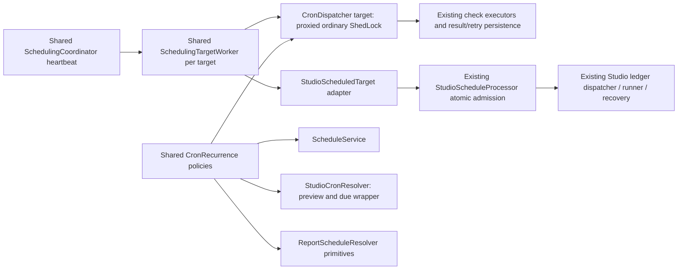

# STUDIO-SCHED-002: shared scheduling implementation

Aria, 2026-10-05. **Design independently accepted and PO Ready before implementation; local implementation evidence recorded below.** The user's explicit request establishes the shared scheduling direction; this document selects an implementation boundary without changing public schedules, stored data or browser execution semantics. Architect-first skill/checklist applied; the current dirty working tree, including completed STUDIO-SCHED-001, is the baseline. Independent implementation QA owns its separate verdict.

## Current map and capability baseline

The following map records the **pre-refactor baseline**, retained for compatibility review. Ordinary `scheduling/CronDispatcher.java` owns `@Scheduled` polling, an ordinary-only ShedLock, capacity/type-enabled due selection, transaction advancement and after-commit submission to `CheckExecutorDispatcher`; ordinary outcomes and retry stay in that path. `ScheduleService.java` independently implements five-field normalization, Spring parsing, a configured minimum sampled against two UTC occurrences, timezone validation and future time calculation. `ScheduleRepository.java` selects owned catalog schedules by type; no Studio test can satisfy its check FK.

Studio `studio/scheduling/StudioSchedulePoller.java` separately owns `@Scheduled`, a bounded single executor/in-flight guard and calls `StudioScheduleProcessor`. `StudioCronResolver.java` independently normalizes minute cron and selects canonical earlier-overlap slots. Studio producer transactions own occurrence/readiness/activation/grants/quotas/ledger/cursor; `StudioDispatcher` and runner admission/recovery own actual browser work. **Shared Spring imports do not yet constitute shared application implementation.** [AC-01, AC-04]

`ReportScheduleResolver` is another compatible consumer of cron parsing/next primitives: retain its custom input with **no five-field normalization**, including current Spring six-field syntax and macros, and `ZoneId.SHORT_IDS` alias resolution. Reusing the pure kernel there does not merge report delivery orchestration into this story.

## A/B/C options and decision

| Option | Benefit | Cost / risk | Decision |
|---|---|---|---|
| A: turn `CronDispatcher` itself into a universal coordinator and extract ordinary execution elsewhere | Keeps one familiar class as the timer owner | Moves its large constructor, lifecycle, permits and ShedLock seam; its existing conditional flag can suppress Studio-only operation; direct dependency on Studio would couple core scheduling to a feature | Viable larger refactor, unnecessary migration of stable execution code |
| **B: neutral shared coordinator + pure recurrence kernel, with ordinary `CronDispatcher` and a Studio adapter as targets** | Real shared timer/cadence/bounded worker/failure-isolation algorithm and real shared normalization/parse/timezone/next algorithm; existing ordinary executor and Studio transaction/runner remain intact | Must explicitly preserve per-target completion-based delay, lifecycle, roles, AOP leadership and grammar policies | **Recommended; selected for QA/PO validation** |
| C: shared cron utility while retaining two independent timer/executor algorithms | Smallest code change | Does not satisfy actual shared orchestration requested by the user; duplicated pool/non-overlap/lifecycle handling persists | Reject |

No new scheduler dependency, queue, table, migration, catalog check, frontend flow or runner/public wire change. [AC-01–08]



## Exact shared contracts

**`scheduling/CronRecurrence`** is a pure, neutral Spring component. It owns normalization/parsing, zone validation and `next` calculation, returning a nullable next-slot value (`Instant`, local timestamp, offset). Callers supply explicit normalization/zone/overlap policy and the reference instant. It throws ordinary `IllegalArgumentException`; feature adapters translate existing errors. It imports no Studio types and does not own source readiness, schedule persistence, misfire, quotas, authorization or execution.

- Generic normalization: trim edges, prepend `0 ` to five fields, preserve interior whitespace, six-field seconds and macros. Zone policy accepts existing `ZoneId.of` forms, including fixed offsets. Generic minimum retains the existing **two UTC sample** algorithm/reference date/configuration and null-next acceptance. This refactor must not silently strengthen that known validation limitation.
- Generic next: actual Spring sequence, including both absolute instants in a repeated local slot. `CronDispatcher` advances from its **stored nextExecutionAt** when present; fallback is current time only when absent. Preserve nullable exhaustion and existing catch-up behavior. Remove the incorrect “fall-back never duplicates” comment without altering behavior.
- Studio normalization: canonical whitespace; seconds exactly `0`; fixed minute floor; UTC/IANA regions. Studio next selects earlier offset once per local slot and skips gaps; null next remains `400 INVALID_SCHEDULE`. Preserve the existing bounded 36-hour overlap suppression and grace-window traversal. `StudioCronResolver` becomes the thin policy/Clock/error/DTO adapter; preview and due still share it.
- Report wrapper retains its frequency builder, custom Spring six-field/macros validation without five-field normalization, and short timezone aliases; it calls the same parse/next primitives with ordinary instant-sequence/null semantics. No report timer/SMTP/retry change.

**`scheduling/ScheduledTarget`** is a neutral port implemented by the existing ordinary `CronDispatcher` and new `StudioScheduledTarget`. Contract: bounded target ID (`checks`/`studio`), `enabled()` (including its role/flag), positive poll interval, nonnegative initial delay, and public `pollAndDispatch()` performing one domain pass. The common coordinator has no catalog/Studio repository or executor dependency. The existing ordinary constructor/direct-call API stays compatible.

**`SchedulingTargetWorker`** owns one bounded single-thread executor, queue capacity one, in-flight/closed guards and completion-based cadence for its target. Eligibility uses an injected monotonic ticker (`System.nanoTime` default), separate from the UTC Clock used for recurrence. It submits at most one pass; overlapping heartbeat calls are discarded. On success or failure, next eligibility is **completion ticker + the target's interval**, not submit time + interval. Initial eligibility starts from coordinator start + target initial delay. Failure logs target ID/class and releases only that target's guard. No worker pass runs on Spring's shared timer thread. One blocked Studio target cannot exhaust the ordinary target's pool or suppress its pass. [AC-05, AC-06]

Timing distinction adopted under the user's reuse request: ordinary polling already delays after its actual domain pass. The previous Studio timer returned after submission, skipped callbacks while its private work was in flight and could start the next pass less than five seconds after actual work completed. The shared worker intentionally standardizes Studio to the ordinary **completion-based** mechanism. It preserves the configured interval, nominal cron/grace/public contracts and exclusive due ownership; it does not claim the prior Studio callback-phase quirk was identical. PO should record this as an explicit, authorized reuse consequence rather than a hidden historical-compatibility claim.

**`SchedulingCoordinator`** owns the sole recurring **due-production** heartbeat, assembles injected targets and starts/stops their shared workers. Its bean exists independently of the ordinary flag/CronDispatcher bean. Heartbeat only tests eligibility/submits bounded work; it never waits for domain database/network work. No shared ShedLock covers the heartbeat. Ordinary-only leadership stays on the externally invoked, proxied `CronDispatcher.pollAndDispatch()`; do not call it through `this` or release a lease immediately after merely submitting its real work. Studio correctness remains its database occurrence/ledger identity, independent of optional poll leadership.

Remove `@Scheduled` from ordinary `CronDispatcher.pollAndDispatch` and remove the independent `StudioSchedulePoller` implementation. Keep the distinct Studio **execution dispatcher/recovery/cancel** schedules intact: they consume accepted work, not recurring due definitions. Do not route Studio through `CheckExecutorDispatcher`, ordinary retry or `failed_dispatches`.

## Profiles, flags and timing

The shared hub's auto-owner profile is **`!api | worker`**; this preserves existing standalone `dev` and test ordinary scheduling as well as deployed worker/local behavior. API-only contexts have no auto hub even if the ordinary flag is misconfigured. Studio target independently requires `worker | (local & !api)` plus `studio.scheduling.enabled`, preserving prior Studio role ownership. `worker` wins in intentionally mixed worker/api profiles, matching existing Studio worker rules. Manual domain service/processor beans remain available for controlled API/test use; they do not create another periodic owner.

| Context | Ordinary target | Studio recurring target |
|---|---|---|
| worker | Existing ordinary flag/type caps | Independent Studio flag; default off |
| local without api | Existing ordinary flag | Independent Studio flag |
| standalone dev / test without worker or local | Existing ordinary behavior/flag/initial-delay controls | Not an automatic owner |
| api or local+api without worker | No automatic due hub | No automatic Studio production |
| ordinary flag off, Studio flag on, worker/local | Ordinary target absent/disabled | Still eligible through the independent hub |
| Studio flag off, ordinary flag on | Ordinary unchanged | Disabled; accepted execution recovery continues |

Existing values remain owned by their domains: ordinary `checks.scheduling.poll-interval-ms` (10000), initial delay (5000), batch/caps/retries/shutdown; Studio `studio.scheduling.poll-interval-ms` (5000), default initial delay zero, producer batch/CSI/grace/pass budget. Introduce only neutral heartbeat/shutdown tuning:

```yaml
checks:
  scheduling:
    coordinator:
      heartbeat-ms: 1000
      shutdown-timeout-ms: 5000
```

Positive heartbeat, nonnegative shutdown timeout; one fixed bounded worker per target is the algorithm's safety invariant. Heartbeat resolution adds bounded polling jitter; it cannot run a target before its completion-based interval. The **effective heartbeat is the minimum of the requested heartbeat and all configured target intervals**, with a positive millisecond floor; it must not reject a formerly valid ordinary subsecond polling configuration merely because the new heartbeat default is 1000. Including a currently disabled Studio target's configured interval keeps later capability enabling responsive. Test ordinary 250ms without any new setting and an explicitly slower requested heartbeat. Cron UTC clock is injectable; move the existing conditional default Clock factory from Studio properties into neutral scheduling configuration. No generic service depends on Studio to obtain a clock.

Coordinator lifecycle phase is later than the ordinary dispatcher so **stop occurs before its existing async drain**. Stop closes submission guards first, interrupts/waits within the shared shutdown budget and prevents new due passes. Already submitted/accepted work remains governed by existing domain transaction/shutdown/recovery semantics. Stopping the hub does not cancel accepted browser work or rewrite occurrence outcomes.

## Ownership and preservation checks

Aria/Dex owns new neutral `CronRecurrence`, `ScheduledTarget`, `SchedulingTargetWorker`, `SchedulingCoordinator`, properties/ticker/clock configuration and the new Studio target; modifies `ScheduleService`, `CronDispatcher`, `StudioCronResolver`, existing Studio properties and the report resolver; replaces the old Studio poller/isolation test with shared worker tests. Root owns matching architecture/operations/ADR notes. Quinn owns independent verdict; Pax owns Ready validation. No frontend/runner/schema edits are expected.

Neutral core must have **no imports of `com.citi.put.checks.studio`**; feature adaptation points import the neutral port/kernel. Existing type-execution dependencies remain within their existing target. The skill's expansion-pack coupling script does not establish Java module correctness; verify these actual imports/interfaces plus executable target-absence tests. No “coupling passed” result is claimed before implementation.

Implementation order after validation: pure recurrence + policy tests → adapt existing callers → shared target/worker/coordinator and neutral Clock → ordinary target integration and Studio adapter/remove private poller → profile/flag/cadence/failure/leadership integration → focused existing executor/Studio regressions and static gates → independent QA.

## Required behavioral evidence

1. Generic five/six fields, seconds, macro/L/W/#, fixed offsets, exact whitespace, existing UTC interval samples/no-future null and stored due advancement remain; Studio alone rejects seconds/aliases/no-future and selects first overlap. Keep NY, Lord Howe and Casey cases. Report six-field/macros, no five-field normalization, short aliases and nullable exhaustion remain.
2. Shared worker tests use injected monotonic time: initial delay, fixed delay **after completion**, no overlap/queued pass, failure recovery, shutdown suppression and one slow target versus another. Explicit UTC-clock jump cannot bypass or indefinitely delay cadence.
3. Real registered HTTP, TCP and Splunk ordinary adapters execute controlled fixtures under the same coordinator as Studio, with enabled-type filtering and normal result persistence; Studio creates its actual immutable ledger/history/occurrence and is consumed by the existing runner-dispatch client seam. It never creates ordinary retry work.
4. Disable either domain independently; API/local+API/dev/worker/test role matrix; one automatic due hub; ordinary-held ShedLock still permits Studio work. Ordinary capacity saturation and Studio quota/SQL failure do not starve the other target. Concurrent Studio workers preserve the existing database deduplication.
5. Re-run relevant ordinary CRUD/validation/dispatch/leadership/throttle and Studio schema/API/acceptance/dispatch/recovery/contract cases. Existing public DTO/OpenAPI/runner payload stays unchanged. Retain prior global coverage/production integration concerns honestly rather than redefining them as passed.

The architecture selection was completed before code. **Independent QA design acceptance and PO GO/Ready closed the entry gate before implementation.** Production grants/pilot/load/restore gates inherited from STUDIO-SCHED-001 remain separate and are not closed by implementation reuse.

## Implementation followthrough

The selected neutral kernel and coordinator/worker/target port now serve catalog checks and Studio. `CronDispatcher` implements the shared port and retains its externally proxied ordinary ShedLock; `StudioScheduledTarget` delegates to the unchanged atomic producer; the private `StudioSchedulePoller` has been removed. Report parsing/next calculations consume the same kernel with their existing macros/aliases/null policy.

Two implementation refinements preserve established capability: `SchedulingDelays` accepts numeric milliseconds and ISO-8601 values; actual Spring embedded-value resolution preserves SpEL for both domains rather than parsing unresolved deployment expressions prematurely. A completed neutral `SchedulingHeartbeat` bean supplies the real clamped scheduled delay without a coordinator self-reference during Boot initialization. Lifecycle restart recreates workers while retaining per-target claim/cadence state, so unfinished old work cannot overlap restarted work or lose completion-based eligibility.

`SharedSchedulingIT` exercises actual Spring scheduling metadata (250ms heartbeat, ISO/SpEL initial/interval values, one due timer), real HTTP/TCP/Splunk controlled executors plus Studio ledger → existing runner-dispatch seam, ordinary-held leadership lease isolation, independent flags, and two actual worker application contexts sharing PostgreSQL. `SchedulingCoordinatorTest` covers monotonic completion/initial cadence, subsecond clamping including disabled targets, failure/guard/blocked-target isolation, role ownership and restart. The relevant regression run completed **214 tests, zero failures/skips**; Spotless, Checkstyle Main/Test and SpotBugs Main passed after narrow test formatting. Full unfiltered Gradle/Jacoco and inherited real-production gates are not claimed by these scoped results. Exact commands, source hashes and file list accompany implementation evidence.
